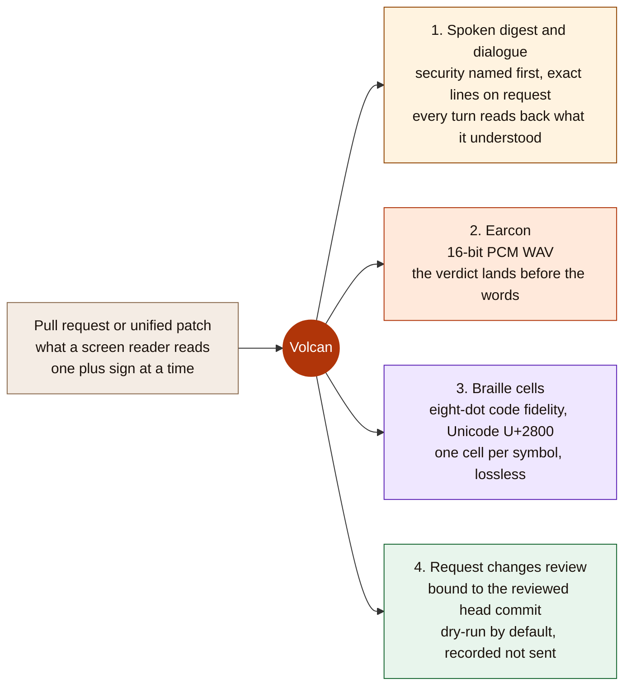
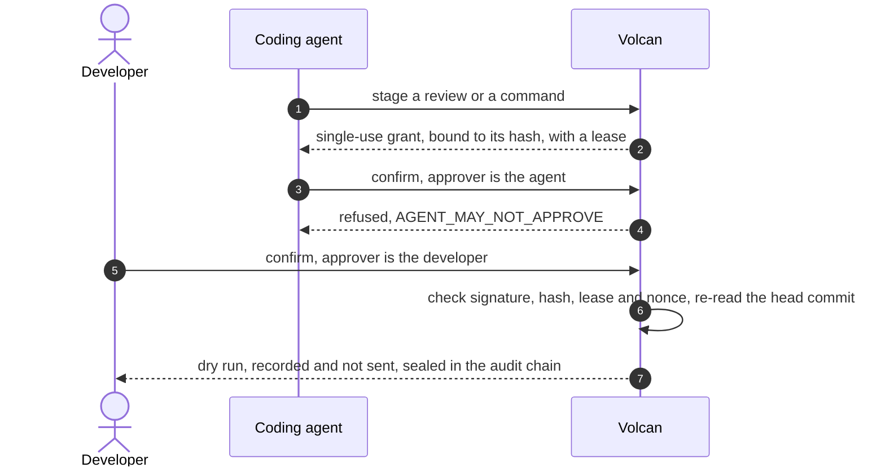

# Volcan

> **Volcan lets blind and low-vision software developers review autonomous coding agents by ear and by touch instead of by reading a diff.**

**What it is.** A Model Context Protocol server that reads a pull request or a patch and
answers three ways: one spoken sentence that names the risky change first, a sound cue whose
pitch falls on a security finding and rises on a clean patch, and eight-dot Braille of the
code. A review that would change GitHub is staged behind a single-use approval grant that the
coding agent cannot approve for itself.

**Who it is for.** A blind or low-vision developer asked to review code an AI agent wrote, who
today hears the raw patch from a screen reader one plus sign at a time.

**Alexa+ fit.** A live MCP server (revision 2025-11-25, Streamable HTTP) with a simulated
Alexa+ front end. Through an MCP add-on, Alexa+ would be this server's MCP client; the add-on
package is in [`alexa_plus/`](alexa_plus/addon-package/addon.json), built and tested locally.
The companion page stands in for Alexa+ with the browser's own speech, and its Evidence tab
(Server and MCP) sends Amazon's documented Alexa+ client requests to `/mcp` on a press.

**Live.** [qylv1gxor9.execute-api.eu-west-1.amazonaws.com](https://qylv1gxor9.execute-api.eu-west-1.amazonaws.com/)
serves commit `716b0f3` (PR #35) at 1769 MB of Lambda memory: its `/health` reported that `source_revision` on 2026-10-07.

**Try it in one step.** Open the live page and press **Hear this code review**. Nothing plays
or speaks until you press. To run it on your own machine, see [Run it locally](#run-it-locally).

It is not an Alexa skill, the Alexa+ front end is simulated, and GitHub reviews are a dry run;
[what is real and what is not](#what-is-real-and-what-is-not).

![Volcan's first screen at 1280 by 720 in the dark theme, before any press: the headline "Hear your code review instead of scrubbing a diff", the line "For blind and low-vision developers.", a card reading "Live MCP server, simulated Alexa+ front end" and "Not an Alexa skill. GitHub: dry-run.", a two-line patch that turns user.role == "admin" into user.role != "admin", one "Hear this code review" button, and the server's real answer drawn silently beside it: a falling earcon waveform, the sentence "an authorization comparison was inverted", and eight-dot Braille cells.](docs/assets/volcan-first-viewport.png)

[](https://opensource.org/licenses/MIT)
[](https://modelcontextprotocol.io)
[](https://www.python.org/)
[](tests/)

## Table of Contents

1. [How it works](#how-it-works)
2. [Amazon technology](#amazon-technology)
3. [Run it locally](#run-it-locally)
4. [What is real and what is not](#what-is-real-and-what-is-not)
5. [Who it is for and who pays](#who-it-is-for-and-who-pays)
6. [The full evidence](#the-full-evidence)

## How it works



The patch on the first screen is the point. It turns `user.role == "admin"` into
`user.role != "admin"`: the words on both sides are the same, so a keyword matcher cannot see
it. Volcan parses the changed lines as Python and says `an authorization comparison was
inverted`. The same three answers reach any MCP client as text and `audio` content blocks, and
reach a browser through the companion page, [`docs/index.html`](docs/index.html). Three tools
also return `structuredContent` that matches a published `outputSchema`, and the review tool
links a `ui://` review card in the MCP Apps format. The page draws that card in a frame shaped
like a smart display; no Echo Show has rendered it.

A review that would change something on GitHub goes through one governed path. An agent
cannot approve its own proposal, a grant is refused if the command or the head commit changed,
and nothing is sent unless the owner turns the write on.



![The same screen in the daylight theme after one keyboard press, Alt+1 then Enter, on a local server with no cloud credentials: the card reading "Live MCP server, simulated Alexa+ front end" and "Not an Alexa skill. GitHub: dry-run.", the focus ring still on Hear this code review, the waveform drawn in ember now that the falling cue has played, a Replay the cue button and its caption, the spoken sentence naming the inverted authorization comparison, and the engine meter reading local heuristic beside the round trip measured on that run.](docs/assets/volcan-after-one-press.png)

## Amazon technology

A hand-written Model Context Protocol server (revision 2025-11-25),
the interface an Alexa+ MCP add-on would call. The add-on package for it is in
[`alexa_plus/`](alexa_plus/addon-package/addon.json), built and tested locally, not certified
or deployed: the [hackathon FAQ](https://amazonappdev2026.devpost.com/details/faqs) says Amazon's Alexa+ add-on tools are
"available to select partners only". With AWS credentials and the `bedrock` extra,
Volcan sends the digest request to Claude on Amazon Bedrock; otherwise, or when the call fails,
a local deterministic engine answers and the response says why. The default model is Claude
Sonnet 5 (`anthropic.claude-sonnet-5`) from 2026-10-06, and each answer names the model its
request asked for in `model_answered` (the configured id, not read back from the response); the live function keeps the model it was deployed with until it is redeployed. Live was redeployed at `716b0f3` and, on 2026-10-07, answered with `anthropic.claude-sonnet-5` at 1769 MB of Lambda memory: one press of the same diff took 17.88 s at 256 MB and 3.44 s at 1769 MB (one press each, not a benchmark; [details](docs/EVIDENCE.md#the-public-deployment)). A Bedrock answer was recorded on 2026-09-30: one live digest answered `synthesis_mode: bedrock` with a null reason. The public endpoint is an AWS Lambda in eu-west-1; its `GET /health` on 2026-10-06 read
`bedrock_model_path` `ready_to_attempt` and `durable_state` `configured_reachable`, and
[`infra/`](infra/) declares a Lambda with a function URL and a DynamoDB table in Terraform.

## Run it locally

Python 3.11 or newer. No AWS account, GitHub token or device is needed.

### 1. Install and run the tests

```bash
python -m pip install -e ".[dev,bedrock]"
python -m pytest tests/ -q
```

CI run 37516718286 on PR #35 at `745358f` printed `892 passed` on 2026-10-06, and
`python -m pytest tests/ --collect-only -q` collects 894 on this branch, two of them tests of
`GET /health` with a model override, added after that run. The `bedrock` extra installs
`anthropic[bedrock]==1.8.0`. With AWS credentials as well, a Bedrock call is ready to attempt.
Credentials and an importable SDK do not prove a model answered: the receipt is the digest
response's `synthesis_mode: bedrock`. Without them the local engine answers, and the page says
which engine answered and why.

### 2. Start the server

```bash
python -m src.interfaces.mcp_server              # add --port 8743 if 8000 is taken
```

It answered its first `GET /health` 1.7 s after launch on 2026-09-26, measured by
`python scripts/measure_cold_start.py`.

### 3. Check the protocol

```bash
python scripts/mcp_conformance.py http://127.0.0.1:8000/mcp
```

On 2026-10-06 it printed `23/23 checks passed, 0 failed` (23 of 23 conformance checks)
against a local server in each transport mode, the stateless one with `--expect-mode
stateless`, and its `tools/list` check found 12 tools. The checks include the version-header rule of the
2025-11-25 transport specification: a request without the header is served under the
revision negotiated for its session, or as 2025-03-26 without one, and an unsupported header
gets HTTP 400.

### 4. Hear a code review

Open `http://127.0.0.1:8000/` and press **Hear this code review**, or <kbd>Alt</kbd>+<kbd>1</kbd>
then <kbd>Enter</kbd> (<kbd>Option</kbd> on a Mac). Nothing plays or speaks until you press.
If your own screen reader should speak, turn on **My screen reader speaks the answers** at the
top right. To review a real pull request, scroll to **Talk through a real pull request**, paste
its URL and type `open`; the full command list is in
[the evidence](docs/EVIDENCE.md#the-review-journey).

## What is real and what is not

**Honest status.** *Real:* the MCP server, the spoken digest, the earcon, the Braille, the live
GitHub read, the grants and the hash-chained audit log. *Simulated:* the voice loop is the
browser's own speech recognition and synthesis, labelled on the page as not an Alexa skill, and
the smart-display frame around the review card is a drawing on the page.
*Submission shape:* a self-hosted MCP server demoed through its own web front end, which is
what the [hackathon FAQ](https://amazonappdev2026.devpost.com/details/faqs) asks for: "build a self-hosted MCP server (or Agent
Skill) per the Official Rules, and demo it via your own web-based simulator or front end."
*Not possible for participants:* deploying the add-on package, because the add-on tools are
partner-only (FAQ), so Alexa+ has never called Volcan. *Not tested:* an Echo device; the FAQ
says "no physical device needed". *Missing:* a published demo video (a render of a local run exists, pending upload) and a live GitHub write. *Not required
for this track:* a public build; the FAQ says "hosting isn't required". The public endpoint
serves `716b0f3`, the master this README was updated on; the table below gives the commands.

| | |
|---|---|
| **Live endpoint** | [qylv1gxor9.execute-api.eu-west-1.amazonaws.com](https://qylv1gxor9.execute-api.eu-west-1.amazonaws.com/health) serves `716b0f3` (PR #35: default model `anthropic.claude-sonnet-5`, the `volcan.bedrock` call-shape log, named no-text causes, `max_retries=0`) at 1769 MB, redeployed and checked on 2026-10-07: `curl -s <endpoint>/health` reported `source_revision` `716b0f3`, and one press of the same diff took 17.88 s at 256 MB and 3.44 s at 1769 MB (one press each, not a benchmark). The previous build, `aa3364a` (PR #30, which merged #25 to #29), was redeployed on 2026-10-06: `curl -s <endpoint>/health` reported `source_revision` `aa3364a94928de9b4f6586603bf11a5ff8d988e0` at 08:03 UTC that day, and `GET /` answered HTTP 200 with 299,248 bytes, the size `git cat-file -s aa3364a:docs/index.html` prints. The commits on master after it, PR #31 through `f9e5135` (`git log --oneline aa3364a..f9e5135`), change only the video pipeline, its test, `video_sync_receipt.json`, this README and the evidence file; `git diff --name-only aa3364a f9e5135 -- src docs/index.html` printed nothing, so the live runtime was then the current one. The deploy probe of 2026-10-06, kept outside the repository like every live observation, found 12 tools in `tools/list`, an `outputSchema` on `digest_semantic_diff`, `drill_down_section` and `review_dialogue_turn`, and the `ui://` card link on `review_dialogue_turn`; it made no `tools/call` or `resources/read`, so `structuredContent` and the card body are proven by the local tests named below. [Details](docs/EVIDENCE.md#the-public-deployment). Earlier builds, kept in EVIDENCE as history: `aa3364a` (PR #30) on 2026-10-06, `9b2bcb9` (PR #23) on 2026-10-01 and 2026-10-05, `6e9ae4d` (PR #22) on 2026-09-30, before that `0e96e45`, and `2d0b8f8` on 2026-09-27, 43 commits behind. |
| **Evidence** | [docs/EVIDENCE.md](docs/EVIDENCE.md): every claim with the command that prints it |
| **Friction log** | [docs/FRICTION_LOG.md](docs/FRICTION_LOG.md): eight entries from building Volcan on MCP, Amazon Bedrock, AWS Lambda and the Alexa+ documentation, each with the task attempted, the steps taken, the expected and actual result, a severity rating, the workaround used and an actionable suggestion |
| **Source** | A private repository. The [hackathon FAQ](https://amazonappdev2026.devpost.com/details/faqs) rule for one: "Add the Amazon and Devpost reviewers as collaborators before the submission deadline". That is an owner step. The MIT licence is in [LICENSE](LICENSE) |

| Part | Status | Check it |
|---|---|---|
| MCP server, 12 tools, Streamable HTTP | Real, written by hand | `python scripts/mcp_conformance.py http://127.0.0.1:8000/mcp` |
| Structured results and the review card | Real: `digest_semantic_diff`, `drill_down_section` and `review_dialogue_turn` publish an `outputSchema` and return `structuredContent`; `resources/read` returns `ui://volcan/review-card` as `text/html;profile=mcp-app`. The page hosts the card itself, so no MCP Apps client, Echo Show or Alexa+ has rendered it. The live endpoint at `aa3364a` lists the three schemas and the card link in `tools/list` (deploy probe, 2026-10-06) | `python -m pytest tests/integration/test_mcp_structured_results.py tests/e2e/test_review_card.py -v` |
| Security finding named first | Real. Python corpus: 86.4% recall over n=40 labelled patches with 0% false positives, against a baseline of 0% for a screen reader reading the raw patch, three known misses named. It was 81.8% until the TLS rule of 2026-09-28 closed `pos-21`, a miss known before that rule was written, so this corpus is not held out for it. JavaScript and TypeScript, on a held-out half of 16 patches per language: recall 62.5% (JS) and 75.0% (TS), false positives 0.0% and 25.0%; the held-out half is independent of the tuning, not of the author. Classic families (string-built SQL, TLS checks off, shell built from input), on 72 patches written before those rules: recall 91.7% (Python), 66.7% (JS) and 66.7% (TS), up from 41.7%, 41.7% and 50.0%; false positives unchanged at 33.3%, 50.0% and 25.0%, all from the older keyword pass, none from a family rule. Eight probes written after the rules to find where line-at-a-time reading breaks: 4 of 4 detected, 2 of 4 over-flagged, and the two are both JavaScript must-not-flag probes, so 2 of 2 JavaScript false alarms (0 of 4 detected and 4 of 4 over-flagged on 2026-09-27, before the rule work). A second round of eight: 4 of 4 detected, 2 of 4 over-flagged before the CORS test-file exemption and 1 of 4 after it; commit `f1c35a1` added that exemption and those probes together, so 1 of 4 is not an untuned figure. Every corpus is self-written and synthetic | `python scripts/benchmark_suite.py`, `python scripts/benchmark_js_ts_detection.py` (`--probes`, `--probes2`) and `python scripts/benchmark_classic_families.py` |
| Earcon that encodes the verdict | Real: different WAV bytes for a finding and a clean patch | `python -m pytest tests/unit/test_earcon_encodes_the_verdict.py -q -s` |
| Eight-dot code Braille | Real and lossless over 95 ASCII characters. Not reviewed by a Braille transcriber, not read on a physical display | `python -m pytest tests/unit/test_braille_code_fidelity.py -v` |
| Governed review | Real: HMAC single-use grants, self-approval refused, head commit re-read, dry run by default. No live GitHub review has ever been sent | `python -m pytest tests/unit/test_governance.py -v` |
| Digest by Claude on Amazon Bedrock | Real code with a stated fallback. A provider failure returns a fixed public category; raw account, role and request identifiers never enter the anonymous response. One Bedrock answer recorded 2026-09-30 (live digest, `synthesis_mode: bedrock`, null reason); where the SDK is absent the local engine answers with the reason stated. Default model `anthropic.claude-sonnet-5` from 2026-10-06. `anthropic.claude-opus-5` had refused 2 of 4 reviews of an inverted admin check; Sonnet 5 did not refuse in 8 calls (4 on that patch, 4 on a second). Not a controlled comparison: the Opus 5 calls came from an earlier window, and 2 of 4 against 0 of 4 is not a significant difference ([evidence](docs/EVIDENCE.md#model-choice-2026-10-06)). Each answer names the model its request asked for in `model_answered` | `python -m pytest tests/unit/test_bedrock_synthesis_path.py -v` |
| Voice loop | Simulated: the browser's speech, not an Alexa skill, and no test drives a microphone | [Evidence](docs/EVIDENCE.md#what-is-true-and-what-is-simulated) |
| Shared durable state | Deployed: DynamoDB `volcan-state-euw1-prod` plus a Secrets Manager approval secret; a local run keeps state in memory | The `durable_state` field of `GET /health` says which |
| Alexa+ MCP add-on package | Built and tested locally, not certified or deployed: the hackathon FAQ says the add-on tools are "available to select partners only", so participants cannot deploy it. A replay of Amazon's documented Alexa+ client requests, against a local build (the registered endpoint serves `aa3364a`, `source_revision` read 2026-10-06, whose `src/` is the current one; the replay was not re-run against that endpoint), gets the finding back from all three client shapes: one that follows the protocol's version rules, one that declares the revision it asked for, and one that never sends the version header. The page's Evidence tab, Server and MCP, runs the same three clients from the browser on a press. Alexa+ has never called it; no Echo test | `python scripts/validate_alexa_addon.py`, then `python scripts/replay_alexa_plus_envelopes.py http://127.0.0.1:8000/mcp`; [Road to Alexa+](docs/EVIDENCE.md#road-to-alexa) |
| Demo video | Rendered locally: 163.68 s at 1920x1080 (ffprobe) from a local run of `09d4862`, whose `src/` and `docs/` it shows (earlier 164.52 s render from `7a3de49` superseded). The review-dialogue fixes after `09d4862` are not on camera, including README and other extensionless file names, next from the overview, help examples taken from the open change, next steps outlined only where they work, plain words when a pull request cannot be opened, and README spoken as documentation. Pending upload by the owner; no public link yet | [video/README.md](video/README.md) |
| Test suite | 894 collected (`python -m pytest tests/ --collect-only -q`, 2026-10-06 on this branch). CI run 37516718286 on PR #35 at `745358f`, 2026-10-06: `892 passed`, 93.71% statement coverage (5133 statements, 323 missed), readiness `46/53 passed, 0 blocking failures, 7 externally blocked`. The two tests added after that run are not in it. Earlier: CI run 37512533048 on PR #35 at `a81be1c` passed 889 with 93.70% (5124 statements, 323 missed) on 2026-10-06; CI run 37508504877 on PR #35 at `bceecb0` passed 884 with 93.67% (5099 statements, 323 missed) on 2026-10-06; CI run 37432272539 on master at `f9e5135` passed 854 with 93.52% (5029 statements, 326 missed) on 2026-10-06; CI run 36804593070 at `fc10e7d` passed 751 with 93.18% (4734 statements, 323 missed) on 2026-10-01 | `python -m pytest tests/ -q --cov=src` |

## Who it is for and who pays

**User.** A blind or low-vision developer reviewing code an AI agent wrote.

No buyer has been interviewed or contacted. The population is measured; the price is a guess
nobody has been asked to pay. Every quote and link is in
[the evidence](docs/EVIDENCE.md#who-would-buy-this-and-out-of-which-budget), fetched 2026-09-28.

| | |
|---|---|
| **Population, measured** | 17,933 US software developers report a vision difficulty (90% margin +/- 2,686), 0.775% of 2.31 million: US Census Bureau, [ACS 2024 microdata](https://www2.census.gov/programs-surveys/acs/data/pums/2024/1-Year/), reproduced by `python scripts/size_blind_developer_population.py`. The question counts anyone "blind or having serious difficulty seeing, even when wearing glasses", so it is an upper bound on screen-reader users |
| **Price, untested hypothesis** | $24 per developer seat per month, billed annually: [CodeRabbit](https://www.coderabbit.ai/pricing)'s published annual list price for pull request review. The agent being reviewed, [Copilot Business](https://docs.github.com/en/copilot/get-started/plans), lists $19 a seat. If every one of the 17,933 bought, about $5.2 million a year in the US. Small: growing past it needs an org-wide price or users beyond blind developers, and neither is priced or tested |
| **Wedge** | An engineering team that has switched on a coding agent and employs a blind developer who is asked to review its pull requests |
| **Why now** | GitHub's coding agent became generally available on [25 September 2025](https://github.blog/changelog/2025-09-25-copilot-coding-agent-is-now-generally-available/): "Once Copilot is done, it will request a review from you". The European Accessibility Act, [Directive (EU) 2019/882](https://eur-lex.europa.eu/legal-content/EN/TXT/HTML/?uri=CELEX:32019L0882), applies from 28 June 2025 to consumer products and services, not to developer tools |
| **Who pays** | The employer, which EU law obliges to provide "reasonable accommodation" ([Directive 2000/78/EC](https://eur-lex.europa.eu/legal-content/EN/TXT/HTML/?uri=CELEX:32000L0078), Article 5); US federal agencies owe disabled employees comparable access under [Section 508](https://www.section508.gov/manage/laws-and-policies/) |
| **Riskiest assumption** | That blind developers find reviewing agent pull requests by screen reader painful enough to switch. Cheapest test: five timed sessions, own screen reader then Volcan; pass only if three of five are faster and would use it again |

**Road to Alexa+: an add-on package, built and tested locally, not certified or deployed,
because the add-on tools are partner-only.** Amazon's route for a service outside its fixed
categories is an MCP add-on: Alexa+ would be the MCP client of this same server, and would
write the spoken reply from what the tools return. [`alexa_plus/addon-package/addon.json`](alexa_plus/addon-package/addon.json)
is that manifest, checked against Amazon's documented schema; the privacy page, terms page,
icons and carousel image are placeholders for the owner to host. The
[hackathon FAQ](https://amazonappdev2026.devpost.com/details/faqs) says the add-on tools, the MCP Toolkit among them, are
"available to select partners only", and "You do not need these tools for your submission".
Volcan is the shape it asks for instead, a self-hosted MCP server with its own web front end.
Deploying the add-on waits on Amazon granting access. Replaying Amazon's
documented client requests, against a local build rather than the registered
endpoint, found that the server listed protocol revision 2025-03-26, which Amazon's example
client asks for, without honouring it. It no longer offers that revision, and still serves a
client that declares it in its header; the first version of that fix refused one. A client
that never sends the `MCP-Protocol-Version` header was refused after initialize until
2026-09-27. It is now served as the 2025-11-25 transport specification directs: under the
revision negotiated for its session, or as 2025-03-26 when there is no session. On 2026-09-27
the replay against a local server on port 8841 answered all six shapes (two requested
revisions, three clients each) in 15 of 15 sessions, with tool-call medians from 26.8 ms to
32.0 ms against Amazon's documented 500 ms.
There is no Alexa skill, no certification and no test on an Echo device; for this track the
FAQ says "no physical device needed".

## The full evidence

[docs/EVIDENCE.md](docs/EVIDENCE.md) keeps every claim with its command: the full quickstart
and the four preset answers, what is true and what is simulated, the architecture, the MCP
surface and its version-header rule, the companion page's rules, the review journey's grammar,
the whole Braille table, the measured numbers, the public deployment as checked, the known
limitations, and the buyer case: the measured population, the price hypothesis and the tests. `python ci/readiness.py` prints every readiness gate,
including the ones still red and why.

## License

MIT. See [LICENSE](LICENSE).
