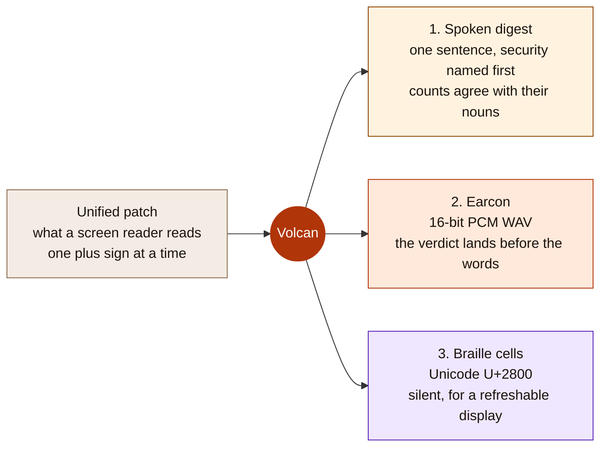
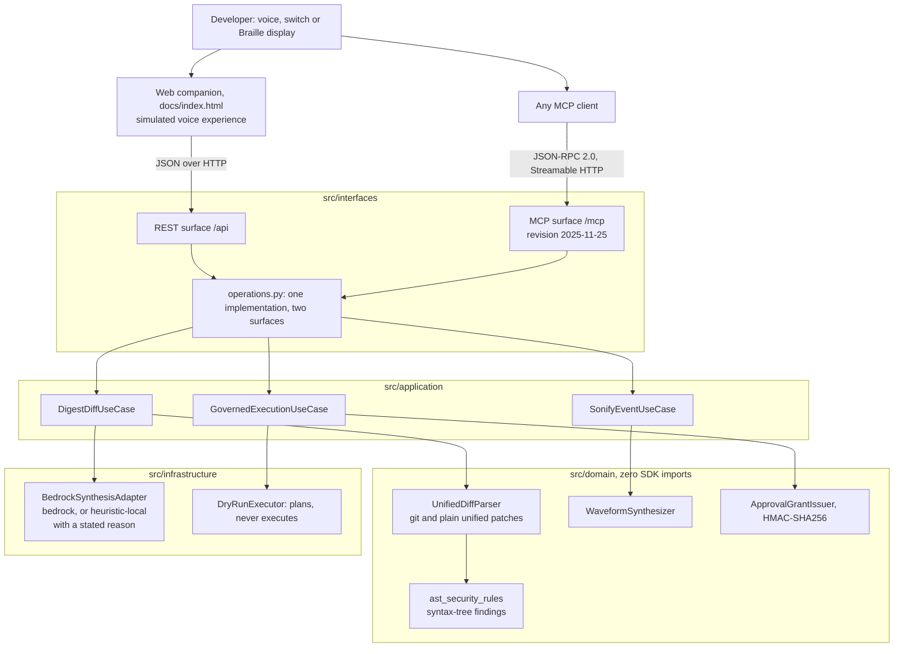
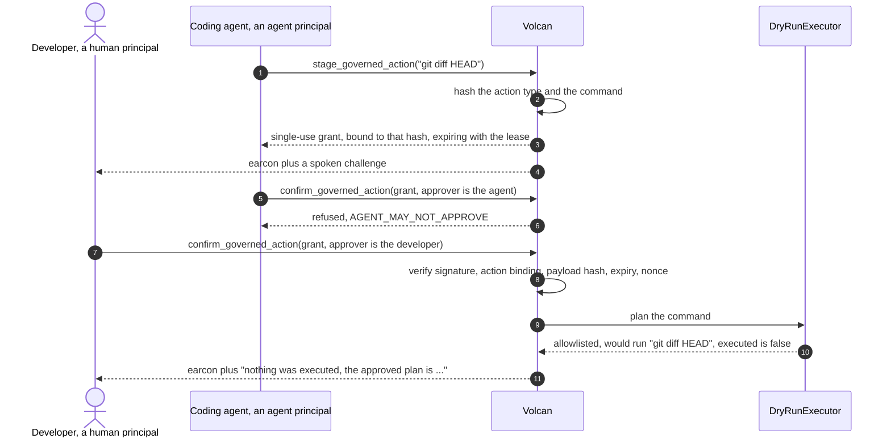

# Volcan

> **Volcan lets blind and mobility-impaired software developers review autonomous coding agents by ear and by touch instead of by reading a diff.**

[](https://opensource.org/licenses/MIT)
[](https://modelcontextprotocol.io)
[](https://www.python.org/)
[](tests/)

One patch goes in. Three things a person can actually use come out.



The same three renderings reach a Model Context Protocol client as text and `audio`
content blocks, and reach a browser through the companion page at
[`docs/index.html`](docs/index.html).

---

## Quickstart

Four steps. Everything they print is checkable on your own machine.

### 1. Install and run the tests

```bash
git clone https://github.com/upgradedev/volcan_amazon.git
cd volcan_amazon
python -m pip install fastapi uvicorn pydantic httpx boto3 pytest pytest-asyncio
python -m pytest tests/ -q
```

### 2. Start the server

```bash
python -m src.interfaces.mcp_server
```

### 3. Prove the protocol before you trust the page

In a second terminal:

```bash
python scripts/mcp_conformance.py http://127.0.0.1:8000/mcp
```

### 4. Hear a code review

Open `http://127.0.0.1:8000/` and press **Hear this code review**, or press
<kbd>Alt</kbd>+<kbd>1</kbd> then <kbd>Enter</kbd> without touching a pointer. The button
posts the patch to the running server, plays the WAV the server synthesized, prints the
Braille cells, and reports the round trip it measured with `performance.now()`.

**Time to first result, measured on the development machine on 2026-09-08.** Step 1 reported
`240 passed, 1 warning in 3.49s`. The server in step 2 answered its first `GET /health` with
HTTP 200 **1.5 seconds** after launch, printed by
[`scripts/measure_cold_start.py`](scripts/measure_cold_start.py). That script launches its
own server, so stop the one from step 2 before running it. It refuses to time a process that
was already warm, and says so rather than printing a figure it cannot stand behind. Step 3
printed
`18/18 checks passed, 0 failed`. The first digest round trip in step 4 was **72.6 ms** in
Chrome at 1280x900, measured on 2026-09-06 and not re-measured since, because it needs a
browser and the page prints the figure for itself on every run rather than taking it from
this file. The `pip install` step depends on your network and is not measured here.

Requires Python 3.11 or newer. The repository is private until the submission window opens,
so `git clone` works for an account with access and otherwise starts from the submitted
archive.

---

## Table of Contents

1. [What is true and what is simulated](#what-is-true-and-what-is-simulated)
2. [The problem](#the-problem)
3. [What Volcan does](#what-volcan-does)
4. [Architecture](#architecture)
5. [Governed actions](#governed-actions)
6. [The MCP surface](#the-mcp-surface)
7. [The companion page](#the-companion-page)
8. [Measured numbers](#measured-numbers)
9. [Verify every claim yourself](#verify-every-claim-yourself)
10. [Known limitations](#known-limitations)
11. [Who would buy this, and out of which budget](#who-would-buy-this-and-out-of-which-budget)
12. [License](#license)

---

## What is true and what is simulated

Read this section before anything else. It is the honest boundary of the project.

**Real, and you can check it in one command.** Volcan ships a Model Context Protocol server
written by hand to revision **2025-11-25** over the **Streamable HTTP** transport: JSON-RPC
2.0 at `POST /mcp`, an SSE stream at `GET /mcp`, session identifiers, protocol version
negotiation, a tool catalog whose JSON Schemas are generated from the code that parses the
arguments, and MCP audio content blocks carrying the synthesized earcons.
`python scripts/mcp_conformance.py` runs a full client handshake against a running server
and prints a pass or fail line for each of its 18 conformance checks.

**Simulated, and labelled as such everywhere it appears.** The voice experience is a web
companion, not an Alexa skill. There is no Alexa skill package in this repository, no skill
has been submitted for certification, and nothing here has been tested on an Echo device.
The companion speaks with the browser's Web Speech API and calls the same API an Alexa+
integration would call.

**Real code with a labelled fallback, and a stated reason.** The Amazon Bedrock adapter calls
Claude on Amazon Bedrock through the Anthropic SDK's `AnthropicBedrockMantle` client, pinned to
`anthropic.claude-opus-5`. When the call cannot be made or fails, the deterministic local path
runs instead. Every response carries `synthesis_mode`, which is `"bedrock"` when a model
answered and `"heuristic-local"` when none did, **and `synthesis_fallback_reason`, which says
why**. The companion prints both beside the synthesis meter. An unexplained fallback is
indistinguishable from a design decision, which is why the reason is not optional.

Run against this repository on 2026-09-08 it prints, verbatim:

```
synthesis_mode: heuristic-local
synthesis_fallback_reason: the Anthropic SDK is not installed (No module named 'anthropic');
pip install 'anthropic[bedrock]' to reach Amazon Bedrock
```

**No model has ever answered here, and the pinned model id is unverified.** `pip install
'anthropic[bedrock]'` (or `pip install -e '.[bedrock]'`) installs the client. The previous
pin, `anthropic.claude-3-5-sonnet-20241022-v2:0`, is a retired snapshot on the legacy
InvokeModel integration and answers `ResourceNotFoundException`; the new id is the documented
current one, and nobody here has AWS access that could confirm it answers. Confirming it is an
owner action, listed under Known limitations.

**Never executed.** Volcan plans shell commands against an allowlist and refuses the rest. It
does not run them. The claim covers the whole product, not one module: no file under `src/`
imports or calls `subprocess`, `os.system`, `eval`, `exec` or any process spawn, and
`tests/unit/test_no_execution_in_source_tree.py` walks every source module's AST on each run
to keep it that way.

---

## The problem

An autonomous coding agent produces a patch, and a sighted reviewer scans it in seconds. A
blind reviewer using a screen reader hears every plus sign, minus sign and hunk header as
literal characters. A 300 line patch becomes minutes of auditory scrubbing through syntax
before any comprehension begins, and a one line authentication change sits in the middle of
it sounding exactly like everything else.

A developer with a repetitive strain injury or limited hand mobility hits the same wall from
the other side: the review is not hard to understand, it is hard to navigate.

---

## What Volcan does

1. **Semantic diff digests.** Parses a unified patch and speaks it at three levels: an
   executive sentence, a file-by-file breakdown, then a line drill-down. Counts are
   pluralised, because a listener hears "1 files" and a reader skims past it.
2. **Security flags before comprehension.** Two deterministic passes run over every patch. A
   keyword pass flags authentication, cryptographic, database and process-execution
   vocabulary. A syntax-tree pass then compares the added and removed lines as parsed Python
   and reports what the change *did*: an authorization comparison inverted, a cross-origin
   policy widened to any origin, a verification call deleted and not replaced. The second pass
   exists because `user.role == "admin"` and `user.role != "admin"` contain identical words,
   so no keyword matcher can tell them apart. The digest speaks findings first, and names the
   change rather than the keyword that matched.
3. **Audio earcons as first-class results.** A pure-Python PCM WAV synthesizer produces
   distinct cues, returned over MCP as `audio` content blocks so a client plays the sound
   instead of reading a description of it. Each cue also carries a `spoken_fallback` string,
   so a Deaf or hard-of-hearing developer reads what a hearing one heard.
4. **Unicode Braille output.** Renders patches and commands as Braille patterns in the U+2800
   block for a refreshable Braille display, for quiet hours, open offices and deafblind
   developers.
5. **Governed actions.** High-consequence commands are staged behind a single-use,
   content-bound authorization grant with a lease, and an agent cannot release its own
   proposal.
6. **Adaptive switch and haptic input.** Maps sip-and-puff, single-button and foot-pedal
   pulses to navigation actions, and builds vibration cadences with visual captions.

---

## Architecture



---

## Governed actions



A grant is refused when its signature is altered, when it was minted for a different action,
when the command changed after it was issued, when the lease elapsed, and when it has already
been used once. Each of those refusals has its own test in
[`tests/unit/test_governance.py`](tests/unit/test_governance.py).

Every audit record is sealed with the hash of the record before it, so editing a stored
entry, deleting one or reordering two is **detected** and the verdict names the entry that
broke. It is tamper-evident, not tamper-proof: nothing here stops someone who can rewrite the
whole chain from re-sealing it end to end, because the head hash is not published anywhere
the writer cannot reach. `python -m pytest tests/unit/test_audit_chain.py -v` covers each
detection path.

---

## The MCP surface

Eleven tools, each with an `inputSchema` generated from the pydantic model that parses its
arguments, so the published schema cannot drift away from the code:

| Tool | What it returns |
|---|---|
| `digest_semantic_diff` | Spoken digest, the DIFF_READY earcon as audio, and the parsed detail |
| `drill_down_section` | Symbol-level explanation of one file section, plus an earcon |
| `stage_governed_action` | An action id, a payload hash, a dry-run plan and a single-use grant |
| `confirm_governed_action` | Release or a named refusal, plus the matching earcon |
| `play_earcon` | A 16-bit PCM WAV as an MCP `audio` content block |
| `voice_turn` | One conversational turn: summarize, stage, approve or reject |
| `translate_text_to_braille` | Unicode Braille patterns in the U+2800 block |
| `braille_diff_digest` | A patch formatted with tactile add and remove markers |
| `process_switch_pulse` | The navigation action a switch pulse resolves to |
| `get_haptic_profile` | A vibration cadence and a visual caption |
| `check_ast_completeness` | Whether Python source parses, with node, function and class counts |

Protocol behaviour worth checking: `initialize` issues a cryptographically random
`Mcp-Session-Id`, and a session this server never minted is answered HTTP 404;
`MCP-Protocol-Version` is required on every request after initialize and is echoed on every
response; `notifications/initialized` returns HTTP 202 with no body; JSON-RPC error codes
`-32700`, `-32600`, `-32601` and `-32602` are all reachable; a failing tool is reported as
`isError` inside the result rather than as a transport failure; a browser `Origin` outside
the allowlist is rejected while an absent `Origin` is allowed so non-browser clients work;
and `PUT /mcp` returns 405 with an `Allow` header.

The REST surface at `/api` is ordinary JSON over HTTP for the web companion. It is not MCP
and is not described as MCP anywhere in this repository.

---

## The companion page

[`docs/index.html`](docs/index.html) is the only companion document here. FastAPI serves the
same bytes at `/` and `/demo`, so the page cannot disagree with itself.

Four rules the page keeps, each enforced by
[`tests/e2e/test_html_structure.py`](tests/e2e/test_html_structure.py):

* **Every value on it came out of an HTTP response in that session.** There is no second
  implementation of the product in JavaScript to fall back on, so the page cannot show a
  digest, a Braille cell or a waveform that the server did not produce. The waveform is
  drawn from the returned WAV's own 16-bit samples.
* **Every duration was measured with `performance.now()`** around the request that produced
  it. `test_latency_is_measured_and_never_typed` fails the build on any latency literal in
  the file.
* **Nothing is written with `innerHTML`.** Server text is inserted through `textContent`.
* **An unreachable server is stated, not papered over.** The page prints the command that
  starts one, and distinguishes "no server answered" from "the server answered and the call
  still failed", because those need different next steps.

The **Run a real MCP handshake** button performs `initialize`, `notifications/initialized`
and `tools/list` against `POST /mcp` in the browser, then renders the negotiated protocol
version, the session id taken off the response header, and each published `inputSchema`.

Accessibility is enforced rather than asserted. The page has semantic landmarks, a labelled
and keyboard-scrollable Braille region, `aria-live` on every asynchronous pane and
`role="alert"` on security findings, a 3px focus ring in both colour schemes, a written
description of every audio cue taken from the server's own `spoken_fallback`, and no control
that ships disabled. `prefers-reduced-motion` removes every animation and the smooth scroll;
`prefers-color-scheme` selects a designed light or dark palette. The page loads nothing from
the network, so it renders whole on a locked-down machine.

---

## Measured numbers

Every number below was printed by the command beside it on 2026-09-08, on the development
machine recorded in [`benchmarks_summary.json`](benchmarks_summary.json). Nothing here is an
estimate unless it says ESTIMATE.

| Metric | Baseline | Volcan | Command that prints it |
|---|---|---|---|
| Security-flag detection | 0% recall, because a screen reader reading a raw patch surfaces no security categorisation at all | **81.8% recall over n=40 labelled patches**, 22 that must flag and 18 that must not, with 0% false positives | `python scripts/benchmark_suite.py` |
| Patch parse latency, mean of 1000 runs | not measured | 0.17 ms | `python scripts/benchmark_suite.py` |
| Earcon synthesis latency, mean of 1000 runs | not measured | 2.562 ms | `python scripts/benchmark_suite.py` |
| MCP protocol conformance | not applicable | **18 of 18 conformance checks pass** | `python scripts/mcp_conformance.py http://127.0.0.1:8000/mcp` |
| Tools advertised by `tools/list` | not applicable | 11 | `python scripts/mcp_conformance.py http://127.0.0.1:8000/mcp` |
| Automated tests | not applicable | 240 passing in 3.49 s | `python -m pytest tests/ -q` |
| Cold start to the first HTTP 200 on `/health` | not applicable | 1.5 s | `python scripts/measure_cold_start.py` |
| First digest round trip, browser to server and back | not applicable | 72.6 ms, measured on 2026-09-06 | the page measures and prints this itself on every run |

The cold start figure comes from
[`scripts/measure_cold_start.py`](scripts/measure_cold_start.py), which launches the server as
a child process, polls `/health` until it answers 200, prints the elapsed seconds and stops
the child again. Stop any server already on port 8000 first, or the script refuses to time a
process that was already warm.

**The detection corpus is written by the same people who wrote the parser.** It is 40
hand-labelled patches in [`tests/fixtures/diff_corpus.py`](tests/fixtures/diff_corpus.py),
each carrying an explicit `expect_security_flag`. It measures behaviour on those fixtures and
is not a claim about any real repository, and a figure measured over fixtures its own author
chose is worth less than one measured over somebody else's. Read the number with that in mind.

Two things push back on it. Six of the positives were written to defeat the keyword matcher
rather than to flatter it, including the three regressions an end-customer review found in the
field: an authorization comparison inverted to `!= "admin"`, CORS origins widened to `["*"]`,
and a signature-verification call deleted. Six negatives were written to tempt the rules those
positives forced into existence, among them the same CORS line narrowed rather than widened,
and a removed `verify_email_format` call that a cruder rule would flag.

And four positives are in the corpus precisely because nothing here detects them. They are why
recall is 81.8% and not a round hundred:

| Missed | What it is | Why it is missed |
|---|---|---|
| `pos-19` | an authorization guard block deleted | no rule reads deleted blocks, only deleted calls |
| `pos-20` | a permission decorator removed | a bare decorator line is not parseable Python on its own |
| `pos-21` | `verify=False` added to an outbound call | no rule inspects argument values |
| `pos-22` | an IAM policy widened in JSON | the syntax-tree rules are Python only |

[`tests/unit/test_security_detection_corpus.py`](tests/unit/test_security_detection_corpus.py)
recomputes the published figures and pins that list by fixture id, so a new miss fails the
build and closing one of these means deleting its id from the list.

The two latency figures are the single run recorded in `benchmarks_summary.json`, not a stable
constant. The parse mean rose from 0.041 ms to 0.17 ms when the syntax-tree pass was added,
which is the honest cost of parsing every changed line rather than scanning it; treat the order
of magnitude as the claim and rerun the benchmark on your own hardware.

---

## Verify every claim yourself

| Claim | Command |
|---|---|
| The MCP server speaks the protocol | `python scripts/mcp_conformance.py http://127.0.0.1:8000/mcp` |
| The tests pass, and how many | `python -m pytest tests/ -q` |
| The benchmark numbers above | `python scripts/benchmark_suite.py` |
| Every readiness gate, including the failing ones | `python ci/readiness.py` |
| Forged and replayed grants are refused | `python -m pytest tests/unit/test_governance.py -v` |
| The security rules catch an inverted check, and refuse a lookalike | `python -m pytest tests/unit/test_ast_security_rules.py -v` |
| A plain `diff -u` patch is named, not called unknown_file | `python -m pytest tests/unit/test_plain_unified_diff.py -v` |
| A fallback from Amazon Bedrock states its reason | `python -m pytest tests/unit/test_bedrock_synthesis_path.py -v` |
| Nothing executes a shell command | `python -m pytest tests/unit/test_dry_run_executor.py -v` |
| Injection payloads and grant attacks are refused | `python scripts/security_audit.py` |
| An edited audit record is detected | `python -m pytest tests/unit/test_audit_chain.py -v` |
| The whole product in one terminal walkthrough | `python scripts/volcan_cli.py` |
| How long a cold server takes to answer | `python scripts/measure_cold_start.py` |
| The companion page keeps its four rules and is keyboard reachable | `python -m pytest tests/e2e -v` |

`ci/readiness.py` is written so that it can fail, and it does. On 2026-09-08 it printed
`45/53 passed, 0 blocking failures, 8 externally blocked`. The eight red gates are the absent
video and its sync check, the absent browser-driver journey, the deployed endpoint running an
older commit than HEAD, and three actions only the owner can perform. Each failure is printed
with its reason rather than hidden.

**You will see 41, not 45, and that is expected.** Four of those gates read the persona review
out of `STATE.md`, a coordination file that lives one directory above this repository and is
deliberately never committed. From a standalone clone or a CI runner there is no copy to read,
so gates I1 to I4 report themselves externally blocked with that reason and the script still
exits 0: `41/53 passed, 0 blocking failures, 12 externally blocked`. The excuse is narrow. If
`STATE.md` is present and does not record the review, those four gates fail as blocking and the
script exits 1.

To satisfy yourself that the script is capable of failing rather than decorative, change the
test count in the README badge from 240 to 241 and run it again. Gate G1 turns red under
`FAILED, BLOCKING`, the summary reads `1 blocking failures`, and the process exits 1.

---

## Known limitations

* **No Alexa skill.** No skill package is submitted, no certification has been sought, and
  nothing has been tested on an Echo device. The Alexa+ claim is the MCP server plus a web
  companion that simulates the voice experience and says so on screen.
* **No browser-driver end-to-end test.** `tests/e2e` parses the companion DOM and asserts its
  structure, its accessibility and its four honesty rules; it does not drive a real browser,
  because no browser driver is vendored here. Gate C5 records that as a failure.
* **Bedrock has never answered here, and the pinned model id is unverified.** Every digest
  produced in this repository came from the local heuristic path, labelled
  `synthesis_mode: heuristic-local` with the reason printed beside it. On the development
  machine `/health` reports `bedrock_credentials_present: true`, because boto3 resolves
  something from the local credential chain; that says nothing about whether a model answers,
  which is the whole reason the reason field exists. The Anthropic SDK is not installed here,
  so the call has never left the process. Nobody working on this repository has AWS access
  that could confirm `anthropic.claude-opus-5` answers on Bedrock, so **it has not been
  confirmed**. Recording a successful Bedrock transcript is an owner action: install
  `anthropic[bedrock]`, run one digest with working credentials, and check that the response
  reads `synthesis_mode: bedrock` with a null reason.
* **The syntax-tree security rules cover three change classes and Python only.** An inverted
  authorization comparison, a widened cross-origin policy, and a removed verification call. A
  deleted guard block, a removed decorator, a dangerous argument value and any non-Python file
  are outside them, which is what the four named misses in Measured numbers are. A line that
  does not parse as Python produces no finding rather than a guess.
* **The deployed endpoint is stale.** `deploy_teardown_receipt.json` records a real probe
  performed on 2026-09-05: the endpoint answered `GET /health` with HTTP 200, but it runs
  commit `38668ad`, an ancestor of HEAD, and returns 404 for `/mcp`. Gates D2 and G2 are red
  for exactly that reason. Run the server locally to exercise the MCP surface.
* **No video has been recorded.** [`video/SHOT_LIST.md`](video/SHOT_LIST.md) is a beat sheet
  in which every beat is an action this repository can perform today, and `video/` holds no
  footage. Gates E2 and E4 are red for that reason.
* **Approval grants do not survive a restart.** The signing secret is generated per process
  unless `VOLCAN_APPROVAL_SECRET` is set, so outstanding grants become invalid when the server
  restarts. That direction of failure is the safe one.
* **Sessions and the audit trail live in memory.** Nothing is persisted between runs.
* **Braille output is computer Braille, not contracted Grade 2.** It maps characters one to
  one and has not been reviewed by a Braille transcriber.
* **The companion's cross-device panels were removed.** Volcan targets one track. Bee, Fire TV
  and Ring helpers remain in the codebase as local simulations reachable under
  `/api/companions`, and no device SDK is involved.

---

## Who would buy this, and out of which budget

**This section is a commercial hypothesis, not a finding.** It names a buyer and the basis for
asking them to pay. It contains no market size, no price, no revenue projection and no
conversion rate, because none of those have been measured and an invented one would be worth
less than the empty space.

**The buyer.** An engineering organisation that is already obliged to meet accessibility
requirements and already employs, or wants to employ, blind and mobility-impaired engineers.
Two obligations create that population and are the cited basis:

* **Directive (EU) 2019/882, the European Accessibility Act**, which applies from 28 June 2025
  to products and services placed on the EU market, computer hardware and operating systems,
  e-commerce and several other categories. Its technical requirements are met in practice
  through the harmonised European standard **EN 301 549**, which is also what
  **Directive (EU) 2016/2102** puts into public sector procurement.
* **Section 508 of the US Rehabilitation Act**, which requires information and communication
  technology developed, procured, maintained or used by US federal agencies to be accessible.
  The Revised 508 Standards adopt WCAG 2.0 Level AA, and US federal procurement routinely asks
  a supplier for an Accessibility Conformance Report before signing.

Those two make accessibility a condition of selling and of being sold to. Volcan is not an
audit tool and does not help anyone pass an audit. It is aimed one step behind that: the
engineers who do the work.

**The budget line.** Not a new one. The three that already exist in such organisations are
third-party accessibility audit and report authoring engagements, assistive technology and
workplace adjustment provision for disabled employees, and per-seat developer tooling. The
hypothesis is that Volcan is bought out of the second or the third, because it is a tool an
individual engineer uses to do their job, not a report anyone files.

**The willingness-to-pay basis.** These organisations already pay for comparable things: paid
screen reader licences such as JAWS alongside free ones such as NVDA, refreshable Braille
displays as capital equipment, and consultancy days from accessibility firms. That is the
comparison to argue from. **What they pay, and what fraction of it a tool like this could
ask for, is not known here and is the first thing the conversations below exist to find out.**
No figure is stated because none was measured.

**The first ten to approach.** Three accessibility consultancies who both employ this
population and sell to it, four engineering organisations with a named internal accessibility
function, one public sector buyer on each side of the Atlantic, and two disability
organisations who can say whether the premise is wrong:

1. Deque Systems
2. Level Access
3. TPGi
4. Microsoft accessibility engineering
5. Google central accessibility
6. GitHub accessibility
7. UK Government Digital Service
8. European Commission DIGIT, as an EN 301 549 procurement buyer
9. Royal National Institute of Blind People
10. American Foundation for the Blind

The first question to all ten is not whether they would buy it. It is whether a blind engineer
on their staff reviews agent-written patches today, and what that costs them in hours.

**On whether this compounds, which it does not yet.** Volcan has real distribution and no loop.
The MCP surface is genuine and any MCP client can mount it today, which is a way in, not a
flywheel. Nothing here improves as more people use it: there is no shared corpus, no telemetry
and no model trained on usage. The one honest compounding hypothesis is that regressions a user
finds and reports become fixtures in the detection corpus, so the tool gets better at the
mistakes real agents actually make. That is a process rather than a product loop, it has not
been tried, and the four misses named in Measured numbers are what it would have to close
first. A CI surface, where the digest runs on a pull request and posts the spoken summary as an
artifact, is the obvious second distribution path and **has not been built**.

---

## License

MIT. See [LICENSE](LICENSE).
