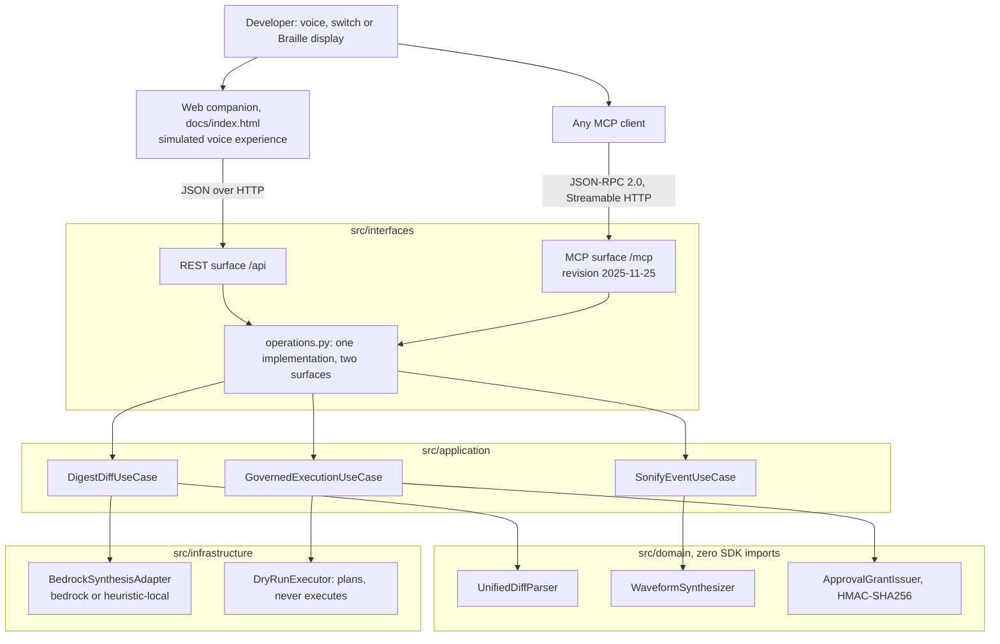
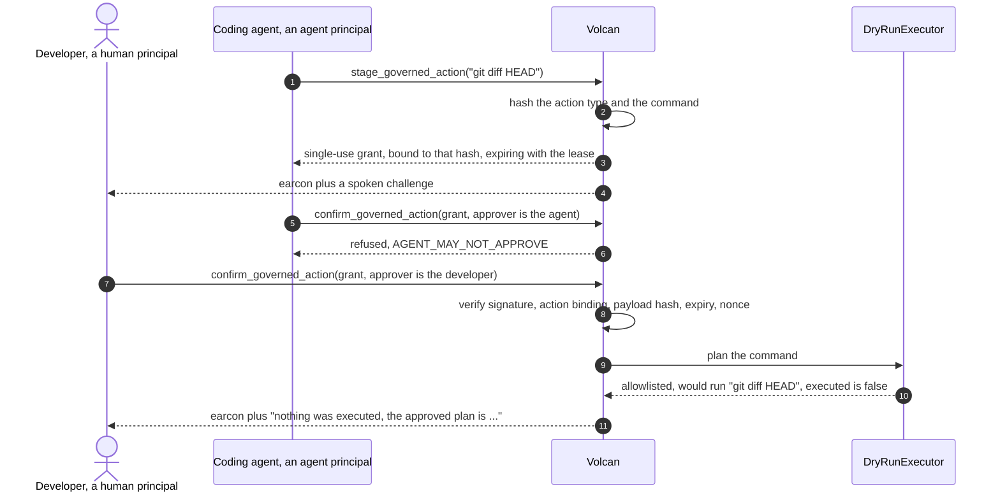

# Volcan: Accessible Voice-First AI Agent Forge

> **Volcan lets blind and mobility-impaired software developers review autonomous coding agents by ear and by touch instead of by reading a diff.**

[](https://opensource.org/licenses/MIT)
[](#verify-every-claim-yourself)
[](https://modelcontextprotocol.io)
[](https://www.python.org/)

---

## Table of Contents
1. [What is true and what is simulated](#what-is-true-and-what-is-simulated)
2. [The problem](#the-problem)
3. [What Volcan does](#what-volcan-does)
4. [Architecture](#architecture)
5. [Governed actions](#governed-actions)
6. [The MCP surface](#the-mcp-surface)
7. [Measured numbers](#measured-numbers)
8. [Quickstart](#quickstart)
9. [Verify every claim yourself](#verify-every-claim-yourself)
10. [Known limitations](#known-limitations)
11. [License](#license)

---

## What is true and what is simulated

Read this section before anything else. It is the honest boundary of the project.

**Real, and you can check it in one command.** Volcan ships a Model Context Protocol
server written by hand to revision **2025-11-25** over the **Streamable HTTP** transport:
JSON-RPC 2.0 at `POST /mcp`, an SSE stream at `GET /mcp`, session identifiers, protocol
version negotiation, a tool catalog whose JSON Schemas are generated from the code that
parses the arguments, and MCP audio content blocks carrying the synthesized earcons.
`python scripts/mcp_conformance.py` runs a full client handshake against a running
server and prints a pass or fail line for each of 18 checks.

**Simulated, and labelled as such everywhere it appears.** The voice experience is a web
companion, not an Alexa skill. There is no Alexa skill package in this repository, no
skill has been submitted for certification, and nothing here has been tested on an Echo
device. The companion synthesizes speech with the browser's Web Speech API and calls the
same API an Alexa+ integration would call. When no server answers, the page shows
**SIMULATED** in its banner and tags every browser-produced result.

**Real code with a labelled fallback.** The Amazon Bedrock adapter is genuine boto3 code
against `bedrock-runtime`, and with no AWS credentials in the environment it never runs;
the deterministic local path runs instead. Every response carries `synthesis_mode`, which
is `"bedrock"` when a model answered and `"heuristic-local"` when none did, so the
companion can show which path produced the words you are hearing.

**Never executed.** Volcan plans shell commands against an allowlist and refuses the
rest. It does not run them. `DryRunExecutor` imports no execution primitive at all, and a
test parses its AST to keep it that way.

---

## The problem

An autonomous coding agent produces a patch, and a sighted reviewer scans it in seconds.
A blind reviewer using a screen reader hears every plus sign, minus sign and hunk header
as literal characters. A 300 line patch becomes minutes of auditory scrubbing through
syntax before any comprehension begins, and a one line authentication change sits in the
middle of it sounding exactly like everything else.

A developer with a repetitive strain injury or limited hand mobility hits the same wall
from the other side: the review is not hard to understand, it is hard to navigate.

---

## What Volcan does

1. **Semantic diff digests.** Parses a unified patch and speaks it at three levels: an
   executive sentence, a file-by-file breakdown, then a line drill-down. Counts are
   pluralised, because a listener hears "1 files" and a reader skims past it.
2. **Security flags before comprehension.** A deterministic pass flags authentication,
   cryptographic, database and process-execution changes, and the digest names them first
   rather than burying them in line order.
3. **Audio earcons as first-class results.** A pure-Python PCM WAV synthesizer produces
   distinct cues, returned over MCP as `audio` content blocks so a client plays the sound
   instead of reading a description of it.
4. **Unicode Braille output.** Renders patches and commands as Braille patterns in the
   U+2800 block for a refreshable Braille display, for quiet hours, open offices and
   deafblind developers.
5. **Governed actions.** High-consequence commands are staged behind a single-use,
   content-bound authorization grant with a lease, and an agent cannot release its own
   proposal.
6. **Adaptive switch and haptic input.** Maps sip-and-puff, single-button and foot-pedal
   pulses to navigation actions, and builds vibration cadences with visual captions.

---

## Architecture



---

## Governed actions



A grant is refused when its signature is altered, when it was minted for a different
action, when the command changed after it was issued, when the lease elapsed, and when it
has already been used once. Each of those refusals has its own test in
[`tests/unit/test_governance.py`](tests/unit/test_governance.py).

---

## The MCP surface

Eleven tools, each with an `inputSchema` generated from the pydantic model that parses its
arguments, so the published schema cannot drift away from the code:

| Tool | What it returns |
|---|---|
| `digest_semantic_diff` | Spoken digest, the DIFF_READY earcon as audio, and the parsed detail |
| `drill_down_section` | Symbol-level explanation of one file section, plus an earcon |
| `stage_governed_action` | An action id, a payload hash, a dry-run plan and a single-use grant |
| `confirm_governed_action` | Release or a named refusal, plus the matching earcon |
| `play_earcon` | A 16-bit PCM WAV as an MCP `audio` content block |
| `voice_turn` | One conversational turn: summarize, stage, approve or reject |
| `translate_text_to_braille` | Unicode Braille patterns in the U+2800 block |
| `braille_diff_digest` | A patch formatted with tactile add and remove markers |
| `process_switch_pulse` | The navigation action a switch pulse resolves to |
| `get_haptic_profile` | A vibration cadence and a visual caption |
| `check_ast_completeness` | Whether Python source parses, with node, function and class counts |

Protocol behaviour worth checking: `initialize` issues a cryptographically random
`Mcp-Session-Id`, and a session this server never minted is answered HTTP 404;
`MCP-Protocol-Version` is required on every request after initialize and is echoed on
every response; `notifications/initialized` returns HTTP 202 with no body; JSON-RPC error
codes `-32700`, `-32600`, `-32601` and `-32602` are all reachable; a failing tool is
reported as `isError` inside the result rather than as a transport failure; a browser
`Origin` outside the allowlist is rejected while an absent `Origin` is allowed so
non-browser clients work; and `PUT /mcp` returns 405 with an `Allow` header.

The REST surface at `/api` is ordinary JSON over HTTP for the web companion. It is not
MCP and is not described as MCP anywhere in this repository.

---

## Measured numbers

Every number below was printed by the command beside it on 2026-09-05. Nothing here is an
estimate unless it says ESTIMATE.

| Metric | Baseline | Volcan | Command that prints it |
|---|---|---|---|
| Security-flag detection | 0% recall, because a screen reader reading a raw patch surfaces no security categorisation at all | **100% recall over n=24 labelled patches**, 12 that must flag and 12 that must not, with 0% false positives | `python scripts/benchmark_suite.py` |
| Patch parse latency, mean of 1000 runs | not measured | 0.027 ms | `python scripts/benchmark_suite.py` |
| Earcon synthesis latency, mean of 1000 runs | not measured | 2.734 ms | `python scripts/benchmark_suite.py` |
| MCP conformance checks passing | not applicable | 18 of 18 | `python scripts/mcp_conformance.py` |
| Automated tests | not applicable | 161 passing | `python -m pytest tests/ -q` |

The detection corpus is 24 hand-labelled patches in
[`tests/fixtures/diff_corpus.py`](tests/fixtures/diff_corpus.py), each carrying an
explicit `expect_security_flag`. It measures behaviour on those fixtures and is not a
claim about any real repository.
[`tests/unit/test_security_detection_corpus.py`](tests/unit/test_security_detection_corpus.py)
recomputes the published figures, so the number in this table turns red if the parser or
the corpus changes.

Idle cloud cost is documented with its measurement date in
[`infra/README.md`](infra/README.md).

---

## Quickstart

### 1. Clone and enter the repository
```bash
git clone https://github.com/upgradedev/volcan_amazon.git
cd volcan_amazon
```

### 2. Install the runtime and test dependencies
```bash
python -m pip install fastapi uvicorn pydantic httpx pytest pytest-cov ruff
```

### 3. Run the test suite
```bash
python -m pytest tests/ -q
```

### 4. Start the server on loopback
```bash
python -m src.interfaces.mcp_server
```

### 5. Prove the MCP server is real, then open the companion
```bash
python scripts/mcp_conformance.py http://127.0.0.1:8000/mcp
```
Then open `http://127.0.0.1:8000/`. The companion's banner reports whether it reached a
server, and says SIMULATED when it did not.

---

## Verify every claim yourself

| Claim | Command |
|---|---|
| The MCP server speaks the protocol | `python scripts/mcp_conformance.py` |
| The tests pass, and how many | `python -m pytest tests/ -q` |
| The benchmark numbers above | `python scripts/benchmark_suite.py` |
| Every readiness gate, including the failing ones | `python ci/readiness.py` |
| Forged and replayed grants are refused | `python -m pytest tests/unit/test_governance.py -v` |
| Nothing executes a shell command | `python -m pytest tests/unit/test_dry_run_executor.py -v` |
| The companion is keyboard reachable and announced | `python -m pytest tests/e2e -v` |

`ci/readiness.py` is written so that it can fail, and it does. It currently reports gates
red for the absent video, the absent browser-driver journey, and the deployed endpoint
running an older commit than HEAD. Those failures are printed with their reasons rather
than hidden.

---

## Known limitations

* **No Alexa skill.** No skill package is submitted, no certification has been sought, and
  nothing has been tested on an Echo device. The Alexa+ claim is the MCP server plus a web
  companion that simulates the voice experience and says so on screen.
* **No browser-driver end-to-end test.** `tests/e2e` parses the companion DOM and asserts
  its structure and accessibility; it does not drive a real browser, because no browser
  driver is vendored here. Gate C5 records that as a failure.
* **Bedrock has not run in this environment.** There are no AWS credentials here, so every
  digest produced in this repository came from the local heuristic path and is labelled
  `synthesis_mode: heuristic-local`.
* **The deployed endpoint is stale.** `deploy_teardown_receipt.json` records a real probe
  performed on 2026-09-05: the endpoint answered `GET /health` with HTTP 200, but it runs
  commit `38668ad`, an ancestor of HEAD, and returns 404 for `/mcp`. Gates D2 and G2 are
  red for exactly that reason. Run the server locally to exercise the MCP surface.
* **Approval grants do not survive a restart.** The signing secret is generated per
  process unless `VOLCAN_APPROVAL_SECRET` is set, so outstanding grants become invalid
  when the server restarts. That direction of failure is the safe one.
* **Sessions and the audit trail live in memory.** Nothing is persisted between runs.
* **Braille output is computer Braille, not contracted Grade 2.** It maps characters one
  to one and has not been reviewed by a Braille transcriber.
* **Latency figures come from one machine.** They were measured on the development machine
  recorded in `benchmarks_summary.json` and will differ on yours. Rerun the benchmark.
* **The companion's cross-device panels were removed.** Volcan targets one track. Bee,
  Fire TV and Ring helpers remain in the codebase as local simulations reachable under
  `/api/companions`, and no device SDK is involved.

---

## License

MIT. See [LICENSE](LICENSE).
