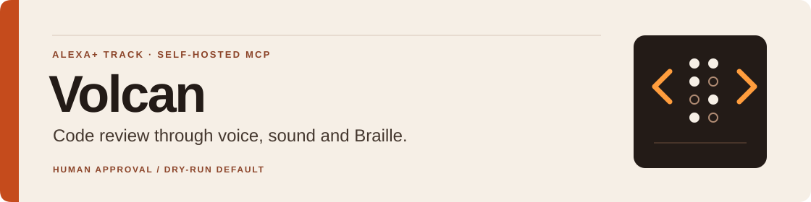
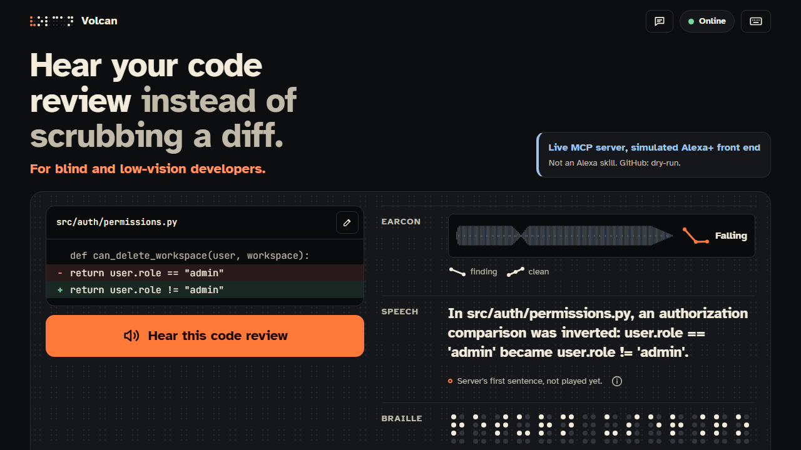
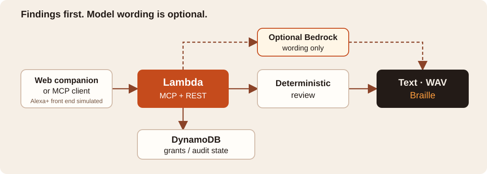
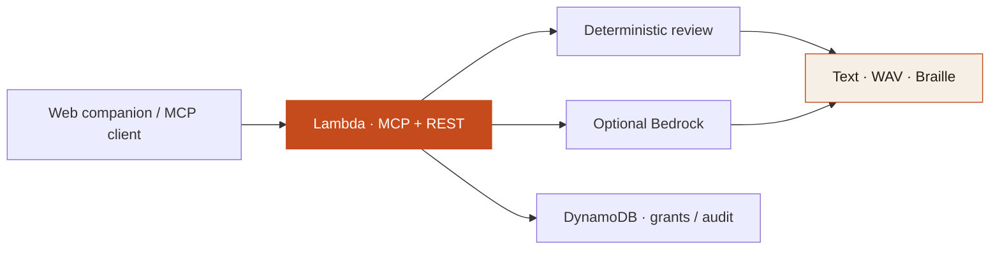
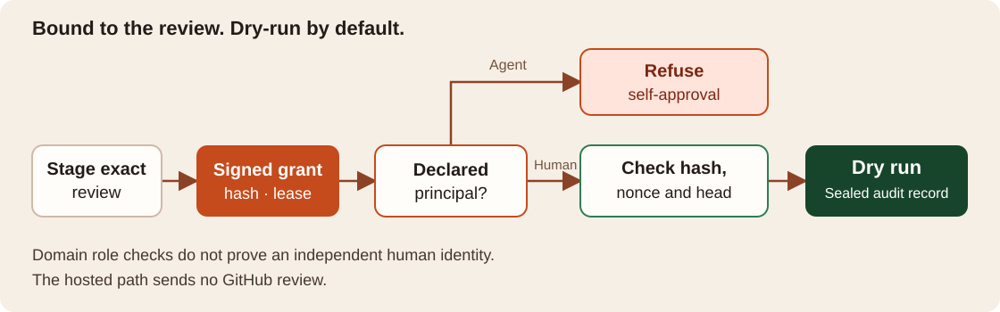
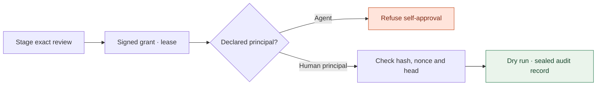

# Volcan

> **Volcan lets blind and low-vision software developers review autonomous coding agents by ear and by touch instead of by reading a diff.**

[](https://github.com/upgradedev/volcan_amazon/actions/workflows/ci.yml)
[](tests/)
[](https://www.python.org/)
[](https://modelcontextprotocol.io)
[](infra/)
[](LICENSE)

[Live demo](https://qylv1gxor9.execute-api.eu-west-1.amazonaws.com/) ·
[Video](https://youtu.be/cX3k-psa-yI) · [Devpost](https://devpost.com/software/volcan) ·
[Judge path](#judge-path) · [Evidence](docs/EVIDENCE.md) ·
[Run locally](#run-it-locally) · [Developer guide](docs/DEVELOPER_GUIDE.md)

**One patch, three outputs:** a spoken finding, a verdict sound and code Braille.
The first-screen example inverts an authorization comparison; Volcan names the
changed meaning before reading the lines.

**Live MCP server. Simulated Alexa+ front end. GitHub: dry-run.**
The web companion stands in for Alexa+; no Alexa skill, Echo device or certified
add-on is claimed. The [local add-on package](alexa_plus/addon-package/addon.json)
and client replay are implementation evidence, not an Alexa+ deployment.



*Local screenshot committed 2026-09-29; it predates the latest Braille/UI fixes.
It is a browser view, not an Echo display.*

## Table of Contents

[Judge path](#judge-path) · [Outputs](#outputs) ·
[Architecture](#architecture) · [Proof and limits](#proof-and-limits) ·
[Run locally](#run-it-locally) · [Documentation](#documentation)

## Judge path

1. **Open the live page.** The preview is quiet: nothing plays or speaks on load.
   Read the simulated-client and dry-run labels beside the patch.
2. **Explore Braille.** Code mode preserves supported ASCII distinctions.
   Literary mode is explicitly non-reversible; tabs and unsupported characters
   disclose their loss. No physical Braille display has been tested.
3. **Check the protocol.** In Evidence → Server and MCP, run the client checks.
   A handshake checks transport and tools; it does not prove a model answered.
4. **Optionally hear the review.** Press **Hear this code review**.
   This can incur Bedrock usage; file drill-down can add model requests.
   The answer names its engine or fallback. Use **Stop** or Escape
   to stop playback; enable **My screen reader speaks the answers** if preferred.

For the governed PR journey, use the
[command guide](docs/EVIDENCE.md#the-review-journey).
Approval grants are single-use and bound to the reviewed head.
Domain checks refuse an agent principal's self-approval; the public interface does
not prove independent human identity. The hosted path records a dry run and sends
no GitHub review.

## Outputs

| Output | What reaches the reviewer |
|---|---|
| **Voice** | Risk first, then exact changed lines or a file-specific drill-down |
| **Sound** | A different WAV cue for a finding and a clean patch |
| **Braille** | Eight-dot code cells; six-dot literary mode always discloses non-reversibility |

Code mode is lossless over the 95 printable ASCII characters; unsupported input
and tab expansion are reported. A Braille transcriber and real assistive users
have not validated the output.

## Architecture

The deterministic finding remains distinct from optional model wording.



<details>
<summary>Mermaid source</summary>



</details>

The review card is hosted by the companion page. Its smart-display frame is a
drawing; no Echo Show or third-party MCP Apps host is implied.



<details>
<summary>Mermaid source</summary>



</details>

## Proof and limits

Release evidence below is dated **2026-10-23**. Later documentation commits do
not relabel an unchanged deployed runtime.

| Evidence | Verified scope |
|---|---|
| **Runtime `48bdfda0`** | Lambda Active / Successful; source revision and package hash match the built revision. [Receipt](deploy_teardown_receipt.json), [code PR #48](https://github.com/upgradedev/volcan_amazon/pull/48) |
| **990 tests · 93.83% coverage** | [Master CI 39999658456](https://github.com/upgradedev/volcan_amazon/actions/runs/39999658456) at `d36b14f`, including Braille, delayed speech, stale responses, focus and layout regressions |
| **86.4% recall · n=40** | Synthetic Python finding corpus; raw-patch baseline: 0% recall; Volcan false positives: 0%. Self-authored and not held out for every rule; not a human speed comparison. [Measurements](docs/EVIDENCE.md#measured-numbers) |
| **MCP 2025-11-25 · 12 tools** | Hand-written Streamable HTTP, structured results and review-card resource. [Protocol surface](docs/EVIDENCE.md#the-mcp-surface) |
| **Public MIT source** | Repository published 2026-10-23; cloning needs no invitation. [License](LICENSE) |

**Limits that matter.** JS/TS results and false positives differ; full corpora and
known misses stay in the evidence. No real GitHub review has been sent, no
microphone/Echo journey is proved, and no blind-user benefit or buyer demand has
been measured. Price and adoption remain hypotheses.

**Submitted on 2026-10-23:** [Devpost entry](https://devpost.com/software/volcan)
and [public video with English subtitles](https://youtu.be/cX3k-psa-yI).
Take 6 was recorded on 2026-10-19 at `873845d`; it predates the current Braille/UI
fixes. Saved cuts are 167.448 s and 153.688 s.
[Video provenance](video/README.md).

Reproduce individual claims with `python scripts/benchmark_suite.py`,
`python scripts/mcp_conformance.py http://127.0.0.1:8000/mcp` and
`python ci/readiness.py`. Readiness is an internal audit, not an organizer score.

## Run it locally

Python 3.11+. No AWS account, GitHub token or device is required for local fallback.

### 1. Install and verify

```bash
python -m pip install -e ".[dev,bedrock]"
python -m playwright install chromium
python -m pytest tests/ -q
```

On Linux, missing browser libraries may require
`python -m playwright install --with-deps chromium`.

The Bedrock extra makes the client **ready to attempt** a call. Credentials and
an installed SDK **do not prove** a model answered; the response receipt is
`synthesis_mode: bedrock`. Without credentials, the deterministic engine answers.
Provider failures use a fixed public category: raw account, role and
request identifiers never enter the anonymous response.

### 2. Start the server

```bash
python -m src.interfaces.mcp_server
```

Open `http://127.0.0.1:8000/`. For a no-model demo, use an environment without
AWS credentials; the on-screen engine label identifies fallback. Nothing speaks before a press.

### 3. Check the MCP endpoint

```bash
python scripts/mcp_conformance.py http://127.0.0.1:8000/mcp
```

The [developer guide](docs/DEVELOPER_GUIDE.md) retains transport modes, all commands,
configuration, model history and the complete capability table.

## Documentation

| Start here | Then read |
|---|---|
| [Developer guide](docs/DEVELOPER_GUIDE.md) | Preserved implementation detail and dated release history |
| [Evidence](docs/EVIDENCE.md) | Corpora, commands, Braille table, architecture and buyer hypotheses |
| [Friction log](docs/FRICTION_LOG.md) | Recorded issues, workarounds and suggestions |
| [Persona review](docs/PERSONA_REVIEW.md) | Internal review procedure and findings |
| [Infrastructure](infra/README.md) | Terraform and operations |
| [Video](video/README.md) | Historical capture provenance; current publication links above |

## License

MIT. See [LICENSE](LICENSE).
