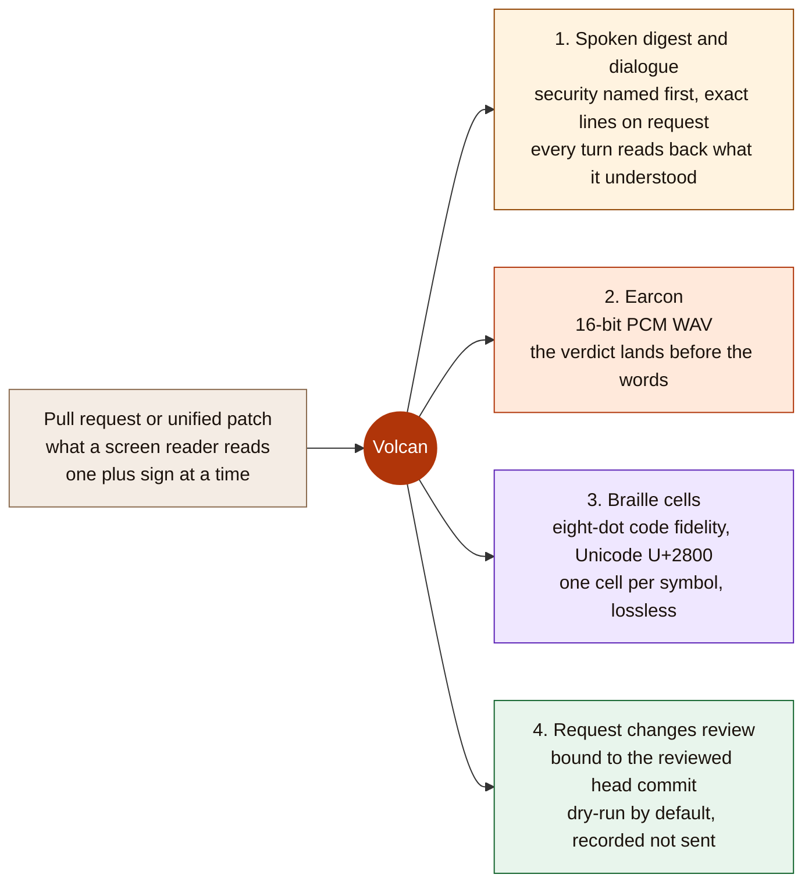
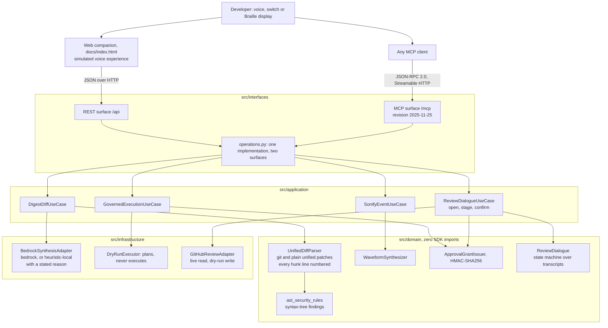
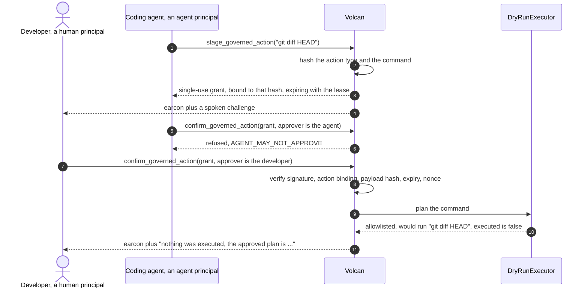

# Volcan

> **Volcan lets blind and mobility-impaired software developers review autonomous coding agents by ear and by touch instead of by reading a diff.**

![The companion page's first screen at 1280 by 720 in the basalt dark theme, as the UX harness captured it before any press: the headline "Hear your code review instead of scrubbing a diff", the disclosure "Simulated Alexa+ experience, not an Alexa skill" and "Live, except GitHub write: dry-run.", the patch whose changed lines turn user.role == "admin" into user.role != "admin", one ember "Hear this code review" button, and the server's real answer drawn silently beside it: the returned earcon's waveform in its not yet heard grey with a measured falling contour, the server's finding "In src/auth/permissions.py, an authorization comparison was inverted: user.role == 'admin' became user.role != 'admin'.", the Braille cells, and the line "Server's real answer, not played yet."](docs/assets/volcan-first-viewport.png)


*Both screenshots are unedited headless Chromium captures of `docs/index.html` served locally by the FastAPI app in `src/interfaces/mcp_server.py`, started without AWS credentials and without the `bedrock` extra. The first is the harness capture on load, whose preview request names the local engine; the second shows the real response to the press, so the engine reads local heuristic.*

[](https://opensource.org/licenses/MIT)
[](https://modelcontextprotocol.io)
[](https://www.python.org/)
[](tests/)

One pull request goes in. Three things a person can actually use come out, and one governed
action goes back.



The three renderings reach a Model Context Protocol client as text and `audio` content
blocks, and reach a browser through the companion page at [`docs/index.html`](docs/index.html).
The fourth is the journey the product exists for: a blind developer opens a real pull request
by URL (a live, unauthenticated GitHub read), converses about the change, hears the exact
numbered source lines, corrects a misheard command, and submits a `REQUEST_CHANGES` review
bound to the commit that was reviewed. That review is **dry-run by default**: the server
re-reads the head commit, records the exact request it would send, and sends nothing unless
its owner starts it with `VOLCAN_GITHUB_WRITE=1` and a `GITHUB_TOKEN`. The voice loop is the
browser's own speech recognition and synthesis with a typed twin for every command, and it is
labelled on the page as a simulated voice experience, not an Alexa skill.

---

## Quickstart

Four steps. Everything they print is checkable on your own machine.

### 1. Install and run the tests

```bash
git clone https://github.com/upgradedev/volcan_amazon.git
cd volcan_amazon
python -m pip install -e ".[dev,bedrock]"
python -m pytest tests/ -q
```

**Install the `bedrock` extra, which is in that command.** It pulls in `anthropic[bedrock]`,
the client that reaches Claude on Amazon Bedrock. With it installed and AWS credentials
resolvable, the digest in step 4 is sent to a Bedrock model, and the companion page reports
which engine answered: `Amazon Bedrock` when a model did, `local heuristic` when none did,
with the reason printed beside it either way. Without the extra the model call cannot even
be attempted, so the heuristic answers instead. An earlier quickstart installed the base
dependencies only, which made the fallback unavoidable even when AWS credentials resolved.

Credentials and an importable SDK only make the path ready to attempt. They do not prove a
model answered. The receipt is the response itself: `synthesis_mode: bedrock` with a null
fallback reason. Any provider failure returns a fixed public category; raw account, role and
request identifiers never enter the anonymous response.

### 2. Start the server

```bash
python -m src.interfaces.mcp_server
```

It binds `127.0.0.1:8000`. Port 8000 taken? `python -m src.interfaces.mcp_server --port 8743`
(or `VOLCAN_PORT=8743`) moves the server and its default MCP Origin allowlist together, so the
page it serves can still run the MCP handshake. Use the same port in the URLs below.

### 3. Prove the protocol before you trust the page

In a second terminal:

```bash
python scripts/mcp_conformance.py http://127.0.0.1:8000/mcp
```

### 4. Hear a code review

Open `http://127.0.0.1:8000/` and press **Hear this code review**, or press
<kbd>Alt</kbd>+<kbd>1</kbd> then <kbd>Enter</kbd> without touching a pointer. The button
posts the patch to the running server, plays the WAV the server synthesized, prints the
Braille cells, and reports the round trip it measured with `performance.now()`.

**The patch already in the box is the point of the product.** It inverts an authorization
comparison, and the words on both sides of that change are identical, so no keyword matcher
can see it. Volcan answers `an authorization comparison was inverted: user.role == 'admin'
became user.role != 'admin'` and sounds the falling `SECURITY_FINDING` cue. Three more chips
sit beside it: one per syntax-tree rule, plus a labelled clean control where the right answer
is no finding at all and the rising `DIFF_READY` cue. Every chip's label quotes the sentence
the server will produce, and
[`tests/e2e/test_shipped_presets_reach_their_rule.py`](tests/e2e/test_shipped_presets_reach_their_rule.py)
runs each shipped preset through the production parser and fails the build if a label and its
rule ever separate. Until 2026-09-08 they had: the first preset removed a hardcoded secret,
which is a security *improvement*, and the other two produced no finding at all, so the first
press showed the weakest output the product can give. All four were pressed against a running
server on 2026-09-08:

```
preset 1: cue=SECURITY_FINDING
   finding: In src/auth/permissions.py, an authorization comparison was inverted: user.role == 'admin' became user.role != 'admin'.
preset 2: cue=SECURITY_FINDING
   finding: In src/api/app.py, a cross-origin policy was widened to accept any origin: allow_origins = ['*'].
preset 3: cue=SECURITY_FINDING
   finding: In src/webhooks/receiver.py, the call verify_signature(payload, request.headers['X-Signature']) was removed and nothing replaced it.
preset 4: cue=DIFF_READY
   voice: Changes are mostly business logic. Modified 1 file with 3 additions and 1 deletion.
```

**Time to first result, measured on the development machine on 2026-09-08.** Step 1 reported
`421 passed, 1 warning in 5.00s` on the run that closed this round; the run before it, with
one more test still red, took 7.00 s, and earlier runs that day with a smaller suite took 8.77
s, 5.06 s, 5.22 s and 4.74 s, so the count is the claim here and the duration is not. The
server in step 2 answered its first `GET /health` with
HTTP 200 **1.4 seconds** after launch, printed by
[`scripts/measure_cold_start.py`](scripts/measure_cold_start.py). That script launches its
own server, so stop the one from step 2 before running it. It refuses to time a process that
was already warm, and says so rather than printing a figure it cannot stand behind. Step 3
printed
`21/21 checks passed, 0 failed`. The first digest round trip in step 4 was **39.0 ms** in
headless Chromium at 1440x900 on 2026-09-26, read from the page's own meter, with the server
started as in step 2 on port 8743 and no AWS credential file present; three further presses
of the same button on the same page read 30.2 ms, 28.8 ms and 31.9 ms. The first press is the
one quoted, because that is the press a judge makes. Earlier rounds published 117.2 ms
(2026-09-08) and 72.6 ms (2026-09-06). On a machine without AWS credentials those earlier
builds walked the whole boto3 credential chain, ending in a two-second instance-metadata
probe, on every request: a review on 2026-09-25 measured 2089.6 ms for the first press. The
server now resolves the chain once at startup and caches the answer. The page measures the
round trip itself with `performance.now()` on every run and takes no figure from this file. The `pip install` step depends on your network
and is not measured here.

### 5. Review a real pull request by voice or by keyboard

On the same page, scroll to **Talk through a real pull request**, or press
<kbd>Alt</kbd>+<kbd>6</kbd>, paste the URL of any public GitHub pull request, then press
<kbd>Alt</kbd>+<kbd>4</kbd> and type `open` <kbd>Enter</kbd>. The server reads the pull
request's head commit and diff from GitHub without a token, and the page reads back
`Understood: open the pull request.` before it speaks the overview. Then type, or say with
<kbd>Alt</kbd>+<kbd>5</kbd> where the browser has speech recognition:
`what changed in <file>`, `read the lines`, `next`, `no, I said previous`, `spell that`,
`request changes: <your comment>`, `confirm`. The last turn ends in one of three server
outcomes printed on the page: `recorded and not sent` (the default, with the exact request
shown), `submitted` (only when the server runs with `VOLCAN_GITHUB_WRITE=1` and a
`GITHUB_TOKEN`), or `refused` with the reason, `STALE_HEAD` when the pull request moved after
you reviewed it. Section [The review journey](#the-review-journey) has the whole grammar.

Requires Python 3.11 or newer. The repository is private until the submission window opens,
so `git clone` works for an account with access and otherwise starts from the submitted
archive.

---

## Table of Contents

1. [What is true and what is simulated](#what-is-true-and-what-is-simulated)
2. [The problem](#the-problem)
3. [What Volcan does](#what-volcan-does)
4. [Architecture](#architecture)
5. [Governed actions](#governed-actions)
6. [The MCP surface](#the-mcp-surface)
7. [The companion page](#the-companion-page)
8. [The review journey](#the-review-journey)
9. [Braille fidelity](#braille-fidelity)
10. [Measured numbers](#measured-numbers)
11. [Verify every claim yourself](#verify-every-claim-yourself)
12. [Known limitations](#known-limitations)
13. [Who would buy this, and out of which budget](#who-would-buy-this-and-out-of-which-budget)
14. [License](#license)

---

## What is true and what is simulated

Read this section before anything else. It is the honest boundary of the project.

**Real, and you can check it in one command.** Volcan ships a Model Context Protocol server
written by hand to revision **2025-11-25** over the **Streamable HTTP** transport: JSON-RPC
2.0 at `POST /mcp`, an SSE stream at `GET /mcp`, protocol version negotiation, optional
stateful sessions for a single-process host, a stateless public Lambda mode, a tool catalog
whose JSON Schemas are generated from the code that parses the arguments, and MCP audio
content blocks carrying the synthesized earcons.
`python scripts/mcp_conformance.py` runs a full client handshake against a running server
and prints a pass or fail line for each of its 22 conformance checks.

**Simulated, and labelled as such everywhere it appears, the page included.** The voice
experience is a web companion, not an Alexa skill. There is no Alexa skill package in this
repository, no skill has been submitted for certification, and nothing here has been tested on
an Echo device. The companion listens with the browser's `SpeechRecognition` API where the
browser has one (Chrome and Edge do, Firefox does not), speaks with `speechSynthesis`, keeps a
typed twin for every spoken command, and calls the same server an Alexa+ integration would
call. The label sits in the page header above the fold, in the paragraph with id `notASkill`,
and `tests/e2e/test_html_structure.py::test_the_first_screen_says_this_is_not_an_alexa_skill_and_names_the_simulation`
fails the build if the words `alexa`, `skill` and `simulat` leave the first screen. A review
round on 2026-09-08 found the page contained none of them while this file claimed it did;
that is why the test exists.

**Real read, dry-run write, and the page prints which.** Opening a pull request by URL is a
live, unauthenticated `GET` against `api.github.com` for its head commit and diff; it needs no
token for a public repository. Submitting the `REQUEST_CHANGES` review is a real external side
effect and ships behind a dry-run default: the server re-reads the head commit, refuses with
`STALE_HEAD` if it moved, and without `VOLCAN_GITHUB_WRITE=1` records the exact request it
would send, token redacted, and sends nothing. `/health` publishes the resolved
`github_review_path` so the page prints the server's conclusion rather than guessing. **No
live review has ever been sent from this repository**; the owner action that produces one is
under [Known limitations](#known-limitations). The live read has been exercised against a
real pull request: on 2026-09-08 the companion page opened
`https://github.com/python/cpython/pull/1`, printed
`Opened python/cpython pull request 1, Support "bpo-" in Misc/NEWS, by brettcannon, head
commit 02a87ce` with a round trip of 1223.2 ms measured by the page, walked its first hunk
line by line, and on `confirm` printed `Dry run. Nothing was sent to GitHub. The head commit
is still 02a87ce, and the exact request Volcan would send has been recorded.`

**Real code with a labelled fallback, and a stated reason.** The Amazon Bedrock adapter calls
Claude on Amazon Bedrock through the Anthropic SDK's `AnthropicBedrockMantle` client, pinned to
`anthropic.claude-opus-5`. When the call cannot be made or fails, the deterministic local path
runs instead. Every response carries `synthesis_mode`, which is `"bedrock"` when a model
answered and `"heuristic-local"` when none did, **and `synthesis_fallback_reason`, which says
why without returning the provider's raw payload**. The companion prints both beside the
synthesis meter. An unexplained fallback is indistinguishable from a design decision, while a
verbatim cloud error can expose account, role and request identifiers. Volcan returns a fixed
category for permission, unavailable-model, throttling, timeout and malformed-response cases.

The client uses the account-scoped Bedrock Mantle project. The checked-in infrastructure
defines that permission as a separate policy behind `enable_bedrock_mantle=false`; the
durable-state plan does not add model authority by default. Enabling it is a separate owner
decision. A deployment without the grant falls back with the bounded permission category.
`/health` reports readiness to attempt; only the digest's `synthesis_mode` reports whether
the model answered.

**Never executed.** Volcan plans shell commands against an allowlist and refuses the rest. It
does not run them. The claim covers the whole product, not one module: no file under `src/`
imports or calls `subprocess`, `os.system`, `eval`, `exec` or any process spawn, and
`tests/unit/test_no_execution_in_source_tree.py` walks every source module's AST on each run
to keep it that way.

---

## The problem

An autonomous coding agent produces a patch, and a sighted reviewer scans it in seconds. A
blind reviewer using a screen reader hears every plus sign, minus sign and hunk header as
literal characters. A 300 line patch becomes minutes of auditory scrubbing through syntax
before any comprehension begins, and a one line authentication change sits in the middle of
it sounding exactly like everything else.

A developer with a repetitive strain injury or limited hand mobility hits the same wall from
the other side: the review is not hard to understand, it is hard to navigate.

---

## What Volcan does

1. **Semantic diff digests.** Parses a unified patch and speaks it at three levels: an
   executive sentence, a file-by-file breakdown, then a line drill-down. Counts are
   pluralised, because a listener hears "1 files" and a reader skims past it.
2. **Security flags before comprehension.** Two deterministic passes run over every patch. A
   keyword pass flags authentication, cryptographic, database and process-execution
   vocabulary. A syntax-tree pass then compares the added and removed lines as parsed Python
   and reports what the change *did*: an authorization comparison inverted, a cross-origin
   policy widened to any origin, a verification call deleted and not replaced. The second pass
   exists because `user.role == "admin"` and `user.role != "admin"` contain identical words,
   so no keyword matcher can tell them apart. The digest speaks findings first, and names the
   change rather than the keyword that matched.
3. **Audio earcons as first-class results, and the cue carries the verdict.** A pure-Python
   PCM WAV synthesizer produces distinct cues, returned over MCP as `audio` content blocks
   so a client plays the sound instead of reading a description of it. A digest whose patch
   carries a security finding returns the falling two-note `SECURITY_FINDING` cue; one that
   does not returns the rising `DIFF_READY` cue, so the verdict reaches a listener before
   the sentence does. The two payloads are different bytes, and
   `tests/unit/test_earcon_encodes_the_verdict.py` prints and asserts the difference:

   ```
   $ python -m pytest tests/unit/test_earcon_encodes_the_verdict.py -q -s
   benign   | earcon DIFF_READY       | sha256[:16] 08f48648388bff02 | 19448 WAV bytes | 25932 base64 chars
   security | earcon SECURITY_FINDING | sha256[:16] 22c91bec11e275d1 | 26504 WAV bytes | 35340 base64 chars
   ```

   Each cue also carries a `spoken_fallback` string, so a Deaf or hard-of-hearing developer
   reads what a hearing one heard.
4. **Unicode Braille output at two fidelities, and the response says which.** Renders patches
   and commands as Braille patterns in the U+2800 block for a refreshable display, for quiet
   hours, open offices and deafblind developers. The default for a patch is eight-dot code
   fidelity, one cell per printable ASCII character, so `(`, `)` and `=` keep their own cells
   and the cells decode back to the exact source. Six-dot literary Braille is available for
   prose and is lossy for code; when it is used the response names the characters that
   collided in that patch. See [Braille fidelity](#braille-fidelity).
5. **Governed actions.** High-consequence commands are staged behind a single-use,
   content-bound authorization grant with a lease, and an agent cannot release its own
   proposal.
6. **Adaptive switch and haptic input.** Maps sip-and-puff, single-button and foot-pedal
   pulses to navigation actions, and builds vibration cadences with visual captions.
7. **A spoken review dialogue that ends in a governed GitHub action.** Open a pull request by
   URL, ask what changed in a file, hear the exact numbered source lines of a hunk, spell a
   line out symbol by symbol, correct a misheard command, and request changes. Every turn
   reads back what it understood before it acts, a new command interrupts the current speech,
   and `resume` restores the exact file, hunk, source line and revision. If the pull request
   changed while interrupted, Volcan refreshes it and explicitly invalidates the old approval.
   Sessions are bound to one reviewer. The review is bound to the head commit and dry-run
   unless the owner enables the write.
   See [The review journey](#the-review-journey).

---

## Architecture



---

## Governed actions



A grant is refused when its signature is altered, when it was minted for a different action,
when the command changed after it was issued, when the lease elapsed, and when it has already
been used once. Each of those refusals has its own test in
[`tests/unit/test_governance.py`](tests/unit/test_governance.py). The `REQUEST_CHANGES` review
in [The review journey](#the-review-journey) is the same mechanism with a real consequence
behind it: the payload hash covers the repository, the pull request number, the head SHA and
the SHA-256 of the comment, the staging principal is the dialogue and the approver is the
human who said `confirm`, and the audit record's `outcome` field says `SUBMITTED`, `DRY RUN
recorded, not sent` or `REFUSED <code>` in the executor's own words.

Every audit record is sealed with the hash of the record before it, so editing a stored
entry, deleting one or reordering two is **detected** and the verdict names the entry that
broke. It is tamper-evident, not tamper-proof: nothing here stops someone who can rewrite the
whole chain from re-sealing it end to end, because the head hash is not published anywhere
the writer cannot reach. `python -m pytest tests/unit/test_audit_chain.py -v` covers each
detection path.
In durable mode there is one chain per authenticated reviewer and repository, selected by a
hashed partition key. `/api/audit_log` requires a reviewer credential and derives the only
readable scopes from the server-side repository roster; it never accepts a caller-provided
scope or exposes a global audit listing.

---

## The MCP surface

Twelve tools, each with an `inputSchema` generated from the pydantic model that parses its
arguments, so the published schema cannot drift away from the code. What this surface returns
is the answer to "is it a wrapper around an existing API": `audio` content blocks carrying the
earcon that encodes the verdict, Braille cells with their fidelity and loss declared, a review
dialogue that reads back before it acts, and a review action that is governed by a single-use
grant, bound to a head commit, and dry-run by default. No GitHub or Bedrock API returns any of
those.

| Tool | What it returns |
|---|---|
| `digest_semantic_diff` | Spoken digest, the earcon that encodes the verdict as audio, and the parsed detail |
| `drill_down_section` | Symbol-level explanation of one file section, plus the earcon for that section |
| `stage_governed_action` | An action id, a payload hash, a dry-run plan and a single-use grant |
| `confirm_governed_action` | Release or a named refusal, plus the matching earcon |
| `play_earcon` | A 16-bit PCM WAV as an MCP `audio` content block |
| `voice_turn` | One conversational turn: summarize, stage, approve or reject |
| `review_dialogue_turn` | One turn of the spoken review: readback, answer, the earcon, and on `confirm` the review outcome, `submitted`, `recorded and not sent` or `refused` |
| `translate_text_to_braille` | Unicode Braille patterns, in eight-dot code fidelity or six-dot literary, with `lossless` and the collisions named |
| `braille_diff_digest` | A patch formatted with tactile add and remove markers, code fidelity by default, with its `disclosure` sentence |
| `process_switch_pulse` | The navigation action a switch pulse resolves to |
| `get_haptic_profile` | A vibration cadence and a visual caption |
| `check_ast_completeness` | Whether Python source parses, with node, function and class counts |

Protocol behaviour worth checking: in the default single-process mode `initialize` issues a
cryptographically random `Mcp-Session-Id`, and a session this server never minted is answered
HTTP 404. The public Lambda sets `VOLCAN_MCP_SESSION_MODE=stateless`, so it issues no session
header and request-contained calls do not depend on a process-specific MCP id. Both modes are
permitted by revision 2025-11-25 and the conformance runner detects which one answered. The
Terraform Lambda additionally sets `VOLCAN_STATE_TABLE`: review and voice sessions, pending
actions, spent nonces and scoped audit records then use one encrypted DynamoDB table shared by
every worker. Staging commits the session and action together; approval claims the action and
nonce together; finalization commits the terminal action and audit line together. Local runs
without that variable deliberately remain process-memory only. `/health` reports configuration
and successful reachability without publishing AWS resource identifiers, so transport
statelessness or configuration alone is never presented as state durability.

Durable voice turns also require the existing `VOLCAN_REVIEWERS` Bearer roster. The server
derives the owner and allowed `owner/repository` from that credential, ignores the JSON
`user_id` for ownership and gives each owner/repository/session an opaque action namespace.
This prevents caller-selected session or action ids from reading, approving or rejecting
another reviewer's staged action. Local process-memory demos retain the unauthenticated
simulated voice flow.
`MCP-Protocol-Version` is required on every request after initialize and is echoed on every
response; `notifications/initialized` returns HTTP 202 with no body; JSON-RPC error codes
`-32700`, `-32600`, `-32601` and `-32602` are all reachable; a failing tool is reported as
`isError` inside the result rather than as a transport failure; a browser `Origin` outside
the allowlist is rejected while an absent `Origin` is allowed so non-browser clients work;
and `PUT /mcp` returns 405 with an `Allow` header.

**On the version header, two things a reviewer should know.**

*It is refused, not assumed.* The transport specification permits a server that receives no
`MCP-Protocol-Version` header to fall back to assuming the older `2025-03-26` revision. This
server refuses instead, because assuming lets a client and a server disagree about the
revision they are speaking while both believe the handshake succeeded, and that disagreement
surfaces later and somewhere else. It is a deliberate deviation and this is where it is
written down. `POST` answers `-32600` inside a JSON-RPC envelope; `GET` and `DELETE` carry no
envelope, so they answer HTTP 400 with the same sentence.

*A review round reported that a `tools/list` carrying a valid session but no version header
returned HTTP 200 with an empty tools array.* **That did not reproduce here.** It was re-run on
2026-09-08 against a server started for the purpose, and both the session-present and
session-absent requests were refused identically:

```
tools/list  session YES, version header NO -> 200 {"jsonrpc":"2.0","id":2,"error":{"code":-32600,"message":"Missing MCP-Protocol-Version header; it is required on every request after initialize.","data":{"expected":"2025-11-25"}}}
tools/list  session NO,  version header NO -> 200 {"jsonrpc":"2.0","id":3,"error":{"code":-32600,"message":"Missing MCP-Protocol-Version header; it is required on every request after initialize.","data":{"expected":"2025-11-25"}}}
tools/list  session YES, version header YES -> 200 tools: 12
```

`tests/integration/test_mcp_conformance.py::test_a_valid_session_never_excuses_a_missing_protocol_version`
now pins both halves and additionally asserts that no `result` member is present, because the
dangerous shape of that failure is not an error but a plausible-looking answer.
`test_the_version_rule_runs_before_dispatch_for_every_post_initialize_method` extends the same
assertion to `tools/call`, `ping`, `resources/list` and an unknown method, with and without a
valid session: each is refused `-32600` for the missing header and never reaches the `-32601`
that would tell a client the header was fine. What the same
investigation *did* find is that `GET /mcp` and `DELETE /mcp` accepted a request with no
version header at all: the stream opened with HTTP 200 and the session terminated with HTTP
204. The README already claimed the header was required on every request, and two verbs were
not keeping that promise. All three verbs now enforce one rule from one function, and the
conformance script checks each of them.

The REST surface at `/api` is ordinary JSON over HTTP for the web companion. It is not MCP
and is not described as MCP anywhere in this repository.

---

## The companion page

[`docs/index.html`](docs/index.html) is the only companion document here. FastAPI serves the
same bytes at `/` and `/demo`, so the page cannot disagree with itself.

Four rules the page keeps, each enforced by
[`tests/e2e/test_html_structure.py`](tests/e2e/test_html_structure.py):

* **Every value on it came out of an HTTP response in that session.** There is no second
  implementation of the product in JavaScript to fall back on, so the page cannot show a
  digest, a Braille cell or a waveform that the server did not produce. The waveform is
  drawn from the returned WAV's own 16-bit samples.
* **Every duration was measured with `performance.now()`** around the request that produced
  it. `test_latency_is_measured_and_never_typed` fails the build on any latency literal in
  the file.
* **Nothing is written with `innerHTML`.** Server text is inserted through `textContent`.
* **An unreachable server is stated, not papered over.** The page prints the command that
  starts one, and distinguishes "no server answered" from "the server answered and the call
  still failed", because those need different next steps.

A fifth rule joined them on 2026-09-08: **the preset chips have to reach the rules the page
exists to demonstrate.** Four chips ship, three of them one per syntax-tree rule and the
fourth a labelled clean control, and each chip's `title` quotes the sentence the server will
say back.
[`tests/e2e/test_shipped_presets_reach_their_rule.py`](tests/e2e/test_shipped_presets_reach_their_rule.py)
lifts the patches straight out of the page, runs them through the production parser, and fails
if a chip promises a sentence the server no longer produces, if the control stops being
silent, or if a rule is added to `src/domain/ast_security_rules.py` with no preset to show it.
That last one works by reading the rule ids out of the module's own syntax tree rather than
from a list kept by hand here.

The **Run a real MCP handshake** button performs `initialize`, `notifications/initialized`
and `tools/list` against `POST /mcp` in the browser, then renders the negotiated protocol
version, whether the server chose a stateful id or stateless mode, and each published
`inputSchema`.

Accessibility is enforced rather than asserted. The page has semantic landmarks, a labelled
and keyboard-scrollable Braille region, and one announcement per press: a single polite status
line gives the round trip and hands over to the speech engine, which reads the answer finding
first, and only a browser with no speech engine gets the whole answer in the status line
instead. Until 2026-09-26 one press wrote the same sentence to four live regions and the
speech engine then read it again over the screen reader; `tests/e2e/first_screen_runner.py`
now counts the regions a press writes to and fails on more than one. The silent preview drawn
on load sits outside every live region, so opening the page announces nothing. The skip link
lands focus inside `main`. There is a 3px focus ring in both colour schemes, a written
description of every audio cue taken from the server's own `spoken_fallback`, and no control
that ships disabled. `prefers-reduced-motion` removes every animation and the smooth scroll;
`prefers-color-scheme` selects a designed light or dark palette. The page requests nothing
from another origin. Its typefaces, Atkinson Hyperlegible (drawn by the Braille Institute for
readers with low vision) and JetBrains Mono, are the latin woff2 files in
[`docs/fonts`](docs/fonts) with their SIL Open Font License texts, inlined into the page by
`scripts/embed_fonts.py`, so GitHub Pages, the FastAPI route and the container all ship them
inside the one HTML file. Every face keeps `font-display: swap` and every font stack ends in
local faces. `tests/e2e/test_first_screen.py` loads the page with every request to another
origin aborted and requires both families loaded and no console error.

The first screen is one stage. The patch is drawn as its changed lines beside a single
primary action, and when the Volcan app serves the page, the three channels already hold the
server's real answer for that patch as it opens, drawn silently; opened with no server behind
it, the channels stay empty until a server answers. The page asks for that answer with `engine: local`, so a
page view never starts a model call, and nothing plays, speaks or writes into a live region
until the press; `tests/e2e/test_first_screen.py` counts all three and requires zero. The
earcon's waveform is drawn from the returned samples, grey until it has been heard, with a
pitch contour measured from those samples, and after the press a playhead follows the audio
element's own clock. The spoken sentence opens with the server's finding (for the preset, the inverted
authorization comparison), with the counts one **Show all** away, and after the press its words brighten only when the browser's speech engine
reports reaching them. The Braille is drawn as large dot cells from the server's own Unicode
code points, with the cell that differs between the removed and the added line marked. A line
under the sentence says it is the server's real answer, not played yet, and an info button
beside it names the engine and why, and says the button asks the server's default engine:
Amazon Bedrock when AWS credentials resolve and `anthropic[bedrock]` is installed, the local
heuristic otherwise. Code is set with ligatures off, so `!=` can never be drawn
as a single glyph. Every proof panel below the story sits in an **Evidence** tab set, and `?`
opens the keyboard map from anywhere outside a text box.

The **Talk through a real pull request** section is the page's half of the review journey below.
It has a microphone button that uses `window.SpeechRecognition` where the browser exposes one
and says so when it does not, a typed command box that always works, one button per common
command so nothing depends on being heard, a dialogue log that shows what was heard, what was
understood and what was answered, and a review panel that prints the server's outcome word for
word. Seven more assertions in `tests/e2e/test_html_structure.py` pin that contract: the
typed path exists, a new command calls `stopAudio()` before it posts, the readback is logged
and spoken before the answer at the `speech_rate` the server returned, every state change
lands in an `aria-live` region, a dry run is printed as `recorded and not sent` and never as a
send, the page never handles a token, and the keyboard map covers the dialogue.

---

## The review journey

The state machine lives on the server, in
[`src/domain/review_dialogue.py`](src/domain/review_dialogue.py), one instance per session,
driven by transcripts. That is deliberate: the browser's `SpeechRecognition` API cannot be
driven headlessly, so the page is only ears and mouth, and everything the dialogue does is
proven by injecting the text a microphone would have produced.
[`tests/unit/test_review_dialogue.py`](tests/unit/test_review_dialogue.py) drives the machine
directly, [`tests/unit/test_review_dialogue_use_case.py`](tests/unit/test_review_dialogue_use_case.py)
adds the grant and the GitHub port, and
[`tests/integration/test_review_dialogue_api.py`](tests/integration/test_review_dialogue_api.py)
runs the whole journey over `POST /api/review/turn` and over the MCP tool
`review_dialogue_turn` against a scripted GitHub. None of them proves a microphone heard
anything, and this file does not claim one did; the browser run recorded under
[What is true and what is simulated](#what-is-true-and-what-is-simulated) used the typed path.

**Three promises the machine keeps, each with a test.**

* **It reads back before it acts.** Every answer begins `Understood: <command>.` or
  `Corrected, <command>.`; an unrecognised transcript answers
  `I heard '<text>' and did not recognise a command.` and changes nothing.
* **A correction undoes the misheard command, then applies the meant one.** `no, I said
  previous` after a misheard `next` returns to where you were and then goes back one, and a
  speech-rate change is never undone by a correction, because `slower` is a preference and not
  a navigation.
* **Nothing is submitted by the machine.** `request changes` stages a review, reads back the
  comment and the head commit, and waits. `confirm` presents a single-use HMAC grant bound to
  the pull request, its head SHA and the SHA-256 of the comment; the server then re-reads the
  live head and either records, sends, or refuses.

**What you can say, or type.** File names may be spoken with "dot" (`auth dot py`), numbers
as words (`line one hundred and twelve`), and every command has the same effect typed.

| Say | What happens | State after |
|---|---|---|
| `open the pull request`, `open <url>`, `open the patch` | Live GitHub read of the head SHA and diff, or the pasted patch | `OVERVIEW` |
| `summary`, `file by file`, `findings` | The digest, every file with its counts, or the security findings | `OVERVIEW` |
| `what changed in auth.py`, `file 2`, `next`, `previous` | Focus a file by name or number and hear its category, finding and first hunk | `FILE` |
| `read the lines` | The exact numbered source lines of the current hunk, 20 per breath, `next` to continue | `LINES` |
| `next line`, `previous line`, `line 14`, `next hunk` | Move within the hunk, or jump to a line number on the new side of the file | `LINES` |
| `spell that` | Every symbol of the current line named, so `!=` is heard as `bang, equals` | `LINES` |
| `repeat`, `slower`, `faster`, `stop`, `where am I`, `help`, `undo` | Say it again, change the rate by 0.15 within 0.5 to 1.6, silence, orientation, the command list, one step back | unchanged |
| `no, I said <command>`, `I meant <command>`, `correction: <command>` | Undo the last navigation and apply the one meant | as the command |
| `request changes: <comment>` | Stage a `REQUEST_CHANGES` review bound to the head commit; a grant is issued | `CONFIRM_REVIEW` |
| `confirm` | Present the grant; the server re-reads the head and records, sends or refuses | `RECORDED`, `SUBMITTED` or `REFUSED` |
| `cancel` | Drop the staged review; nothing was sent | back to where you were |

**Keyboard map on the page.** <kbd>Alt</kbd>+<kbd>6</kbd> focuses the pull request URL box,
<kbd>Alt</kbd>+<kbd>4</kbd> the command box where <kbd>Enter</kbd> sends, <kbd>Alt</kbd>+<kbd>5</kbd>
starts or stops listening, <kbd>Escape</kbd> interrupts the speech, the earcon and the
microphone, and every command chip is a real button in the tab order.

**What is live and what is dry-run, per step.**

| Step | Live | Dry-run or simulated |
|---|---|---|
| Hearing the command | `SpeechRecognition` in Chrome and Edge; the typed box everywhere | The microphone is the browser's, not a device's |
| Opening the pull request | `GET https://api.github.com/repos/<o>/<r>/pulls/<n>` twice, JSON then diff, no token needed for a public repository | nothing |
| The dialogue itself | The server's state machine, the digest, the earcons, the Braille | Speech output is the browser's `speechSynthesis` |
| Staging the review | A real HMAC-SHA256 grant with a 300 second lease, sealed in the audit chain on confirm | nothing |
| Confirming the review | The head SHA is re-read live and a moved head is refused with `STALE_HEAD` | Live writes also require a configured reviewer credential, session ownership and repository authorization; the default records and sends nothing |

The GitHub adapter uses two environment variables, read once at start-up by
[`src/infrastructure/github_review_adapter.py`](src/infrastructure/github_review_adapter.py):
`GITHUB_TOKEN`, a fine-grained token with `pull_requests: write` on the one repository to be
reviewed, and `VOLCAN_GITHUB_WRITE`, which enables the send only when it is exactly `1`. With
the flag and no token the server refuses with `NO_TOKEN` rather than sending unauthenticated;
with a token that lacks the permission GitHub answers 401, 403 or 404 and the server reports
`UNAUTHORIZED`, naming the permission. `/health` publishes the conjunction of the two facts as
`github_review_path.resolved_capability`, one of `dry_run_no_token`, `dry_run_with_token`,
`live_write_requested_but_no_token` and `live_write_enabled`, and never the token value.
Measured on the development machine on 2026-09-08 with neither variable set:

Live mode also requires `VOLCAN_REVIEWERS`, a server-only JSON roster, for example
`{"alice":{"token":"<generate-a-random-secret-of-at-least-32-characters>","repositories":["owner/repo"]}}`.
Use a distinct random credential per human, keep the GitHub token on the server, and use
HTTPS outside loopback. Send `Authorization: Bearer <reviewer-token>` on every durable voice
or REST review turn, and every MCP request calling `voice_turn` or `review_dialogue_turn`.
The companion has a password field
for this reviewer credential; it is not saved in browser storage. Reload before changing
reviewer. The server derives the approver from the roster and ignores JSON `user_id`
as authority. A durable voice session, dialogue session and grant are bound to that identity;
another identity,
an anonymous request, a grant from another session, or a repository outside the exact
allowlist cannot release the review. Repository matching is case-insensitive; wildcards,
missing/invalid rosters and duplicate credentials fail closed. Credential removal takes
effect on the next request. Start a new session after switching between dry-run and live mode.
The GitHub adapter's live capability describes its token/flag only; reviewer authorization is
an additional mandatory boundary, including at its write method. Health, other read tools and
the default dry-run demo remain public. No real GitHub write has been used to validate this fix.

```json
"github_review_path": {
  "resolved_capability": "dry_run_no_token",
  "detail": "Neither VOLCAN_GITHUB_WRITE nor GITHUB_TOKEN is set, so a confirmed review is recorded and not sent, and public pull requests are read unauthenticated.",
  "write_enabled": false,
  "token_present": false,
  "api": "https://api.github.com"
}
```

---

## Braille fidelity

Until 2026-09-08 the Braille output was a single six-dot table, and it lost code-symbol
distinctions without saying so: `(`, `)` and `=` all landed on dots 2-3-5-6, `]` shared a cell
with `w`, `"` with `>`, `'` with `@`, and `_` was indistinguishable from the capital prefix. A
finger reading `user.role != "admin"` in that table could not tell it from
`user.role != >admin>`. Two fidelities now exist, and every response says which one produced
the cells and whether it was lossless:

* **`code`, the default for a patch.** Eight-dot computer Braille: each of the 95 printable
  ASCII characters has its own cell, so the translation is one to one and `braille_to_text`
  reverses it exactly. The table is the North American Braille ASCII six-dot layout for the 64
  characters from space to underscore, with dot 7 added to mark a capital letter and to
  separate `@ [ \ ] ^` from their lower-range partners `` ` { | } ~ ``, which is the convention
  of North American computer Braille. A character outside the table (a Greek identifier, say)
  is rendered as the full eight-dot cell and named in the response, never blanked. A tab
  becomes four blank cells and the response says so. **This table has not been reviewed by a
  Braille transcriber.** What is proven is the property that matters for code, the round trip:
  `tests/unit/test_braille_code_fidelity.py` asserts that all 95 characters map to distinct
  cells and decode back to themselves.
* **`literary`.** Six-dot cells with a capital prefix (dot 6) and a number prefix (dots
  3-4-5-6), the shape of uncontracted English Braille, right for prose and lossy for code.
  When it is used, `lossless` is `false` and `collisions` names, for that patch only, the
  characters that became indistinguishable, so the reader learns the loss in the text they are
  about to read rather than a loss in general. Contracted Grade 2 is not implemented.

The page requests `code` by default and offers both as buttons; the caption beside the cells
prints the server's `fidelity`, `lossless` and `disclosure` fields verbatim. Which symbol lands
on which cell in code fidelity, printed by `code_fidelity_table()` and pinned by
`test_the_readme_prints_the_table_the_code_uses`, which fails the build if this block and the
module disagree (dot numbers, then the Unicode cell):

<!-- braille-code-table -->
```
' '    dots blank     ⠀
'!'    dots 2346      ⠮
'"'    dots 5         ⠐
'#'    dots 3456      ⠼
'$'    dots 1246      ⠫
'%'    dots 146       ⠩
'&'    dots 12346     ⠯
"'"    dots 3         ⠄
'('    dots 12356     ⠷
')'    dots 23456     ⠾
'*'    dots 16        ⠡
'+'    dots 346       ⠬
','    dots 6         ⠠
'-'    dots 36        ⠤
'.'    dots 46        ⠨
'/'    dots 34        ⠌
'0'    dots 356       ⠴
'1'    dots 2         ⠂
'2'    dots 23        ⠆
'3'    dots 25        ⠒
'4'    dots 256       ⠲
'5'    dots 26        ⠢
'6'    dots 235       ⠖
'7'    dots 2356      ⠶
'8'    dots 236       ⠦
'9'    dots 35        ⠔
':'    dots 156       ⠱
';'    dots 56        ⠰
'<'    dots 126       ⠣
'='    dots 123456    ⠿
'>'    dots 345       ⠜
'?'    dots 1456      ⠹
'@'    dots 47        ⡈
'A'    dots 17        ⡁
'B'    dots 127       ⡃
'C'    dots 147       ⡉
'D'    dots 1457      ⡙
'E'    dots 157       ⡑
'F'    dots 1247      ⡋
'G'    dots 12457     ⡛
'H'    dots 1257      ⡓
'I'    dots 247       ⡊
'J'    dots 2457      ⡚
'K'    dots 137       ⡅
'L'    dots 1237      ⡇
'M'    dots 1347      ⡍
'N'    dots 13457     ⡝
'O'    dots 1357      ⡕
'P'    dots 12347     ⡏
'Q'    dots 123457    ⡟
'R'    dots 12357     ⡗
'S'    dots 2347      ⡎
'T'    dots 23457     ⡞
'U'    dots 1367      ⡥
'V'    dots 12367     ⡧
'W'    dots 24567     ⡺
'X'    dots 13467     ⡭
'Y'    dots 134567    ⡽
'Z'    dots 13567     ⡵
'['    dots 2467      ⡪
'\\'   dots 12567     ⡳
']'    dots 124567    ⡻
'^'    dots 457       ⡘
'_'    dots 456       ⠸
'`'    dots 4         ⠈
'a'    dots 1         ⠁
'b'    dots 12        ⠃
'c'    dots 14        ⠉
'd'    dots 145       ⠙
'e'    dots 15        ⠑
'f'    dots 124       ⠋
'g'    dots 1245      ⠛
'h'    dots 125       ⠓
'i'    dots 24        ⠊
'j'    dots 245       ⠚
'k'    dots 13        ⠅
'l'    dots 123       ⠇
'm'    dots 134       ⠍
'n'    dots 1345      ⠝
'o'    dots 135       ⠕
'p'    dots 1234      ⠏
'q'    dots 12345     ⠟
'r'    dots 1235      ⠗
's'    dots 234       ⠎
't'    dots 2345      ⠞
'u'    dots 136       ⠥
'v'    dots 1236      ⠧
'w'    dots 2456      ⠺
'x'    dots 1346      ⠭
'y'    dots 13456     ⠽
'z'    dots 1356      ⠵
'{'    dots 246       ⠪
'|'    dots 1256      ⠳
'}'    dots 12456     ⠻
'~'    dots 45        ⠘
```

---

## Measured numbers

Every number below was printed by the command beside it (the engine and request-latency
figures were refreshed on 2026-09-23), on the development
machine recorded in [`benchmarks_summary.json`](benchmarks_summary.json). Nothing here is an
estimate unless it says ESTIMATE.

| Metric | Baseline | Volcan | Command that prints it |
|---|---|---|---|
| Security-flag detection | 0% recall, because a screen reader reading a raw patch surfaces no security categorisation at all | **81.8% recall over n=40 labelled patches**, 22 that must flag and 18 that must not, with 0% false positives | `python scripts/benchmark_suite.py` |
| Digest earcon, benign patch vs security-sensitive patch | **byte-identical until 2026-09-08**: both returned `DIFF_READY`, 19448 WAV bytes, `sha256[:16] 08f48648388bff02` | 19448 bytes `08f48648388bff02` for the benign patch, 26504 bytes `22c91bec11e275d1` for the security-sensitive one | `python -m pytest tests/unit/test_earcon_encodes_the_verdict.py -q -s` |
| Patch parse latency, 1000 steady runs | not measured | mean 0.281 ms; p95 0.448 ms | `python scripts/benchmark_suite.py` |
| Earcon synthesis latency, 1000 steady runs | not measured | mean 3.592 ms; p95 6.565 ms | `python scripts/benchmark_suite.py` |
| `/health` in-process request latency | not measured | first request 423.502 ms; after 5 warmups, p95 44.515 ms over 100 requests | `python scripts/measure_request_latency.py` |
| MCP protocol conformance | not applicable | **22 of 22 conformance checks pass** | `python scripts/mcp_conformance.py http://127.0.0.1:8000/mcp` |
| Tools advertised by `tools/list` | not applicable | 12 | `python scripts/mcp_conformance.py http://127.0.0.1:8000/mcp` |
| Automated tests | not applicable | 515 passing; 91.26% statement coverage, including a real Chromium judge journey and Lambda bridge, 2026-09-24 | `python -m pytest tests/ -q --cov=src --cov-fail-under=85` |
| Cold start to the first HTTP 200 on `/health` | not applicable | 1.4 s | `python scripts/measure_cold_start.py` |
| First digest round trip, browser to server and back | not applicable | 39.0 ms on the first press, then 30.2, 28.8 and 31.9 ms, headless Chromium at 1440x900 on 2026-09-26, no AWS credential file | the page measures and prints this itself on every run |
| Live GitHub read of a public pull request, browser to server to `api.github.com` and back | not applicable | 1223.2 ms for `python/cpython#1` on 2026-09-08, then 63.2, 59.3, 62.5 and 54.1 ms for the four dialogue turns that followed and touched no network | the page's dialogue log prints each turn's round trip beside the answer |
| Braille characters that share a cell in code fidelity | 5 collision groups in the six-dot table covering `( ) =`, `] w`, `" >`, `' @` and `_` with the capital prefix | 0 of 95 printable ASCII characters | `python -m pytest tests/unit/test_braille_code_fidelity.py -v` |

The cold start figure comes from
[`scripts/measure_cold_start.py`](scripts/measure_cold_start.py), which launches the server as
a child process, polls `/health` until it answers 200, prints the elapsed seconds and stops
the child again. Stop any server already on port 8000 first, or the script refuses to time a
process that was already warm.

**The detection corpus is written by the same people who wrote the parser.** It is 40
hand-labelled patches in [`tests/fixtures/diff_corpus.py`](tests/fixtures/diff_corpus.py),
each carrying an explicit `expect_security_flag`. It measures behaviour on those fixtures and
is not a claim about any real repository, and a figure measured over fixtures its own author
chose is worth less than one measured over somebody else's. Read the number with that in mind.

Two things push back on it. Six of the positives were written to defeat the keyword matcher
rather than to flatter it, including the three regressions an end-customer review found in the
field: an authorization comparison inverted to `!= "admin"`, CORS origins widened to `["*"]`,
and a signature-verification call deleted. Six negatives were written to tempt the rules those
positives forced into existence, among them the same CORS line narrowed rather than widened,
and a removed `verify_email_format` call that a cruder rule would flag.

And four positives are in the corpus precisely because nothing here detects them. They are why
recall is 81.8% and not a round hundred:

| Missed | What it is | Why it is missed |
|---|---|---|
| `pos-19` | an authorization guard block deleted | no rule reads deleted blocks, only deleted calls |
| `pos-20` | a permission decorator removed | a bare decorator line is not parseable Python on its own |
| `pos-21` | `verify=False` added to an outbound call | no rule inspects argument values |
| `pos-22` | an IAM policy widened in JSON | the syntax-tree rules are Python only |

[`tests/unit/test_security_detection_corpus.py`](tests/unit/test_security_detection_corpus.py)
recomputes the published figures and pins that list by fixture id, so a new miss fails the
build and closing one of these means deleting its id from the list.

The engine latency figures are the single run recorded in `benchmarks_summary.json`, not a stable
constant. The parse mean rose from 0.041 ms to a fraction of a millisecond when the
syntax-tree pass was added, which is the honest cost of parsing every changed line rather than
scanning it. Every benchmark record now publishes all raw samples and names its percentile
definition: linear interpolation at index `(n - 1) * q`. The request benchmark records the
first request separately, performs five warmups, and applies the 300 ms gate only to the p95
of 100 steady-state requests. Its committed evidence is `request_latency_summary.json`; CI
reruns it and uploads the new raw-sample artifact for the exact commit. Process cold start
remains a separate measurement from `scripts/measure_cold_start.py`. Treat the order of
magnitude as the claim and rerun each command on your own hardware.

---

## Verify every claim yourself

| Claim | Command |
|---|---|
| The MCP server speaks the protocol | `python scripts/mcp_conformance.py http://127.0.0.1:8000/mcp` |
| The tests pass, and how many | `python -m pytest tests/ -q` |
| The benchmark numbers above | `python scripts/benchmark_suite.py` |
| Every readiness gate, including the failing ones | `python ci/readiness.py` |
| Forged and replayed grants are refused | `python -m pytest tests/unit/test_governance.py -v` |
| The security rules catch an inverted check, and refuse a lookalike | `python -m pytest tests/unit/test_ast_security_rules.py -v` |
| A plain `diff -u` patch is named, not called unknown_file | `python -m pytest tests/unit/test_plain_unified_diff.py -v` |
| A fallback from Amazon Bedrock states its reason | `python -m pytest tests/unit/test_bedrock_synthesis_path.py -v` |
| The quickstart installs the model path, and still refuses to claim it answered | `python -m pytest tests/unit/test_quickstart_reaches_the_model_path.py -v` |
| The earcon differs between a benign and a security-sensitive patch | `python -m pytest tests/unit/test_earcon_encodes_the_verdict.py -q -s` |
| Nothing executes a shell command | `python -m pytest tests/unit/test_dry_run_executor.py -v` |
| Injection payloads and grant attacks are refused | `python scripts/security_audit.py` |
| An edited audit record is detected | `python -m pytest tests/unit/test_audit_chain.py -v` |
| The whole product in one terminal walkthrough | `python scripts/volcan_cli.py` |
| How long a cold server takes to answer | `python scripts/measure_cold_start.py` |
| The companion page keeps its four rules and is keyboard reachable | `python -m pytest tests/e2e -v` |
| The review dialogue reads back, corrects, spells and stages, driven by injected transcripts | `python -m pytest tests/unit/test_review_dialogue.py -v` |
| A moved head, a missing grant, a self-approval and an unauthorized token are each refused | `python -m pytest tests/unit/test_review_dialogue_use_case.py tests/unit/test_github_review_adapter.py -v` |
| The whole journey over REST and MCP ends in a recorded, not sent, review | `python -m pytest tests/integration/test_review_dialogue_api.py -v` |
| Code-fidelity Braille is one to one over 95 characters and literary names its losses | `python -m pytest tests/unit/test_braille_code_fidelity.py -v` |
| A missing version header is refused for every method, session or not | `python -m pytest tests/integration/test_mcp_conformance.py -k version -v` |

`ci/readiness.py` is written so that it can fail, and it does. On 2026-09-23 it printed
`42/53 passed, 0 blocking failures, 11 externally blocked`. The remaining red gates require
the final deployment receipt, video, persona evidence or owner submission actions. Each
failure is printed with its reason rather than hidden.

Four of those gates read the persona review
out of `STATE.md`, a coordination file that lives one directory above this repository and is
deliberately never committed. From a standalone clone or a CI runner there is no copy to read,
so gates I1 to I4 report themselves externally blocked with that reason and the script still
exits 0. The excuse is narrow. If
`STATE.md` is present and does not record the review, those four gates fail as blocking and the
script exits 1.

To satisfy yourself that the script is capable of failing rather than decorative, change the
test count in the README badge from 443 to 444 and run it again. Gate G1 turns red under
`FAILED, BLOCKING`, the summary reads `1 blocking failures`, and the process exits 1.

---

## Operational telemetry

MCP tool calls emit the measured `McpToolDurationMs` as a JSON message through the
`volcan-voice-ide` Python logger. The payload follows the
[CloudWatch EMF specification](https://docs.aws.amazon.com/AmazonCloudWatch/latest/monitoring/CloudWatch_Embedded_Metric_Format_Specification.html).
Local tests capture the real MCP request path. On 2026-09-23 the public deployment emitted
`stage_governed_action` and `confirm_governed_action` records to the `Volcan/VoiceIDE`
namespace; CloudWatch listed both `McpToolDurationMs` and `TotalExecutionLatencyMs` with
`Environment=production-eu-west-1`. Reproduce the readback with
`aws logs tail /aws/lambda/volcan-mcp-euw1-prod --since 15m` and
`aws cloudwatch list-metrics --namespace Volcan/VoiceIDE --recently-active PT3H`.

| Field | Accepted values |
|---|---|
| Metrics | `McpToolDurationMs`, `ASTParseDurationMs` in milliseconds; `BrailleStreamChunks` in counts. Finite, nonnegative numeric values only, within declared bounds. |
| Harness timing | `TotalExecutionLatencyMs` measures the telemetry harness lifetime, not the whole MCP request. |
| Dimensions | Fixed `ServiceName`; `Environment` limited to `local`, `test`, `staging`, `production-eu-west-1`, otherwise `unknown`. Set `VOLCAN_ENVIRONMENT` explicitly for a deployment. |
| Correlation | A new local UUID; caller-provided request IDs are deliberately ignored. It is not a metric dimension. |
| Event details | Finite actor/action/tool labels and numeric `duration_ms`; other content, tenant identities and nested values are discarded. |

Email, phone, token, secret, actor or tenant text need not match a regular expression: arbitrary
text is never an accepted log field. The legacy `mask_pii` method conservatively removes its
entire argument. This is a deliberately limited operational schema, not a general text
redactor or an identity audit trail. Code review content is still returned to the requesting
user and may contain their secrets.

This harness does not guarantee zero cost, data residency,
retention, deletion or privacy of other application/SDK logs. CloudWatch logs and custom
metrics can incur charges. The deployment proof verifies ingestion and readback for the two
named governed-action calls only.

## Known limitations

* **No Alexa skill.** No skill package is submitted, no certification has been sought, and
  nothing has been tested on an Echo device. The Alexa+ claim is the MCP server plus a web
  companion that simulates the voice experience and says so on screen, in the header paragraph
  with id `notASkill`, which a test now holds in place.
* **No live GitHub review has been sent from this repository.** The write path in
  [`src/infrastructure/github_review_adapter.py`](src/infrastructure/github_review_adapter.py)
  is real code, shape-tested against `httpx.MockTransport` for the accepted review, the stale
  head, the missing token, the unauthorized token and the unreachable host, and it has never
  been run with the flag set against real GitHub. Authenticated live-mode tests use a mock
  transport only. Every real GitHub interaction so far was read-only. The owner
  can produce a live receipt against a repository they own, in one terminal, and nothing else
  in this repository needs to change for it:

  ```bash
  export GITHUB_TOKEN=<fine-grained token, pull_requests: write on that one repository>
  export VOLCAN_GITHUB_WRITE=1
  export VOLCAN_REVIEWERS='{"alice":{"token":"<replace-with-a-random-secret-at-least-32-characters>","repositories":["owner/repo"]}}'
  python -m src.interfaces.mcp_server &
  curl -s http://127.0.0.1:8000/health | python -c "import json,sys; print(json.load(sys.stdin)['github_review_path']['resolved_capability'])"   # expect live_write_enabled
  ```

  Replace the roster placeholders before starting. Open `http://127.0.0.1:8000/`, enter the
  same reviewer secret in the reviewer access field, paste the pull request URL, type `open`, `request
  changes: <comment>`, `confirm`. The receipt is the review panel reading `submitted to GitHub,
  review id <n>` and the review appearing on the pull request under the token's account, bound
  to the head commit shown. A token without the permission produces `refused, UNAUTHORIZED`
  instead, and that is also a receipt: it proves the refusal path against real GitHub.
* **Speech recognition depends on the browser and is not tested by a machine.** Chrome and
  Edge expose `SpeechRecognition`; Firefox does not, and the page says so when the microphone
  button is pressed there. No test here drives a microphone: the dialogue is proven with
  injected transcripts, the page's typed path is what the recorded browser run used, and a
  real spoken run is the owner's to make. The recogniser's accuracy is the browser vendor's,
  which is exactly why every answer reads back what was understood before acting.
* **Browser automation does not replace assistive-technology testing.** Playwright drives the
  primary digest, MCP handshake, earcon and Braille journey against a fresh server in CI. It
  does not drive a real microphone, screen reader or refreshable Braille display. Those remain
  part of the target-user proof below.
* **The model-backed path still degrades safely.** The client call in
  [`src/infrastructure/bedrock_adapter.py`](src/infrastructure/bedrock_adapter.py) is real
  code, and its response handling is covered by
  [`tests/unit/test_bedrock_synthesis_path.py`](tests/unit/test_bedrock_synthesis_path.py)
  against a stub. A live deployment can still lose permission, model availability or network
  access; in every case the deterministic digest answers and the public reason is bounded so
  provider identifiers do not leak.

  `/health` used to publish `bedrock_credentials_present: true` on this machine, which was
  true and misleading: boto3 resolves something from the local credential chain, while the
  Anthropic SDK is absent, so no call could be attempted at all. It now publishes one resolved
  capability computed from both facts, with the evidence underneath it. Measured here on
  2026-09-08:

  ```json
  "bedrock_model_path": {
    "resolved_capability": "unavailable_sdk_not_installed",
    "detail": "Credentials resolved, but anthropic is not importable, so no call can leave this process. Install it with: pip install 'anthropic[bedrock]'.",
    "credentials_present": true,
    "sdk_installed": false,
    "model_id": "anthropic.claude-opus-5",
    "region": "us-east-1"
  }
  ```

  Even `ready_to_attempt` promises an attempt and not an answer; only `synthesis_mode` on a
  digest reports what happened, and
  [`tests/unit/test_health_reports_the_resolved_model_path.py`](tests/unit/test_health_reports_the_resolved_model_path.py)
  drives all four combinations and fails the build on a health line that predicts a model
  answer.

  A local operator can reproduce the per-request receipt with:

  ```bash
  python -m pip install -e ".[dev,bedrock]"
  python -m src.interfaces.mcp_server &
  curl -s http://127.0.0.1:8000/health | python -m json.tool     # expect ready_to_attempt
  curl -s -X POST http://127.0.0.1:8000/api/digest_semantic_diff \
       -H "Content-Type: application/json" \
       -d '{"raw_diff":"diff --git a/p.py b/p.py\n--- a/p.py\n+++ b/p.py\n@@ -1 +1 @@\n-    return user.role == \"admin\"\n+    return user.role != \"admin\"\n","level":0}' \
       | python -c "import json,sys; d=json.load(sys.stdin); print(d['synthesis_mode'], '|', d['synthesis_fallback_reason'])"
  ```

  A successful receipt is that last line reading `bedrock | None`. Anything else prints the
  bounded reason category and confirms that the deterministic fallback answered.
* **The syntax-tree security rules cover three change classes and Python only.** An inverted
  authorization comparison, a widened cross-origin policy, and a removed verification call. A
  deleted guard block, a removed decorator, a dangerous argument value and any non-Python file
  are outside them, which is what the four named misses in Measured numbers are. A line that
  does not parse as Python produces no finding rather than a guess.
* **The public endpoint is deployed, while Alexa hardware remains untested.** On 2026-09-23
  `GET /health`, `/`, the REST digest and the MCP initialize/tool path answered successfully.
  `/health` exposes `source_revision` so the deployed candidate can be compared with Git
  directly. No Alexa skill or Echo-device execution is inferred from that server proof.
* **No video has been recorded.** [`video/SHOT_LIST.md`](video/SHOT_LIST.md) is a beat sheet
  in which every beat is an action this repository can perform today, and `video/` holds no
  footage. Gates E2 and E4 are red for that reason.
* **Durability is deployment-dependent and bounded.** A local run without
  `VOLCAN_STATE_TABLE` keeps dialogue, actions, spent nonces and audit records in process
  memory, and a restart loses them. The Terraform deployment passes only an existing
  `VOLCAN_APPROVAL_SECRET_ARN`; Lambda reads the 32-byte-or-longer SecretString from Secrets
  Manager at cold start. Terraform never receives the value, and durable mode refuses a direct
  secret environment value or an unavailable/short secret. `/health.durable_state` reports
  configuration and reachability for the running instance without exposing the table, ARN or
  account. The state document limit is 320,000 bytes, so a larger review is refused at the
  persistence boundary instead of silently becoming process-local.
* **A claimed external write is fail-closed, not magically exactly-once.** The pending action
  and grant nonce move in one transaction before a GitHub write is attempted. A concurrent
  request or retry therefore cannot send the review twice. Terminal state and its scoped audit
  line also commit together, so an audit failure never leaves `EXECUTED` or `FAILED` without a
  chain record. If a worker dies after claim but before the external response is known, the
  durable action remains `APPROVED` and cannot be retried automatically; an operator must
  reconcile it against GitHub. That ambiguous crash window is preserved rather than guessed
  away.
* **Durable review state contains supplied code.** The semantic report includes source lines
  needed for exact spoken navigation. Terraform stores it encrypted at rest in DynamoDB with
  a two-hour TTL on session items and point-in-time recovery on the table. DynamoDB TTL is
  asynchronous and backups can retain deleted state, so this is not an immediate-erasure
  promise. Deployers must set retention and access policy for their own data obligations.
* **Braille output is computer Braille, not contracted Grade 2, and the code table is
  unreviewed.** Code fidelity maps each printable ASCII character to its own eight-dot cell
  and is proven lossless by round trip; literary fidelity is six-dot and lossy for code, and
  names what it lost. Neither table has been reviewed by a Braille transcriber, and neither
  has been read on a physical display. [Braille fidelity](#braille-fidelity) prints the whole
  code table so a transcriber can.
* **The companion's cross-device panels were removed.** Volcan targets one track. Bee, Fire TV
  and Ring helpers remain in the codebase as local simulations reachable under
  `/api/companions`, and no device SDK is involved.

---

## Who would buy this, and out of which budget

**This section is a commercial hypothesis, not a finding.** It names a buyer and the basis for
asking them to pay. It contains no market size, no price, no revenue projection and no
conversion rate, because none of those have been measured and an invented one would be worth
less than the empty space.

**The user is not the buyer, and this section is about the buyer.** The user is the blind or
mobility-impaired engineer who reviews agent-written patches by ear. That person almost never
holds a budget. The person who does is the **enterprise accessibility compliance owner**: the
accessibility programme manager, the director of accessibility engineering, or wherever a
given organisation has parked responsibility for conformance and for workplace adjustments.
They already sign off remediation work, already answer procurement questionnaires, and already
own the line that pays for what disabled employees need in order to work. They are who a first
conversation is with; the engineer is who has to want the tool afterwards, and a no from the
engineer ends it regardless of the budget.

**The organisation.** One that is already obliged to meet accessibility requirements and
already employs, or wants to employ, blind and mobility-impaired engineers. Two obligations
create that population and are the cited basis:

* **Directive (EU) 2019/882, the European Accessibility Act**, which applies from 28 June 2025
  to products and services placed on the EU market, computer hardware and operating systems,
  e-commerce and several other categories. Its technical requirements are met in practice
  through the harmonised European standard **EN 301 549**, which is also what
  **Directive (EU) 2016/2102** puts into public sector procurement.
* **Section 508 of the US Rehabilitation Act**, which requires information and communication
  technology developed, procured, maintained or used by US federal agencies to be accessible.
  The Revised 508 Standards adopt WCAG 2.0 Level AA, and US federal procurement routinely asks
  a supplier for an Accessibility Conformance Report before signing.

Those two make accessibility a condition of selling and of being sold to. Volcan is not an
audit tool and does not help anyone pass an audit. It is aimed one step behind that: the
engineers who do the work.

**The budget line.** Not a new one, and specifically the one the compliance owner already
signs: **accessibility remediation and conformance spend**, the money set aside to close
findings against ADA / WCAG 2.1 AA, Section 508 and EN 301 549, and the assistive technology
and workplace adjustment provision that sits beside it for disabled employees. Two adjacent
lines could also carry it: third-party audit and Accessibility Conformance Report authoring
engagements, and per-seat developer tooling. The hypothesis is the first, because that is the
line with a named owner, an annual figure and an existing obligation behind it, while per-seat
developer tooling is bought by an engineering manager who has no obligation to satisfy.

**Where that hypothesis is weakest, stated rather than smoothed over.** Remediation budgets pay
to fix the accessibility of *the product being shipped*. Volcan makes the *work of building it*
accessible to a disabled engineer, and it produces no Accessibility Conformance Report, closes
no audit finding, and would not appear in a VPAT. Selling into a conformance budget therefore
requires the buyer to accept that employing and retaining blind engineers is part of the same
programme as conforming. Many accessibility owners hold exactly that view and some do not, and
which is more common is not known here. If that argument fails, the fallback is the
workplace adjustment line, which is smaller and per-employee.

**The willingness-to-pay basis.** These organisations already pay for close comparables, and
each of these vendors publishes its own pricing publicly, which is where the comparison should
be argued from rather than from anything asserted here:

* **Freedom Scientific's published pricing for the JAWS screen reader**, the paid product this
  population already licenses alongside the free NVDA.
* **Refreshable Braille display pricing published by HumanWare and by Freedom Scientific**,
  which these employers already buy as capital equipment for the same engineers.
* **Deque's published pricing for axe DevTools**, the closest thing to a per-seat accessibility
  tool bought for developers rather than for auditors.

**No figure from any of those pages is restated here, and none has been used to derive
anything.** What such an organisation actually pays, and what fraction of it a tool like this
could ask for, is not known here, and finding out is the first purpose of the conversations
below. There is no price, no market size, no revenue projection and no conversion rate in this
section for the same reason.

**The first ten to approach. None of these has been contacted.** Nothing below is a pipeline,
a lead, a warm introduction or a conversation in progress; it is a target list written from the
outside, and it may well be wrong about who cares. Three accessibility consultancies who both
employ this population and sell to it, four engineering organisations with a named internal
accessibility function, one public sector buyer on each side of the Atlantic, and two
disability organisations who can say whether the premise is wrong:

1. Deque Systems
2. Level Access
3. TPGi
4. Microsoft accessibility engineering
5. Google central accessibility
6. GitHub accessibility
7. UK Government Digital Service
8. European Commission DIGIT, as an EN 301 549 procurement buyer
9. Royal National Institute of Blind People
10. American Foundation for the Blind

The first question to all ten is not whether they would buy it. It is whether a blind engineer
on their staff reviews agent-written patches today, and what that costs them in hours. The
second is which budget line they would reach for, because the paragraph above is a guess and
they are the only people who can correct it.

**On whether this compounds, which it does not yet.** Volcan has real distribution and no loop.
The MCP surface is genuine and any MCP client can mount it today, which is a way in, not a
flywheel. Nothing here improves as more people use it: there is no shared corpus, no telemetry
and no model trained on usage. The one honest compounding hypothesis is that regressions a user
finds and reports become fixtures in the detection corpus, so the tool gets better at the
mistakes real agents actually make. That is a process rather than a product loop, it has not
been tried, and the four misses named in Measured numbers are what it would have to close
first. A CI surface, where the digest runs on a pull request and posts the spoken summary as an
artifact, is the obvious second distribution path and **has not been built**.

---

## License

MIT. See [LICENSE](LICENSE).
