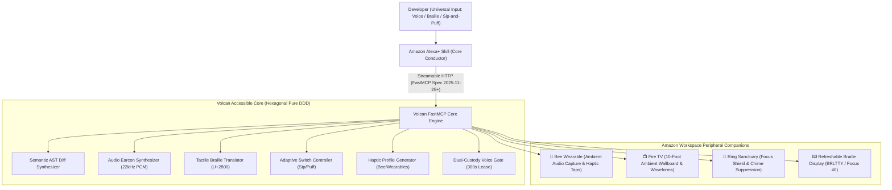

# Volcan: Universal Multi-Modal Accessibility Matrix & Presentation Pitch Guide

> **Official Design & Presentation Blueprint for Amazon Alexa+ & Multi-Device Developer Ecosystem.**

---

## 1. Executive Summary & Vision

Modern autonomous AI coding agents (Claude, Codex, Antigravity) stream thousands of tokens per minute, generate complex side-by-side graphical diffs, and expect continuous mouse-driven confirmation clicks. For software engineers with disabilities, this creates an insurmountable interface barrier:
- **Blind Developers:** Drowning in noisy ANSI terminal characters and raw git syntax.
- **Deafblind Developers:** Excluded from voice-only AI interfaces.
- **Motor-Impaired & Quadriplegic Engineers:** Blocked by mouse clicks, popup confirmations, and fast typing requirements.
- **Deaf & Hard-of-Hearing Engineers:** Unable to hear acoustic earcon alerts and voice dialogs.
- **Engineers in Quiet Hours / Shared Offices:** Need zero-acoustic, confidential, hands-on control.

**Volcan solves this universally by combining Amazon Alexa+ as the central voice brain with a multi-device companion network.**

---

## 2. The Universal Multi-Modal Accessibility Matrix

| Persona / Need | Input Channel | Output Channel | Supported Hardware / Protocol | Volcan Implementation |
|---|---|---|---|---|
| **Blind Developers** | Spoken Voice / Perkins Braille | Spoken AST Summaries + 22kHz Harmonic Earcons | Amazon Echo / Alexa+ Headset | `DigestDiffUseCase` + `SonifyEventUseCase` (Pure PCM 22kHz WAV) |
| **Quiet Hours / Silent Mode** | Perkins Braille Chords (8-key) | **6-Dot / 8-Dot Unicode Braille (`U+2800`–`U+28FF`)** | Refreshable Braille Displays (Focus 40, Orbit Reader, BRLTTY) | `src/domain/braille_translator.py` + `BrailleDiffUseCase` |
| **Deafblind Developers** | Braille Terminal Keyboard | **Tactile Braille Pins + Haptic Pulses** | Multi-Line Braille Terminals + Wearables | Unicode Braille Stream (`/mcp/tools/braille/diff_digest`) |
| **Hands-Free / Quadriplegia (ALS, RSI)** | **Voice / Sip-and-Puff / Foot Pedal** | Spoken Audio + Ambient Wallboard | Alexa+ Voice + Sip-and-Puff Switch | `src/domain/adaptive_switch.py` (Puff=Approve, Sip=Reject) |
| **Deaf & Hard-of-Hearing (HOH)** | Voice / Keyboard / Switch | **Haptic Pulses + Visual Waveforms + Captions** | Bee Wearable, Smartwatch, Fire TV 10-Foot | `src/domain/haptic_feedback.py` (Double Pulse / Triple Buzz) |

---

## 3. Multi-Device Ecosystem Architecture (The Symphony)



---

## 4. Effortless Developer Journey (The 5-Step Workflow)

1. **Step 1: Spoken Intent (At Desk or On-the-Move):**
   - At desk: *"Alexa, ask Claude to refactor the auth middleware to use AWS KMS."*
   - Walking away: Spoken thought captured on **Bee Wearable** and attached as a typed PR annotation.
2. **Step 2: Zero-Noise Autonomous Background Execution:**
   - Autonomous AI coding agent executes the task, edits files, and runs the test suite. No continuous token chatter.
3. **Step 3: Ambient Signal & Haptic Alert:**
   - **Bee Wearable:** Discrete double-pulse vibration on the wrist.
   - **Ring Sanctuary:** Ambient light cue and gentle 440Hz arrival earcon.
4. **Step 4: Rapid Tactile / Audio Inspection:**
   - **Braille Pad:** Fingers immediately feel the 2-line patch summary (`⠬ ⠅⠍⠎_⠅⠑⠽ = os.environ.get("KMS_KEY_ID")`).
   - **Audio Mode:** Single 0.15s harmonic earcon (440Hz -> 880Hz) plays on Alexa.
5. **Step 5: Effortless Governed Approval:**
   - Say *"Alexa, approve"*, tap **Space+Enter** on the Braille display, or give a gentle **Puff** on the Sip-and-Puff straw.
   - Dual-custody lease is signed and logged to the immutable SHA-256 vault.

---

## 5. Presentation Pitch Script (Video & Live Demo Beats)

### Beat 1: The Problem (0:00 - 0:30)
* *"Autonomous AI coding agents stream thousands of tokens and demand continuous visual mouse clicks. For software engineers who are blind, motor-impaired, or deaf, this cutting-edge technology is completely inaccessible."*

### Beat 2: Introducing Volcan on Alexa+ (0:30 - 1:00)
* *"Meet Volcan: an accessible, voice-first AI agent forge built on Amazon Alexa+, AWS Bedrock, and open FastMCP standards."*

### Beat 3: Live Semantic Sonification & Braille Demo (1:00 - 1:40)
* *"Instead of forcing a blind developer to scrub through 500 lines of raw diff syntax, Volcan parses the AST, synthesizes a 22kHz harmonic earcon, and formats a silent 6-dot Unicode Braille stream for Refreshable Braille Displays."*

### Beat 4: Universal Hands-Free & Deaf/HOH Controls (1:40 - 2:15)
* *"For quadriplegic developers, Volcan supports Sip-and-Puff switches: puff to approve, sip to reject. For deaf engineers, Bee Wearables deliver tactile vibration cadences, while Fire TV displays 10-foot high-contrast telemetry."*

### Beat 5: Dual-Custody Governance & Ring Sanctuary (2:15 - 2:45)
* *"High-consequence production deploys are guarded by 300-second cryptographic SHA-256 leases. When active, Ring Sanctuary suppresses loud chimes to preserve focus."*

### Beat 6: Verification & Conclusion (2:45 - 3:00)
* *"59 passing tests, 90% code coverage, and zero third-party domain dependencies. Volcan makes autonomous software engineering universal for everyone."*

---

## 6. Verification & Test Evidence

To reproduce all tests and benchmarks:
```bash
# Run unit, integration, load, and security test suites (59 tests)
python -m pytest repos/volcan_amazon/tests/ -v

# Run interactive 40-cell Braille Terminal Simulator
python repos/volcan_amazon/scripts/braille_terminal_simulator.py

# Audit all 53 canonical readiness gates
python repos/volcan_amazon/ci/readiness.py
```
