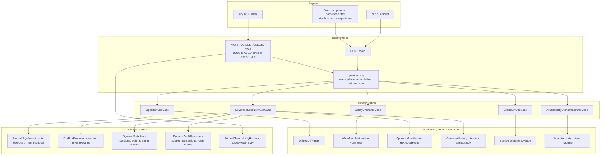

# Volcan: architecture, Well-Architected review and regulatory alignment

**Status column rule.** Nothing in this document is marked verified unless a command in
this repository prints the evidence. Everything else is marked **Designed** (the code
exists and the intent is documented) or **Not verified** (the claim has not been measured
in any environment available here). There is no "100% PASS" anywhere, because no such
measurement was taken.

**Deployment reality, verified on 2026-09-23, re-checked on 2026-09-26 and current since 2026-09-30:** on 2026-09-23
the endpoint at `https://qylv1gxor9.execute-api.eu-west-1.amazonaws.com` served the
companion, REST API and MCP Streamable HTTP surface of the candidate deployed that day.
`GET /health` reports the immutable `source_revision`. **It serves `9b2bcb9` since the 2026-10-01 redeploy** (PR #23, durable DynamoDB live, Bedrock answers recorded, `ready_to_attempt` kept). Before that it served `6e9ae4d` (PR #22) since 2026-09-30, `0e96e45` earlier the same day, and before that it was not the current build: on
2026-09-27 it reported `2d0b8f8`, an ancestor 43 commits behind `6d2e227`; its page was an
older design, its spoken summary did not name the inverted authorization check (its
`critical_findings` field did), and its Bedrock call was refused as not authorized, so the
local engine answered. `docs/EVIDENCE.md`, section "The
public deployment", records the commands. A staged and confirmed dry-run governed action produced bounded EMF logs
and the two declared metrics in CloudWatch. This proves that deployment only; it does not
prove Alexa hardware, a live GitHub write or a human accessibility outcome.

---

## 1. System architecture



The dependency direction is one way. `src/domain` imports no framework and no SDK, which
gate A5 of `ci/readiness.py` verifies by parsing every domain module.

---

## 2. AWS Well-Architected review, six pillars

| Pillar | What exists | Status |
|---|---|---|
| **Pillar 1, operational excellence** | Terraform in `infra/main.tf`; a health endpoint returning service, version, source revision, MCP revision/session mode and the resolved Bedrock and GitHub paths; a GitHub Actions workflow running ruff, the coverage suite, browser journey, build and readiness auditor | **Verified for the exact public release.** `/health` reports the deployed revision and CI runs the same packaged surfaces; the exact run URL is recorded with the release evidence. |
| **Pillar 2, security** | A single-use HMAC-SHA256 approval grant bound to action, payload, namespace and expiry; action claim and nonce consumption share one transaction; durable session and audit partition keys are opaque; anonymous audit reads get only the public demo chain with caller-written text withheld, and reviewer/repository scopes come from the authenticated server roster; the stable signing value is read from Secrets Manager by exact ARN and never enters Terraform | **Verified in local fault/concurrency tests.** `python -m pytest tests/unit/test_governance.py tests/unit/test_durable_volcan_state.py tests/unit/test_durable_public_journey.py tests/unit/test_dry_run_executor.py tests/integration/test_mcp_conformance.py -v`. An exact deployed-state receipt remains separate evidence. |
| **Pillar 3, reliability** | The domain keeps working when a model call fails; DynamoDB session revisions refuse lost updates; staged action and session commit together; terminal action and scoped audit record commit together. An action is claimed before an external write, so retry cannot repeat it. | **Verified without claiming exactly-once delivery.** Cold-start, response-loss and injected transaction-failure tests pass. A crash after claim but before the GitHub response is known leaves an `APPROVED` action for operator reconciliation and cannot auto-retry. Multi-region behaviour has not been measured. |
| **Pillar 4, performance efficiency** | Patch parsing and earcon synthesis run in process with no subprocess and no disk IO | **Verified on one machine.** The 2026-09-23 `python scripts/benchmark_suite.py` record contains all 1000 raw samples and reports 0.281 ms mean / 0.448 ms p95 patch parsing and 3.592 ms mean / 6.565 ms p95 earcon synthesis. Percentiles use documented linear interpolation at `(n - 1) * q`. `python scripts/measure_request_latency.py` separates the first request from five warmups and gates 100 steady requests: the recorded p95 is 44.515 ms against 300 ms. CI uploads the raw request samples for its exact commit. Process cold start is separate: `python scripts/measure_cold_start.py` printed 1.4 s to the first HTTP 200 on 2026-09-08 and 1.7 s on 2026-09-26, and refuses to time an already-warm port. Treat each figure as machine-specific and rerun its command. |
| **Pillar 5, cost optimization** | A scale-to-zero serverless design with no always-on container or load balancer; local parsing handles the deterministic work without model tokens | **Designed, with a dated figure.** The idle cost table in `infra/README.md` carries its measurement date. The figure was taken from the AWS pricing model, not from a bill. |
| **Pillar 6, sustainability** | Scale to zero means no compute is consumed between requests; the deterministic path avoids model inference for work that does not need it | **Designed.** No energy measurement was taken, so no efficiency figure is claimed. |

---

## 3. EU AI Act alignment

Volcan is an assistive tool that summarises code and refuses actions. This section records
how the design maps onto the articles most relevant to it. It is an alignment note, not a
conformity assessment, and no assessment has been performed.

| Article | Requirement | How Volcan addresses it | Residual gap |
|---|---|---|---|
| **Article 10**, data governance | Training and input data governance | No caller content is used for training. In local mode it stays in process memory. The Terraform mode persists the semantic report, including source lines needed for spoken navigation, in encrypted DynamoDB session state with a two-hour TTL; audit items contain action metadata. | TTL deletion is asynchronous and point-in-time recovery can retain deleted state. Repository access, backup retention and lawful basis remain the deployer's responsibility. |
| **Article 13**, transparency | Users can understand system output | Every digest carries `synthesis_mode`, so a user can tell a deterministic parse from a model-generated sentence. Security findings come from documented syntax-tree rules in `src/domain/ast_security_rules.py`, not from a model. Provider failures return bounded public categories instead of raw cloud identifiers. | Model-written summaries still need clarity testing with target users on a representative patch corpus. |
| **Article 14**, human oversight | A human can intervene before consequence | No command executes. A staged command requires a single-use grant presented by a human principal; an agent principal is refused. Live GitHub review and credentialed durable voice actions derive identity and repository access from the server-side credential roster; a durable voice turn without a credential runs under the fixed anonymous owner `public:anonymous`; caller `user_id` is ignored for durable ownership. Leases expire without action. | The voice simulation without a credential, local or durable, plans and never runs, and has no external side effect. |
| **Article 15**, titled "Accuracy, robustness and cybersecurity" | The article's own requirement, quoted | Grants are verified with `hmac.compare_digest` before any claim inside them is trusted. In Terraform mode, one DynamoDB transaction moves the action out of pending and burns its nonce once across concurrent workers. Detection accuracy over a labelled corpus is published with its sample size and is recomputed by the test suite. | The corpus is 24 hand-labelled fixtures. It measures behaviour on those fixtures and nothing more. |
| **Article 50**, transparency of AI output | AI-generated content is marked | `synthesis_mode` marks every digest; the companion shows which path produced the words and tags browser-produced results as SIMULATED. | An MCP client is free to drop the field when rendering. |

---

## 4. GDPR and data residency

* **Caller content:** patches, commands and identifiers can contain personal data or secrets.
  Volcan processes that content to provide the requested review; it cannot claim that it
  never processes personal data. The review output may intentionally quote the supplied code.
* **Application state:** local mode uses process memory. The Terraform mode stores versioned
  review and voice sessions, staged actions, spent nonce hashes and scoped audit chains in one
  encrypted DynamoDB table. Session items carry a two-hour TTL; action and nonce items remain
  for one day after their approval lease; audit items have no automatic deletion. The semantic
  report persisted for dialogue continuity can include caller-supplied source lines. TTL is
  asynchronous, and point-in-time recovery means deletion is not immediate erasure. The
  running answer is exposed at `/health.durable_state` without table, ARN or account identifiers; a deployment reporting
  `process_memory` has no cross-worker durability.
* **Telemetry boundary:** `PrivateObservabilityHarness` emits a bounded EMF object through
  the Python logger, retaining only known numeric metrics, fixed dimension names/finite
  environment values, generated correlation IDs and finite actor/action/tool categories.
  Unknown fields, tenant identities, request IDs, patches, arbitrary text and nested details
  are omitted or replaced by fixed labels. The legacy `mask_pii` helper redacts the entire
  supplied value; it does not guess which substrings are sensitive. Public mutable telemetry
  collections are validated again at emission.
* **Observed proof:** local tests capture a real MCP request's log message and verify its
  measured duration and EMF structure, plus adversarial actor/action/tenant/nested/phone/token
  inputs. The 2026-09-23 deployment additionally emitted and read back bounded EMF records
  for `stage_governed_action` and `confirm_governed_action`; CloudWatch listed both declared
  metrics under `Environment=production-eu-west-1`. This is one deployment receipt, not an
  availability or retention study.
* **Costs and other logs:** no zero-cost or system-wide zero-disclosure guarantee is made.
  Log ingestion, retention and custom metrics can incur charges. This boundary does not
  sanitize unrelated server/access/exception logs, external SDK logs or downstream collectors.

---

## 5. Verifying this document

```bash
python -m pytest tests/ -q
python scripts/benchmark_suite.py
python ci/readiness.py
```

Gates B1, B2 and B3 of the readiness auditor read this file and check that the
Well-Architected pillars, the five articles above and the data map are all present.
