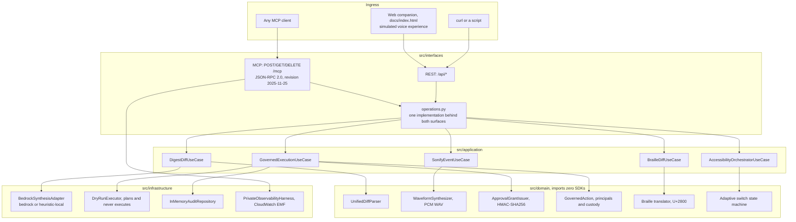

# Volcan: architecture, Well-Architected review and regulatory alignment

**Status column rule.** Nothing in this document is marked verified unless a command in
this repository prints the evidence. Everything else is marked **Designed** (the code
exists and the intent is documented) or **Not verified** (the claim has not been measured
in any environment available here). There is no "100% PASS" anywhere, because no such
measurement was taken.

**Deployment reality, as probed on 2026-09-05 and recorded in
`deploy_teardown_receipt.json`:** the endpoint at
`https://qylv1gxor9.execute-api.eu-west-1.amazonaws.com` answered `GET /health` with HTTP
200, and answered `GET /mcp` with HTTP 404 because it runs commit `38668ad`, an ancestor of
HEAD that predates the MCP endpoint. Run the server locally to exercise the MCP surface.

---

## 1. System architecture



The dependency direction is one way. `src/domain` imports no framework and no SDK, which
gate A5 of `ci/readiness.py` verifies by parsing every domain module.

---

## 2. AWS Well-Architected review, six pillars

| Pillar | What exists | Status |
|---|---|---|
| **Pillar 1, operational excellence** | Terraform in `infra/main.tf`; a health endpoint returning service, version, MCP revision and whether Bedrock credentials are present; a GitHub Actions workflow running ruff, the test suite with a coverage floor, a build and the readiness auditor | **Designed.** The workflow file exists and is checked in, but no CI run is linked from this repository because it is private, so the README carries no build-status badge and no green run can be shown to a reader without access. The four badges it does carry are static, and gate F1 only checks that their targets answer over HTTP. |
| **Pillar 2, security** | A single-use HMAC-SHA256 approval grant bound to the action id, the command payload hash and an expiry; a custody rule that refuses an agent principal releasing its own proposal; an allowlisted planner that executes nothing; Origin validation on the MCP endpoint; session ids from `secrets.token_urlsafe` | **Verified in tests.** `python -m pytest tests/unit/test_governance.py tests/unit/test_dry_run_executor.py -v` |
| **Pillar 3, reliability** | The domain layer is pure and keeps working when a model call fails; the Bedrock adapter degrades to a labelled local path rather than erroring; leases expire on their own and leave no half-approved state | **Partly verified.** The fallback and the expiry are tested. Multi-AZ behaviour is not claimed, because no multi-region deployment was measured. |
| **Pillar 4, performance efficiency** | Patch parsing and earcon synthesis run in process with no subprocess and no disk IO | **Verified on one machine.** `python scripts/benchmark_suite.py` writes `benchmarks_summary.json`, whose recorded run on 2026-09-08 is 0.209 ms mean patch parse and 2.966 ms mean earcon synthesis over 1000 runs each. Those two figures move between runs, and three successive runs on this machine have printed 0.17, 0.253 and 0.209 ms for the parse, so treat the order of magnitude as the claim and rerun the script on your own hardware. Cold start is **verified on one machine**: `python scripts/measure_cold_start.py` printed 1.4 s to the first HTTP 200 on `/health` on 2026-09-08, and refuses to print a figure at all if a server is already warm on the port. |
| **Pillar 5, cost optimization** | A scale-to-zero serverless design with no always-on container or load balancer; local parsing handles the deterministic work without model tokens | **Designed, with a dated figure.** The idle cost table in `infra/README.md` carries its measurement date. The figure was taken from the AWS pricing model, not from a bill. |
| **Pillar 6, sustainability** | Scale to zero means no compute is consumed between requests; the deterministic path avoids model inference for work that does not need it | **Designed.** No energy measurement was taken, so no efficiency figure is claimed. |

---

## 3. EU AI Act alignment

Volcan is an assistive tool that summarises code and refuses actions. This section records
how the design maps onto the articles most relevant to it. It is an alignment note, not a
conformity assessment, and no assessment has been performed.

| Article | Requirement | How Volcan addresses it | Residual gap |
|---|---|---|---|
| **Article 10**, data governance | Training and input data governance | Patches are processed in memory and never persisted or used for training. The audit repository holds action metadata only, in memory, and is lost on restart. | Repository access remains the customer's to control. Nothing here audits what a caller sends. |
| **Article 13**, transparency | Users can understand system output | Every digest carries `synthesis_mode`, so a user can tell a deterministic parse from a model-generated sentence. Security findings come from a documented regular expression set in `src/domain/semantic_diff.py`, not from a model. | The model-generated branch has never run here, so its output has not been reviewed for clarity in practice. |
| **Article 14**, human oversight | A human can intervene before consequence | No command executes. A staged command requires a single-use grant presented by a human principal; an agent principal is refused. Leases expire without action. | Oversight depends on the caller supplying an honest principal role. Volcan does not authenticate identity. |
| **Article 15**, titled "Accuracy, robustness and cybersecurity" | The article's own requirement, quoted | Grants are verified with `hmac.compare_digest` before any claim inside them is trusted. Nonces are burned on use. Detection accuracy over a labelled corpus is published with its sample size and is recomputed by the test suite. | The corpus is 24 hand-labelled fixtures. It measures behaviour on those fixtures and nothing more. |
| **Article 50**, transparency of AI output | AI-generated content is marked | `synthesis_mode` marks every digest; the companion shows which path produced the words and tags browser-produced results as SIMULATED. | An MCP client is free to drop the field when rendering. |

---

## 4. GDPR and data residency

* **Caller content:** patches, commands and identifiers can contain personal data or secrets.
  Volcan processes that content to provide the requested review; it cannot claim that it
  never processes personal data. The review output may intentionally quote the supplied code.
* **Application state:** sessions, staged actions and the audit repository currently live
  in process memory. Logging infrastructure is a separate storage surface. Its residency,
  retention and deletion settings depend on the deployed logger/collector configuration;
  this repository does not establish those properties or certify an erasure policy.
* **Telemetry boundary:** `PrivateObservabilityHarness` emits a bounded EMF object through
  the Python logger, retaining only known numeric metrics, fixed dimension names/finite
  environment values, generated correlation IDs and finite actor/action/tool categories.
  Unknown fields, tenant identities, request IDs, patches, arbitrary text and nested details
  are omitted or replaced by fixed labels. The legacy `mask_pii` helper redacts the entire
  supplied value; it does not guess which substrings are sensitive. Public mutable telemetry
  collections are validated again at emission.
* **Observed proof:** local tests capture a real MCP request's log message and verify its
  measured duration and EMF structure, plus adversarial actor/action/tenant/nested/phone/token
  inputs. They do not prove deployed CloudWatch ingestion. A raw JSON log handler and the
  deployment's CloudWatch delivery/readback still require operational verification.
* **Costs and other logs:** no zero-cost or system-wide zero-disclosure guarantee is made.
  Log ingestion, retention and custom metrics can incur charges. This boundary does not
  sanitize unrelated server/access/exception logs, external SDK logs or downstream collectors.

---

## 5. Verifying this document

```bash
python -m pytest tests/ -q
python scripts/benchmark_suite.py
python ci/readiness.py
```

Gates B1, B2 and B3 of the readiness auditor read this file and check that the
Well-Architected pillars, the five articles above and the data map are all present.
