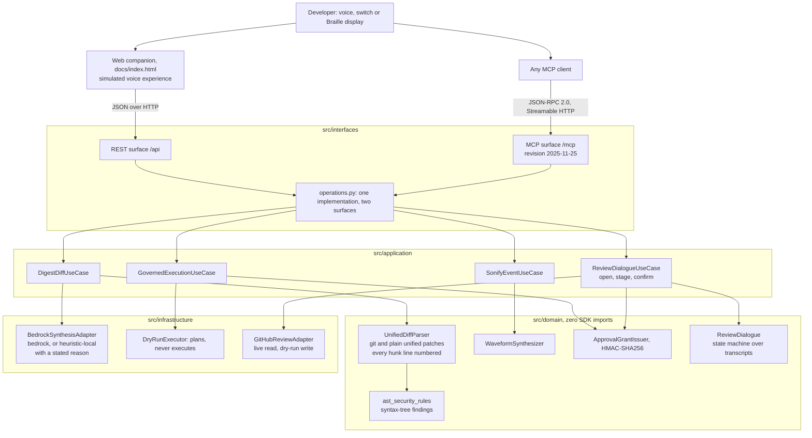
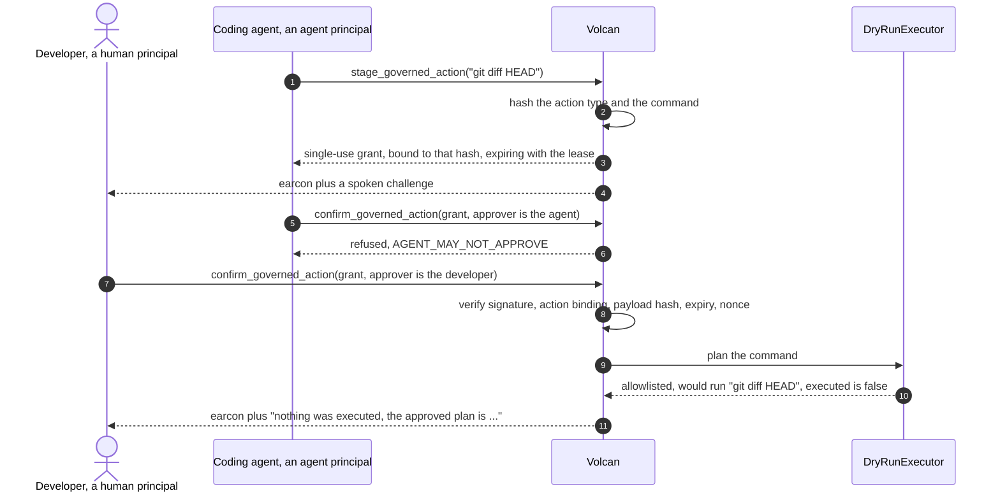

# Volcan: the evidence

The [README](../README.md) tells the story in one screen. This file is the full record behind
it: every claim with the command that prints it, the audit history, the measurements and the
limits. Nothing here is an estimate unless it says ESTIMATE, and a figure that changed keeps
its history in [Figures the README used to quote](#figures-the-readme-used-to-quote-and-why-they-changed),
at the end of this file.

## Contents

1. [How the pieces fit](#how-the-pieces-fit) and [Quickstart, in full](#quickstart-in-full)
2. [What is true and what is simulated](#what-is-true-and-what-is-simulated)
3. [The problem](#the-problem)
4. [What Volcan does](#what-volcan-does)
5. [Architecture](#architecture)
6. [Governed actions](#governed-actions)
7. [The MCP surface](#the-mcp-surface)
8. [The companion page](#the-companion-page)
9. [The review journey](#the-review-journey)
10. [Braille fidelity](#braille-fidelity)
11. [Measured numbers](#measured-numbers)
12. [Verify every claim yourself](#verify-every-claim-yourself)
13. [Operational telemetry](#operational-telemetry)
14. [The public deployment](#the-public-deployment)
15. [Road to Alexa+](#road-to-alexa)
16. [Known limitations](#known-limitations)
17. [Who would buy this, and out of which budget](#who-would-buy-this-and-out-of-which-budget)
18. [Figures the README used to quote, and why they changed](#figures-the-readme-used-to-quote-and-why-they-changed)

---

## How the pieces fit

One pull request goes in. Three things a person can actually use come out, and one governed
action goes back.

The three renderings reach a Model Context Protocol client as text and `audio` content
blocks, and reach a browser through the companion page at [`docs/index.html`](index.html).
The fourth is the journey the product exists for: a blind developer opens a real pull request
by URL (a live, unauthenticated GitHub read), converses about the change, hears the exact
numbered source lines, corrects a misheard command, and submits a `REQUEST_CHANGES` review
bound to the commit that was reviewed. That review is **dry-run by default**: the server
re-reads the head commit, records the exact request it would send, and sends nothing unless
its owner starts it with `VOLCAN_GITHUB_WRITE=1` and a `GITHUB_TOKEN`. The voice loop is the
browser's own speech recognition and synthesis with a typed twin for every command, and it is
labelled on the page as a simulated voice experience, not an Alexa skill.

---

## Quickstart, in full

Five steps. Everything they print is checkable on your own machine. The README carries the
first four in short form.

### Step 1: Install and run the tests

```bash
git clone https://github.com/upgradedev/volcan_amazon.git
cd volcan_amazon
python -m pip install -e ".[dev,bedrock]"
python -m pytest tests/ -q
```

**Install the `bedrock` extra, which is in that command.** It pulls in `anthropic[bedrock]`,
the client that reaches Claude on Amazon Bedrock. With it installed and AWS credentials
resolvable, the digest in step 4 is sent to a Bedrock model, and the companion page reports
which engine answered: `Amazon Bedrock` when a model did, `local heuristic` when none did,
with the reason printed beside it either way. Without the extra the model call cannot even
be attempted, so the heuristic answers instead. An earlier quickstart installed the base
dependencies only, which made the fallback unavoidable even when AWS credentials resolved.

Credentials and an importable SDK only make the path ready to attempt. They do not prove a
model answered. The receipt is the response itself: `synthesis_mode: bedrock` with a null
fallback reason. Any provider failure returns a fixed public category; raw account, role and
request identifiers never enter the anonymous response.

### Step 2: Start the server

```bash
python -m src.interfaces.mcp_server
```

It binds `127.0.0.1:8000`. Port 8000 taken? `python -m src.interfaces.mcp_server --port 8743`
(or `VOLCAN_PORT=8743`) moves the server and its default MCP Origin allowlist together, so the
page it serves can still run the MCP handshake. Use the same port in the URLs below.

### Step 3: Prove the protocol before you trust the page

In a second terminal:

```bash
python scripts/mcp_conformance.py http://127.0.0.1:8000/mcp
```

### Step 4: Hear a code review

Open `http://127.0.0.1:8000/` and press **Hear this code review**, or press
<kbd>Alt</kbd>+<kbd>1</kbd> (<kbd>Option</kbd>+<kbd>1</kbd> on a Mac) then <kbd>Enter</kbd>
without touching a pointer. If your own screen reader should speak the answers, turn on the
speech bubble button at the top right, **My screen reader speaks the answers**: the page then
stays silent and puts each whole answer in one status line. The button
posts the patch to the running server, plays the WAV the server synthesized, prints the
Braille cells, and reports the round trip it measured with `performance.now()`.

**The patch already in the box is the point of the product.** It inverts an authorization
comparison, and the words on both sides of that change are identical, so no keyword matcher
can see it. Volcan answers `an authorization comparison was inverted: user.role == 'admin'
became user.role != 'admin'` and sounds the falling `SECURITY_FINDING` cue. Three more chips
sit beside it: one per syntax-tree rule, plus a labelled clean control where the right answer
is no finding at all and the rising `DIFF_READY` cue. Every chip's label quotes the sentence
the server will produce, and
[`tests/e2e/test_shipped_presets_reach_their_rule.py`](../tests/e2e/test_shipped_presets_reach_their_rule.py)
runs each shipped preset through the production parser and fails the build if a label and its
rule ever separate. All four, posted to `POST /api/digest_semantic_diff` on a running server on
2026-09-27, answered:

```
preset 1: cue=SECURITY_FINDING
   voice: In src/auth/permissions.py, an authorization comparison was inverted: user.role == 'admin' became user.role != 'admin'. Modified 1 file with 1 addition and 1 deletion.
preset 2: cue=SECURITY_FINDING
   voice: In src/api/app.py, a cross-origin policy was widened to accept any origin: allow_origins = ['*']. Modified 1 file with 1 addition and 1 deletion.
preset 3: cue=SECURITY_FINDING
   voice: In src/webhooks/receiver.py, the call verify_signature(payload, request.headers['X-Signature']) was removed and nothing replaced it. Modified 1 file with 0 additions and 1 deletion.
preset 4: cue=DIFF_READY
   voice: The change touches normalise in src/utils/parser.py; no security rule matched. Modified 1 file with 3 additions and 1 deletion.
```

The finding is said once and leads; the counts follow. With no finding, the local engine names
the files and the definitions each hunk sits in (from the hunk header, plus any `def` or `class`
line the patch adds or removes), at most two files and three names each. On
`psf/requests#6710` it said: `The change touches build_response, _get_connection,
get_connection_with_tls_context and 2 more in src/requests/adapters.py; no security rule
matched.` The same response carries
`voice_summary_for_speech`, the sentence as the page hands it to the speech engine, with each
code operator named (`user.role not equals 'admin'`), while the screen and the Braille keep
the literal `!=`.

**Time to first result, measured on the development machine on 2026-09-26.** Step 1 collects
874 tests (`python -m pytest tests/ --collect-only -q`); CI run 37432272539 on master at `f9e5135` printed `854 passed` on 2026-10-06 (the count is the claim; the duration varies run to run; CI run 36804593070 at `fc10e7d` printed 751 on 2026-10-01; 737 on 2026-09-30; 725 on 2026-09-29;
723 earlier that day, before the Lambda SSE-bridge disconnect fix; 707 on 2026-09-28, before the persona-review gates moved into this repository; 703 earlier that day, before the dialogue handover, the detector-scope meter row, the bench legend and the narrow-screen context line; 646 earlier that day, before the extensionless file names and the plain words for a pull request that cannot be opened; 637 on 2026-09-27 before the single review cursor and the local revision in /health; that
day, before the version-header fix and the replay panel, it was 631, before the JavaScript and TypeScript rules and the Alexa+ package, it was 577, and before the audit fixes 623). The server in step 2 answered its first `GET /health` with HTTP 200 **1.7 seconds**
after launch on 2026-09-26 (three runs that day read 1.7, 1.7 and 1.8 s), printed by [`scripts/measure_cold_start.py`](../scripts/measure_cold_start.py),
which launches its own server on port 8000 (stop the one from step 2 first) and refuses to time
a process that was already warm. Step 3 printed `23/23 checks passed, 0 failed` on 2026-09-27. The first
digest round trip in step 4 was **31.3 ms** in headless Chromium at 1440x900, read from the
page's own meter, with the server started as in step 2 on port 8746 without AWS credentials;
three further presses read 38.9, 30.5 and 28.7 ms. The page measures the round trip itself
with `performance.now()` on every run and takes no figure from this file. The `pip install`
step depends on your network and is not measured here. Earlier rounds' figures, and why they
changed, are in [Figures the README used to quote, and why they changed](#figures-the-readme-used-to-quote-and-why-they-changed),
at the end of this file.

### Step 5: Review a real pull request by voice or by keyboard

On the same page, scroll to **Talk through a real pull request**, or press
<kbd>Alt</kbd>+<kbd>6</kbd>, paste the URL of any public GitHub pull request, then press
<kbd>Alt</kbd>+<kbd>4</kbd> and type `open` <kbd>Enter</kbd>. The server reads the pull
request's head commit and diff from GitHub without a token, and the page reads back
`Understood: open the pull request.` before it speaks the overview. Then type, or say with
<kbd>Alt</kbd>+<kbd>5</kbd> where the browser has speech recognition:
`what changed in <file>`, `read the lines`, `next`, `no, I said previous`, `spell that`,
`request changes: <your comment>`, `confirm`. The last turn ends in one of three server
outcomes printed on the page: `recorded and not sent` (the default, with the exact request
shown), `submitted` (only when the server runs with `VOLCAN_GITHUB_WRITE=1` and a
`GITHUB_TOKEN`), or `refused` with the reason, `STALE_HEAD` when the pull request moved after
you reviewed it. Section [The review journey](#the-review-journey) has the whole grammar.

Requires Python 3.11 or newer. The repository is private, so `git clone` needs access. The
[hackathon FAQ](https://amazonappdev2026.devpost.com/details/faqs) rule for a private repository: "Add the Amazon and
Devpost reviewers as collaborators before the submission deadline". That is an owner step. The
MIT licence stays in [LICENSE](../LICENSE).

---

## What is true and what is simulated

Read this section before anything else. It is the honest boundary of the project.

**Real, and you can check it in one command.** Volcan ships a Model Context Protocol server
written by hand to revision **2025-11-25** over the **Streamable HTTP** transport: JSON-RPC
2.0 at `POST /mcp`, an SSE stream at `GET /mcp`, protocol version negotiation, optional
stateful sessions for a single-process host, a stateless public Lambda mode, a tool catalog
whose JSON Schemas are generated from the code that parses the arguments, and MCP audio
content blocks carrying the synthesized earcons.
`python scripts/mcp_conformance.py` runs a full client handshake against a running server
and prints a pass or fail line for each of its 22 conformance checks.

**The road to Alexa+ is an add-on package, built and tested locally, not certified or
deployed, because the add-on tools are partner-only.** Amazon's route for a service like
this is an MCP add-on, in which Alexa+ is the MCP client of this same server. The add-on
manifest is in the repository and a replay of Amazon's documented client requests runs against
the server, but no add-on has been deployed and Alexa+ has never called Volcan: no skill, no
Alexa+ connection, no Echo run. The [hackathon FAQ](https://amazonappdev2026.devpost.com/details/faqs) says the add-on tools,
the MCP Toolkit among them, are "available to select partners only", and "You do not need
these tools for your submission: build a self-hosted MCP server (or Agent Skill) per the
Official Rules, and demo it via your own web-based simulator or front end." Volcan is that
shape: this server and the companion page. Deploying the add-on waits on Amazon granting access.
[Road to Alexa+](#road-to-alexa) has the sources, what was built, what the replay found and
what only the owner can do. The page says so in a band below
its first screen and draws the add-on as a dashed box in its Evidence tab. Until 2026-09-27
this paragraph said the road was "stated, not built", which was true then.

**Simulated, and labelled as such everywhere it appears, the page included.** The voice
experience is a web companion, not an Alexa skill. There is no Alexa skill package in this
repository (the Alexa+ add-on package that is here has never been deployed), no skill has been
submitted for certification, and nothing here has been tested on
an Echo device. The companion listens with the browser's `SpeechRecognition` API where the
browser has one (Chrome and Edge do, Firefox does not), speaks with `speechSynthesis`, keeps a
typed twin for every spoken command, and calls the same server an Alexa+ integration would
call. The label sits in the page header above the fold, in the paragraph with id `notASkill`,
and `tests/e2e/test_html_structure.py::test_the_first_screen_says_this_is_not_an_alexa_skill_and_names_the_simulation`
fails the build if the words `alexa`, `skill` and `simulat` leave the first screen. A review
round on 2026-09-08 found the page contained none of them while this file claimed it did;
that is why the test exists.

**Real read, dry-run write, and the page prints which.** Opening a pull request by URL is a
live, unauthenticated `GET` against `api.github.com` for its head commit and diff; it needs no
token for a public repository. Submitting the `REQUEST_CHANGES` review is a real external side
effect and ships behind a dry-run default: the server re-reads the head commit, refuses with
`STALE_HEAD` if it moved, and without `VOLCAN_GITHUB_WRITE=1` records the exact request it
would send, token redacted, and sends nothing. `/health` publishes the resolved
`github_review_path` so the page prints the server's conclusion rather than guessing. **No
live review has ever been sent from this repository**; the owner action that produces one is
under [Known limitations](#known-limitations). The live read has been exercised against a
real pull request: on 2026-09-08 the companion page opened
`https://github.com/python/cpython/pull/1`, printed
`Opened python/cpython pull request 1, Support "bpo-" in Misc/NEWS, by brettcannon, head
commit 02a87ce` with a round trip of 1223.2 ms measured by the page, walked its first hunk
line by line, and on `confirm` printed `Dry run. Nothing was sent to GitHub. The head commit
is still 02a87ce, and the exact request Volcan would send has been recorded.`

**Real code with a labelled fallback, and a stated reason.** The Amazon Bedrock adapter calls
Claude on Amazon Bedrock through the Anthropic SDK's `AnthropicBedrockMantle` client, pinned to
`anthropic.claude-opus-5`. When the call cannot be made or fails, the deterministic local path
runs instead. Every response carries `synthesis_mode`, which is `"bedrock"` when a model
answered and `"heuristic-local"` when none did, **and `synthesis_fallback_reason`, which says
why without returning the provider's raw payload**. The companion prints both beside the
synthesis meter. An unexplained fallback is indistinguishable from a design decision, while a
verbatim cloud error can expose account, role and request identifiers. Volcan returns a fixed
category for permission, unavailable-model, throttling, timeout and malformed-response cases.

**The model reads a prefix; the rules read the patch.** The model is shown the first 3000
characters of the diff (`MODEL_DIFF_CHAR_BUDGET`); the local rules parse the whole patch, so a
finding past the budget is still found locally. Every digest answers what the model saw:
`model_input_chars_sent` and `model_input_chars_total`, `model_prose_full`, and
`model_input_truncated`. The companion prints the coverage beside the speech pane with the full
answer behind a disclosure, and the patch box warns before a press that the first 3000
characters go to Amazon Bedrock when a model is available. Speech never hears Markdown:
emphasis, ticks, links, headers and bullets are stripped, code-shaped stars kept, before the
summary is cut and before operators are named. A fenced code block keeps every character,
its diff `-` and `+` and its `#` comment markers included, and its fence lines become
"Code:" and "End of code."; the full-answer panel gets the same text. A model call has 25 seconds inside the
30-second function budget, and patches past one million characters are refused with 422.
Covered by `tests/unit/test_model_evidence_reaches_the_api.py`,
`tests/e2e/test_model_coverage_display.py` and the spoken-form tests; added 2026-10-01 after a
review found the evidence fields dropped in the use case and `**Spoken summary:**` read aloud.

The client uses the account-scoped Bedrock Mantle project. The checked-in infrastructure
defines that permission as a separate policy behind `enable_bedrock_mantle=false`; the
durable-state plan does not add model authority by default. Enabling it is a separate owner
decision. A deployment without the grant falls back with the bounded permission category.
`/health` reports readiness to attempt; only the digest's `synthesis_mode` reports whether
the model answered.

**Never executed.** Volcan plans shell commands against an allowlist and refuses the rest. It
does not run them. The claim covers the whole product, not one module: no file under `src/`
imports or calls `subprocess`, `os.system`, `eval`, `exec` or any process spawn, and
`tests/unit/test_no_execution_in_source_tree.py` walks every source module's AST on each run
to keep it that way.

---

## The problem

An autonomous coding agent produces a patch, and a sighted reviewer scans it in seconds. A
blind reviewer using a screen reader hears every plus sign, minus sign and hunk header as
literal characters. A 300 line patch becomes minutes of auditory scrubbing through syntax
before any comprehension begins, and a one line authentication change sits in the middle of
it sounding exactly like everything else.

A developer with a repetitive strain injury or limited hand mobility hits the same wall from
the other side: the review is not hard to understand, it is hard to navigate.

---

## What Volcan does

1. **Semantic diff digests.** Parses a unified patch and speaks it at three levels: an
   executive sentence, a file-by-file breakdown, then a line drill-down. Counts are
   pluralised, because a listener hears "1 files" and a reader skims past it.
2. **Security flags before comprehension.** Two deterministic passes run over every patch. A
   keyword pass flags authentication, cryptographic, database and process-execution
   vocabulary. A syntax-tree pass then compares the added and removed lines as parsed Python
   and reports what the change *did*: an authorization comparison inverted, a cross-origin
   policy widened to any origin, a verification call deleted and not replaced. The second pass
   exists because `user.role == "admin"` and `user.role != "admin"` contain identical words,
   so no keyword matcher can tell them apart. The digest speaks findings first, and names the
   change rather than the keyword that matched.
3. **Audio earcons as first-class results, and the cue carries the verdict.** A pure-Python
   PCM WAV synthesizer produces distinct cues, returned over MCP as `audio` content blocks
   so a client plays the sound instead of reading a description of it. A digest whose patch
   carries a security finding returns the falling two-note `SECURITY_FINDING` cue; one that
   does not returns the rising `DIFF_READY` cue, so the verdict reaches a listener before
   the sentence does. The two payloads are different bytes, and
   `tests/unit/test_earcon_encodes_the_verdict.py` prints and asserts the difference:

   ```
   $ python -m pytest tests/unit/test_earcon_encodes_the_verdict.py -q -s
   benign   | earcon DIFF_READY       | sha256[:16] 08f48648388bff02 | 19448 WAV bytes | 25932 base64 chars
   security | earcon SECURITY_FINDING | sha256[:16] 22c91bec11e275d1 | 26504 WAV bytes | 35340 base64 chars
   ```

   Each cue also carries a `spoken_fallback` string, so a Deaf or hard-of-hearing developer
   reads what a hearing one heard.
4. **Unicode Braille output at two fidelities, and the response says which.** Renders patches
   and commands as Braille patterns in the U+2800 block for a refreshable display, for quiet
   hours, open offices and deafblind developers. The default for a patch is eight-dot code
   fidelity, one cell per printable ASCII character, so `(`, `)` and `=` keep their own cells
   and the cells decode back to the exact source. Six-dot literary Braille is available for
   prose and is lossy for code; when it is used the response names the characters that
   collided in that patch. See [Braille fidelity](#braille-fidelity).
5. **Governed actions.** High-consequence commands are staged behind a single-use,
   content-bound authorization grant with a lease, and an agent cannot release its own
   proposal.
6. **Adaptive switch and haptic input.** Maps sip-and-puff, single-button and foot-pedal
   pulses to navigation actions, and builds vibration cadences with visual captions.
7. **A spoken review dialogue that ends in a governed GitHub action.** Open a pull request by
   URL, ask what changed in a file, hear the exact numbered source lines of a hunk, spell a
   line out symbol by symbol, correct a misheard command, and request changes. Every turn
   reads back what it understood before it acts, a new command interrupts the current speech,
   and `resume` restores the exact file, hunk, source line and revision. If the pull request
   changed while interrupted, Volcan refreshes it and explicitly invalidates the old approval.
   Sessions are bound to one reviewer. The review is bound to the head commit and dry-run
   unless the owner enables the write.
   See [The review journey](#the-review-journey).

---

## Architecture



---

## Governed actions



A released plan is stored with the state `RELEASED_NOT_RUN`, and the confirm response carries
the same word as its `status`, so the response and the audit record name one outcome with one
word; the page prints it as "released to you, nothing run". `EXECUTED` is kept for a review
that was really submitted to GitHub, and for plans sealed before this state existed, whose
`outcome` text still reads "Dry run only, nothing was executed."

A grant is refused when its signature is altered, when it was minted for a different action,
when the command changed after it was issued, when the lease elapsed, and when it has already
been used once. Each of those refusals has its own test in
[`tests/unit/test_governance.py`](../tests/unit/test_governance.py). The `REQUEST_CHANGES` review
in [The review journey](#the-review-journey) is the same mechanism with a real consequence
behind it: the payload hash covers the repository, the pull request number, the head SHA and
the SHA-256 of the comment, the staging principal is the dialogue and the approver is the
human who said `confirm`, and the audit record's `outcome` field says `SUBMITTED`, `DRY RUN
recorded, not sent` or `REFUSED <code>` in the executor's own words.

Every audit record is sealed with the hash of the record before it, so editing a stored
entry, deleting one or reordering two is **detected** and the verdict names the entry that
broke. It is tamper-evident, not tamper-proof: nothing here stops someone who can rewrite the
whole chain from re-sealing it end to end, because the head hash is not published anywhere
the writer cannot reach. `python -m pytest tests/unit/test_audit_chain.py -v` covers each
detection path.
In durable mode each chain lives under a hashed partition key, and no caller names the chain
it reads. Actions staged through the public surface (REST and MCP `stage_governed_action`, which
carry no credential) share one public demo chain, so the page's audit trail keeps working for
an anonymous visitor. `/api/audit_log` returns the newest 50 records of that chain to anyone,
with caller-written text withheld: a command, action id, action type or principal name is shown
only when it is the page's own fixed value (`git diff HEAD`, `companion-operator`), and the
payload hash, state, timestamp and chain position are always shown. A roster credential adds
that reviewer's own review chains, derived from the server-side roster and shown in full.
Anonymous review and voice sessions stay in their own private per-session chains and are never
listed. The response carries a `note` saying so, and the page prints it under the list.
[`src/application/public_audit.py`](../src/application/public_audit.py) holds the rules;
[`tests/unit/test_durable_public_journey.py`](../tests/unit/test_durable_public_journey.py)
stages canary strings through REST and MCP and checks that none of them, and no grant, reaches
the public view.

---

## The MCP surface

Twelve tools, each with an `inputSchema` generated from the pydantic model that parses its
arguments, so the published schema cannot drift away from the code. What this surface returns
is the answer to "is it a wrapper around an existing API": `audio` content blocks carrying the
earcon that encodes the verdict, Braille cells with their fidelity and loss declared, a review
dialogue that reads back before it acts, and a review action that is governed by a single-use
grant, bound to a head commit, and dry-run by default. No GitHub or Bedrock API returns any of
those.

| Tool | What it returns |
|---|---|
| `digest_semantic_diff` | Spoken digest, the earcon that encodes the verdict as audio, and the parsed detail |
| `drill_down_section` | Symbol-level explanation of one file section, plus the earcon for that section |
| `stage_governed_action` | An action id, a payload hash, a dry-run plan and a single-use grant |
| `confirm_governed_action` | Release or a named refusal, plus the matching earcon |
| `play_earcon` | A 16-bit PCM WAV as an MCP `audio` content block |
| `voice_turn` | One conversational turn: summarize, stage, approve or reject |
| `review_dialogue_turn` | One turn of the spoken review: readback, answer, the earcon, and on `confirm` the review outcome, `submitted`, `recorded and not sent` or `refused` |
| `translate_text_to_braille` | Unicode Braille patterns, in eight-dot code fidelity or six-dot literary, with `lossless` and the collisions named |
| `braille_diff_digest` | A patch formatted with tactile add and remove markers, code fidelity by default, with its `disclosure` sentence |
| `process_switch_pulse` | The navigation action a switch pulse resolves to |
| `get_haptic_profile` | A vibration cadence and a visual caption |
| `check_ast_completeness` | Whether Python source parses, with node, function and class counts |

Protocol behaviour worth checking: in the default single-process mode `initialize` issues a
cryptographically random `Mcp-Session-Id`, and a session this server never minted is answered
HTTP 404. The public Lambda sets `VOLCAN_MCP_SESSION_MODE=stateless`, so it issues no session
header and request-contained calls do not depend on a process-specific MCP id. Both modes are
permitted by revision 2025-11-25 and the conformance runner detects which one answered;
`--expect-mode stateless` makes it fail a server that answers in the other mode. The page's
handshake sends `Mcp-Session-Id` only when `initialize` returned one, and
`tests/e2e/test_mcp_transport_modes.py` runs the script and the page against a real server in
each mode.
The Terraform Lambda additionally sets `VOLCAN_STATE_TABLE`: review and voice sessions, pending
actions, spent nonces and scoped audit records then use one encrypted DynamoDB table shared by
every worker. Staging commits the session and action together; approval claims the action and
nonce together; finalization commits the terminal action and audit line together. Local runs
without that variable deliberately remain process-memory only. **This durable mode is in the
code, in the Terraform and on the public endpoint:** its `/health` read `durable_state`
`configured_reachable` on 2026-10-06 (`curl -s <endpoint>/health`), as it did from the
2026-09-30 build on ([The public deployment](#the-public-deployment)). Reachable did not mean
writable: until `22c32ab` every transactional write was refused, so the durable stages
answered HTTP 503 on live
([known issue](#known-issue-durable-stages-answered-http-503-on-live)). On 2026-09-26 the
public endpoint's `/health` carried no `durable_state` field at all, because that build
predated the mode. The
companion page states what the answering server's `/health` reports and nothing more. `/health` reports configuration
and successful reachability without publishing AWS resource identifiers, so transport
statelessness or configuration alone is never presented as state durability.

A durable voice turn with a `VOLCAN_REVIEWERS` Bearer credential is bound to that reviewer: the
server derives the owner and allowed `owner/repository` from the credential, ignores the JSON
`user_id` for ownership and gives each owner/repository/session an opaque action namespace.
Without a credential the turn runs the same simulated flow a local run offers (planned, never
run) under one fixed anonymous owner, `public:anonymous`. The roster refuses any identity
containing `:`, so no reviewer can share that owner, and a caller-selected session or action id
cannot read, approve or reject a reviewer's staged action.
`tests/e2e/test_durable_server_journey.py` runs the whole app in this configuration against
in-memory DynamoDB and Secrets Manager fakes, with no reviewer roster, and walks the page's
journey in Chromium.
`MCP-Protocol-Version` is echoed on every response; `notifications/initialized` returns HTTP
202 with no body; JSON-RPC error codes `-32700`, `-32600`, `-32601` and `-32602` are all
reachable; a failing tool is reported as `isError` inside the result rather than as a
transport failure; a browser `Origin` outside the allowlist is rejected while an absent
`Origin` is allowed so non-browser clients work; and `PUT /mcp` returns 405 with an `Allow`
header.

**The version header rule, as the specification states it.** The 2025-11-25 transport
specification ("Protocol Version Header") says a client MUST send `MCP-Protocol-Version` on
every request after initialize; that a server which receives none, and has no other way to
identify the version, for example the one negotiated during initialization, SHOULD assume
`2025-03-26`; and that an invalid or unsupported header MUST get 400 Bad Request. Since
2026-09-27 Volcan does exactly that, in one function used by `POST`, `GET` and `DELETE`:

* A header, when present, is the version. An empty header counts as present and is refused.
* Without a header, a request carrying a session id this server issued is served under the
  revision negotiated for that session.
* Without a header or a session, which is every request to a stateless deployment such as the
  public Lambda, the request is served as `2025-03-26`, which this server accepts. The one
  2025-03-26 behaviour Volcan lacks, JSON-RPC batching, still fails at once with `-32600` and
  an error naming 2025-11-25.
* An unknown or terminated session id is still HTTP 404 before any version rule runs.
* A header naming any revision other than `2025-11-25`, `2025-06-18` or `2025-03-26` gets HTTP
  400 on every verb. On `POST` the body is a JSON-RPC `-32600` error against the request id,
  whose data lists the negotiable revisions (`supported`) and the accepted header values
  (`accepted_header`).

*What changed, and why.* Until 2026-09-27 Volcan refused a request without the header: `-32600`
inside HTTP 200 on `POST`, HTTP 400 on `GET` and `DELETE`. This file called that a deliberate
deviation, on the grounds that assuming a revision lets a client and server disagree while both
believe the handshake succeeded. The deviation broke the interoperability the specification's
fallback exists for: a client that only knows 2025-03-26 could initialize and then do nothing
else, and the Alexa+ replay showed it. The same review found that `POST` answered an
unsupported header with HTTP 200, where the specification says 400. Both are fixed, and
`python -m pytest tests/integration/test_mcp_conformance.py -k "version or header" -v` pins
each case above.

*An earlier report, kept for the record.* A review round on 2026-09-08 reported that a
`tools/list` carrying a valid session but no version header returned HTTP 200 with an empty
tools array. That did not reproduce then, and it cannot happen now for a different reason: the
request is served, and `test_missing_protocol_version_with_a_session_uses_the_negotiated_revision`
asserts that it returns the real catalog, not an empty one.

**Structured results and the review card.** Since 2026-10-06 three tools publish an
`outputSchema` and return `structuredContent`, as the 2025-11-25 tools page describes ("Output
Schema", "Structured Content"):

* `digest_semantic_diff`, `drill_down_section` and `review_dialogue_turn`. Each schema comes
  from a pydantic model in `src/interfaces/dto.py` that names every top-level key and forbids
  others, so a key added to an operation and not to its model fails a test.
* The structured object is the same object as the JSON text block, which stays for clients that
  predate the field. The first block is still the sentence a listener hears.
* `initialize` now advertises `resources: {listChanged: false}`. `resources/list` lists one
  resource, `resources/read` returns it, and `resources/templates/list` returns an empty list.
  An unknown URI gets `-32002` with the URI in `data`, as the resources page names it.
  `resources/subscribe` stays `-32601`.
* The resource is `ui://volcan/review-card`, served as `text/html;profile=mcp-app`, the format
  of the MCP Apps extension (SEP-1865, marked stable 2026-01-26). `review_dialogue_turn` links
  it through `_meta.ui.resourceUri`, which is where the extension puts the link: on the tool,
  not in each result. The card shows the file in focus, the first finding a rule matched in it,
  up to eight changed lines with each line in eight-dot code Braille, and Confirm and Cancel
  while a review is staged. It loads nothing from the network and declares no `csp` domains, so
  a host applies the extension's restrictive default policy.
* The card's Confirm and Cancel send `tools/call review_dialogue_turn` with `confirm` or
  `cancel`, only on a press. The server then runs the same confirm every surface uses: the
  single-use grant, custody, the live head re-read and, in live mode, the reviewer credential.
  `test_a_forged_grant_from_any_surface_is_refused` pins that a forged grant is still refused.

What this does not show. The extension says a server SHOULD check the client's
`io.modelcontextprotocol/ui` capability before publishing a UI link; this server publishes it
always, because the stateless deployment keeps no per-client memory, and a client without the
extension ignores `_meta`. The companion page is the only host that has drawn the card. It is a
simplified host: the extension asks a web host to load a view through a sandbox proxy on a
second origin, and the page uses one iframe sandboxed to scripts only, whose origin is opaque.
It also keeps one view for the whole review session and sends each later turn as another
`tool-result`, where the extension describes one view per tool call. No MCP Apps client, Echo
Show or Alexa+ has rendered it.

`python -m pytest tests/integration/test_mcp_structured_results.py -v` validates every
structured result against its schema with a JSON Schema 2020-12 validator across the dialogue
states, and checks the listing, the read and the errors. `python -m pytest
tests/e2e/test_review_card.py -v` checks how the page hosts the card and drives Chromium to
reach and press its Confirm by keyboard.

The REST surface at `/api` is ordinary JSON over HTTP for the web companion. It is not MCP
and is not described as MCP anywhere in this repository.

---

## The companion page

[`docs/index.html`](index.html) is the only companion document here. FastAPI serves the
same bytes at `/` and `/demo`, so the page cannot disagree with itself.

Four rules the page keeps (five with the one below), each enforced by
[`tests/e2e/test_html_structure.py`](../tests/e2e/test_html_structure.py):

* **Every value on it came out of an HTTP response in that session.** There is no second
  implementation of the product in JavaScript to fall back on, so the page cannot show a
  digest, a Braille cell or a waveform that the server did not produce. The waveform is
  drawn from the returned WAV's own 16-bit samples.
* **Every duration was measured with `performance.now()`** around the request that produced
  it. `test_latency_is_measured_and_never_typed` fails the build on any latency literal in
  the file.
* **Nothing is written with `innerHTML`.** Server text is inserted through `textContent`.
* **An unreachable server is stated, not papered over.** The page prints the command that
  starts one, and distinguishes "no server answered" from "the server answered and the call
  still failed", because those need different next steps.

A fifth rule joined them on 2026-09-08: **the preset chips have to reach the rules the page
exists to demonstrate.** Four chips ship, three of them one per syntax-tree rule and the
fourth a labelled clean control, and each chip's `title` quotes the sentence the server will
say back.
[`tests/e2e/test_shipped_presets_reach_their_rule.py`](../tests/e2e/test_shipped_presets_reach_their_rule.py)
lifts the patches straight out of the page, runs them through the production parser, and fails
if a chip promises a sentence the server no longer produces, if the control stops being
silent, or if a rule is added to `src/domain/ast_security_rules.py` with no preset to show it.
That last one works by reading the rule ids out of the module's own syntax tree rather than
from a list kept by hand here.

The **Run a real MCP handshake** button performs `initialize`, `notifications/initialized`
and `tools/list` against `POST /mcp` in the browser, then renders the negotiated protocol
version, whether the server chose a stateful id or stateless mode, and each published
`inputSchema`.

Accessibility is enforced rather than asserted. The page has semantic landmarks, a labelled
and keyboard-scrollable Braille region, and one voice per answer, on the stage and in the
review dialogue alike. By default a single polite status line gives the round trip and hands
over to the speech engine, which reads the answer finding first with each code operator named.
The speech bubble button at the top, **My screen reader speaks the answers**, silences the
page's voice and puts each whole answer in the status line instead, for a listener whose own
screen reader should do the talking; the choice is remembered in that browser. The
conversation log is a visible history and not a live region, so no turn is read twice.
`tests/e2e/first_screen_runner.py` counts the live regions a press and a dialogue turn write
to, and the utterances spoken, in both modes. A patch changed after a press returns the stage
to that patch's own silent answer, and the same runner checks that nothing of the old answer
is left on screen or spoken. The silent preview drawn
on load sits outside every live region, so opening the page announces nothing. The skip link
lands focus inside `main`. There is a 3px focus ring in both colour schemes, a written
description of every audio cue taken from the server's own `spoken_fallback`, and no control
that ships disabled. `prefers-reduced-motion` removes every animation and the smooth scroll;
`prefers-color-scheme` selects a designed light or dark palette. The page requests nothing
from another origin. Its typefaces, Atkinson Hyperlegible (drawn by the Braille Institute for
readers with low vision) and JetBrains Mono, are the latin woff2 files in
[`docs/fonts`](fonts) with their SIL Open Font License texts, inlined into the page by
`scripts/embed_fonts.py`, so GitHub Pages, the FastAPI route and the container all ship them
inside the one HTML file. Every face keeps `font-display: swap` and every font stack ends in
local faces. `tests/e2e/test_first_screen.py` loads the page with every request to another
origin aborted and requires both families loaded and no console error.

The first screen is one stage. The patch is drawn as its changed lines beside a single
primary action, and when the Volcan app serves the page, the three channels already hold the
server's real answer for that patch as it opens, drawn silently; opened with no server behind
it, the channels stay empty until a server answers. The page asks for that answer with `engine: local`, so a
page view never starts a model call, and nothing plays, speaks or writes into a live region
until the press; `tests/e2e/test_first_screen.py` counts all three and requires zero. The
earcon's waveform is drawn from the returned samples, grey until it has been heard, with a
pitch contour measured from those samples, and after the press a playhead follows the audio
element's own clock. The spoken sentence opens with the server's finding (for the preset, the inverted
authorization comparison), labelled as the server's first sentence, and after the press the
whole answer is shown and its words brighten only when the browser's speech engine reports
reaching them. The Braille is drawn as large dot cells from the server's own Unicode
code points, with the cell that differs between the removed and the added line marked. A line
under the sentence says it is the server's first sentence, not played yet, and an info button
beside it names the engine and why, and says the button asks the server's default engine:
Amazon Bedrock when AWS credentials resolve and `anthropic[bedrock]` is installed, the local
heuristic otherwise. Code is set with ligatures off, so `!=` can never be drawn
as a single glyph. Every proof panel below the story sits in an **Evidence** tab set, and `?`
opens the keyboard map from anywhere outside a text box.

The **Talk through a real pull request** section is the page's half of the review journey below.
It has a microphone button that uses `window.SpeechRecognition` where the browser exposes one
and says so when it does not, a typed command box that always works, one button per common
command so nothing depends on being heard, a dialogue log that shows what was heard, what was
understood and what was answered, and a review panel that prints the server's outcome word for
word. Seven more assertions in `tests/e2e/test_html_structure.py` pin that contract: the
typed path exists, a new command calls `stopAudio()` before it posts, the readback is logged
and spoken before the answer at the `speech_rate` the server returned, each turn reaches the
listener through one voice (the page's speech, or the one status line when the listener's
screen reader speaks), a dry run is printed as `recorded and not sent` and never as a send,
the page never handles a token, and the keyboard map covers the dialogue. The steps,
**1 Open a pull request** and **2 Request changes**, come before the conversation in the tab
order.

---

## The review journey

The state machine lives on the server, in
[`src/domain/review_dialogue.py`](../src/domain/review_dialogue.py), one instance per session,
driven by transcripts. That is deliberate: the browser's `SpeechRecognition` API cannot be
driven headlessly, so the page is only ears and mouth, and everything the dialogue does is
proven by injecting the text a microphone would have produced.
[`tests/unit/test_review_dialogue.py`](../tests/unit/test_review_dialogue.py) drives the machine
directly, [`tests/unit/test_review_dialogue_use_case.py`](../tests/unit/test_review_dialogue_use_case.py)
adds the grant and the GitHub port, and
[`tests/integration/test_review_dialogue_api.py`](../tests/integration/test_review_dialogue_api.py)
runs the whole journey over `POST /api/review/turn` and over the MCP tool
`review_dialogue_turn` against a scripted GitHub. None of them proves a microphone heard
anything, and this file does not claim one did; the browser run recorded under
[What is true and what is simulated](#what-is-true-and-what-is-simulated) used the typed path.

**Three promises the machine keeps, each with a test.**

* **It reads back before it acts.** Every answer begins `Understood: <command>.` or
  `Corrected, <command>.`; an unrecognised transcript answers
  `I heard '<text>' and did not recognise a command.` and changes nothing.
* **A correction undoes the misheard command, then applies the meant one.** `no, I said
  previous` after a misheard `next` returns to where you were and then goes back one, and a
  speech-rate change is never undone by a correction, because `slower` is a preference and not
  a navigation.
* **Nothing is submitted by the machine.** `request changes` stages a review, reads back the
  comment and the head commit, and waits. `confirm` presents a single-use HMAC grant bound to
  the pull request, its head SHA and the SHA-256 of the comment; the server then re-reads the
  live head and either records, sends, or refuses.

**What you can say, or type.** File names may be spoken with "dot" (`auth dot py`) or without
an extension (`what changed in README`, `the readme`, `read me`), numbers
as words (`line one hundred and twelve`), and every command has the same effect typed.

| Say | What happens | State after |
|---|---|---|
| `open the pull request`, `open <url>`, `open the patch` | Live GitHub read of the head SHA and diff, or the pasted patch | `OVERVIEW` |
| `summary`, `file by file`, `findings` | The digest, every file with its counts, or the security findings | `OVERVIEW` |
| `what changed in auth.py`, `file 2`, `next`, `previous` | Focus a file by name or number and hear its category, finding and first hunk | `FILE` |
| `read the lines` | The exact numbered source lines of the current hunk, 20 per breath. The cursor then sits on the first changed line (on line 20 of a longer hunk, where `next` continues) and the answer says which | `LINES` |
| `next line`, `previous line`, `line 14`, `next hunk` | Move within the hunk, or jump to a line number on the new side of the file | `LINES` |
| `spell that` | Every symbol of the cursor line named, so `!=` is heard as `bang, equals`; the answer says which line and which side. There is one cursor: `spell that`, `where am I`, `next` and `previous` always name the same line | `LINES` |
| `repeat`, `slower`, `faster`, `stop`, `where am I`, `help`, `undo` | Say it again, change the rate by 0.15 within 0.5 to 1.6, silence, orientation, the command list, one step back | unchanged |
| `no, I said <command>`, `I meant <command>`, `correction: <command>` | Undo the last navigation and apply the one meant | as the command |
| `request changes: <comment>` | Stage a `REQUEST_CHANGES` review bound to the head commit; a grant is issued | `CONFIRM_REVIEW` |
| `confirm` | Present the grant; the server re-reads the head and records, sends or refuses | `RECORDED`, `SUBMITTED` or `REFUSED` |
| `cancel` | Drop the staged review; nothing was sent | back to where you were |

**Keyboard map on the page.** <kbd>Alt</kbd>+<kbd>6</kbd> focuses the pull request URL box,
<kbd>Alt</kbd>+<kbd>4</kbd> the command box where <kbd>Enter</kbd> sends, <kbd>Alt</kbd>+<kbd>5</kbd>
starts or stops listening, <kbd>Escape</kbd> interrupts the speech, the earcon and the
microphone, and every command chip is a real button in the tab order. On a Mac,
<kbd>Alt</kbd> is <kbd>Option</kbd>; the page matches the physical key, so
<kbd>Option</kbd>+<kbd>1</kbd> works although it types `¡`.

**What is live and what is dry-run, per step.**

| Step | Live | Dry-run or simulated |
|---|---|---|
| Hearing the command | `SpeechRecognition` in Chrome and Edge; the typed box everywhere | The microphone is the browser's, not a device's |
| Opening the pull request | `GET https://api.github.com/repos/<o>/<r>/pulls/<n>` twice, JSON then diff, no token needed for a public repository | nothing |
| The dialogue itself | The server's state machine, the digest, the earcons, the Braille | Speech output is the browser's `speechSynthesis` |
| Staging the review | A real HMAC-SHA256 grant with a 300 second lease, sealed in the audit chain on confirm | nothing |
| Confirming the review | The head SHA is re-read live and a moved head is refused with `STALE_HEAD` | Live writes also require a configured reviewer credential, session ownership and repository authorization; the default records and sends nothing |

The GitHub adapter uses two environment variables, read once at start-up by
[`src/infrastructure/github_review_adapter.py`](../src/infrastructure/github_review_adapter.py):
`GITHUB_TOKEN`, a fine-grained token with `pull_requests: write` on the one repository to be
reviewed, and `VOLCAN_GITHUB_WRITE`, which enables the send only when it is exactly `1`. With
the flag and no token the server refuses with `NO_TOKEN` rather than sending unauthenticated;
with a token that lacks the permission GitHub answers 401, 403 or 404 and the server reports
`UNAUTHORIZED`, naming the permission. `/health` publishes the conjunction of the two facts as
`github_review_path.resolved_capability`, one of `dry_run_no_token`, `dry_run_with_token`,
`live_write_requested_but_no_token` and `live_write_enabled`, and never the token value.
Measured on the development machine on 2026-09-08 with neither variable set:

Live mode also requires `VOLCAN_REVIEWERS`, a server-only JSON roster, for example
`{"alice":{"token":"<generate-a-random-secret-of-at-least-32-characters>","repositories":["owner/repo"]}}`.
Use a distinct random credential per human, keep the GitHub token on the server, and use
HTTPS outside loopback. An identity may not contain `:`. Send `Authorization: Bearer
<reviewer-token>` on every live review turn, and on every durable voice turn or audit read that
should be bound to that reviewer.
The companion has a password field
for this reviewer credential; it is not saved in browser storage. Reload before changing
reviewer. The server derives the approver from the roster and ignores JSON `user_id`
as authority. A durable voice session, dialogue session and grant are bound to that identity;
another identity,
an anonymous request, a grant from another session, or a repository outside the exact
allowlist cannot release the review. Repository matching is case-insensitive; wildcards,
missing/invalid rosters and duplicate credentials fail closed. Credential removal takes
effect on the next request. Start a new session after switching between dry-run and live mode.
The GitHub adapter's live capability describes its token/flag only; reviewer authorization is
an additional mandatory boundary, including at its write method. Health, other read tools and
the default dry-run demo remain public. No real GitHub write has been used to validate this fix.

```json
"github_review_path": {
  "resolved_capability": "dry_run_no_token",
  "detail": "Neither VOLCAN_GITHUB_WRITE nor GITHUB_TOKEN is set, so a confirmed review is recorded and not sent, and public pull requests are read unauthenticated.",
  "write_enabled": false,
  "token_present": false,
  "api": "https://api.github.com"
}
```

---

## Braille fidelity

Until 2026-09-08 the Braille output was a single six-dot table, and it lost code-symbol
distinctions without saying so: `(`, `)` and `=` all landed on dots 2-3-5-6, `]` shared a cell
with `w`, `"` with `>`, `'` with `@`, and `_` was indistinguishable from the capital prefix. A
finger reading `user.role != "admin"` in that table could not tell it from
`user.role != >admin>`. Two fidelities now exist, and every response says which one produced
the cells and whether it was lossless:

* **`code`, the default for a patch.** Eight-dot computer Braille: each of the 95 printable
  ASCII characters has its own cell, so the translation is one to one and `braille_to_text`
  reverses it exactly. The table is the North American Braille ASCII six-dot layout for the 64
  characters from space to underscore, with dot 7 added to mark a capital letter and to
  separate `@ [ \ ] ^` from their lower-range partners `` ` { | } ~ ``, which is the convention
  of North American computer Braille. A character outside the table (a Greek identifier, say)
  is rendered as the full eight-dot cell and named in the response, never blanked. A tab
  becomes four blank cells and the response says so. **This table has not been reviewed by a
  Braille transcriber.** What is proven is the property that matters for code, the round trip:
  `tests/unit/test_braille_code_fidelity.py` asserts that all 95 characters map to distinct
  cells and decode back to themselves.
* **`literary`.** Six-dot cells with a capital prefix (dot 6) and a number prefix (dots
  3-4-5-6), the shape of uncontracted English Braille, right for prose and lossy for code.
  When it is used, `lossless` is `false` and `collisions` names, for that patch only, the
  characters that became indistinguishable, so the reader learns the loss in the text they are
  about to read rather than a loss in general. Contracted Grade 2 is not implemented.

The page requests `code` by default and offers both as buttons; the caption beside the cells
prints the server's `fidelity`, `lossless` and `disclosure` fields verbatim. Which symbol lands
on which cell in code fidelity, printed by `code_fidelity_table()` and pinned by
`test_the_readme_prints_the_table_the_code_uses`, which fails the build if this block and the
module disagree (dot numbers, then the Unicode cell):

<!-- braille-code-table -->
```
' '    dots blank     ⠀
'!'    dots 2346      ⠮
'"'    dots 5         ⠐
'#'    dots 3456      ⠼
'$'    dots 1246      ⠫
'%'    dots 146       ⠩
'&'    dots 12346     ⠯
"'"    dots 3         ⠄
'('    dots 12356     ⠷
')'    dots 23456     ⠾
'*'    dots 16        ⠡
'+'    dots 346       ⠬
','    dots 6         ⠠
'-'    dots 36        ⠤
'.'    dots 46        ⠨
'/'    dots 34        ⠌
'0'    dots 356       ⠴
'1'    dots 2         ⠂
'2'    dots 23        ⠆
'3'    dots 25        ⠒
'4'    dots 256       ⠲
'5'    dots 26        ⠢
'6'    dots 235       ⠖
'7'    dots 2356      ⠶
'8'    dots 236       ⠦
'9'    dots 35        ⠔
':'    dots 156       ⠱
';'    dots 56        ⠰
'<'    dots 126       ⠣
'='    dots 123456    ⠿
'>'    dots 345       ⠜
'?'    dots 1456      ⠹
'@'    dots 47        ⡈
'A'    dots 17        ⡁
'B'    dots 127       ⡃
'C'    dots 147       ⡉
'D'    dots 1457      ⡙
'E'    dots 157       ⡑
'F'    dots 1247      ⡋
'G'    dots 12457     ⡛
'H'    dots 1257      ⡓
'I'    dots 247       ⡊
'J'    dots 2457      ⡚
'K'    dots 137       ⡅
'L'    dots 1237      ⡇
'M'    dots 1347      ⡍
'N'    dots 13457     ⡝
'O'    dots 1357      ⡕
'P'    dots 12347     ⡏
'Q'    dots 123457    ⡟
'R'    dots 12357     ⡗
'S'    dots 2347      ⡎
'T'    dots 23457     ⡞
'U'    dots 1367      ⡥
'V'    dots 12367     ⡧
'W'    dots 24567     ⡺
'X'    dots 13467     ⡭
'Y'    dots 134567    ⡽
'Z'    dots 13567     ⡵
'['    dots 2467      ⡪
'\\'   dots 12567     ⡳
']'    dots 124567    ⡻
'^'    dots 457       ⡘
'_'    dots 456       ⠸
'`'    dots 4         ⠈
'a'    dots 1         ⠁
'b'    dots 12        ⠃
'c'    dots 14        ⠉
'd'    dots 145       ⠙
'e'    dots 15        ⠑
'f'    dots 124       ⠋
'g'    dots 1245      ⠛
'h'    dots 125       ⠓
'i'    dots 24        ⠊
'j'    dots 245       ⠚
'k'    dots 13        ⠅
'l'    dots 123       ⠇
'm'    dots 134       ⠍
'n'    dots 1345      ⠝
'o'    dots 135       ⠕
'p'    dots 1234      ⠏
'q'    dots 12345     ⠟
'r'    dots 1235      ⠗
's'    dots 234       ⠎
't'    dots 2345      ⠞
'u'    dots 136       ⠥
'v'    dots 1236      ⠧
'w'    dots 2456      ⠺
'x'    dots 1346      ⠭
'y'    dots 13456     ⠽
'z'    dots 1356      ⠵
'{'    dots 246       ⠪
'|'    dots 1256      ⠳
'}'    dots 12456     ⠻
'~'    dots 45        ⠘
```

---

## Measured numbers

Every number below was printed by the command beside it (the engine and request-latency
figures were refreshed on 2026-09-23; the test count, coverage and cold start on 2026-09-26), on the development
machine recorded in [`benchmarks_summary.json`](../benchmarks_summary.json). Nothing here is an
estimate unless it says ESTIMATE.

| Metric | Baseline | Volcan | Command that prints it |
|---|---|---|---|
| Security-flag detection, Python corpus | 0% recall, because a screen reader reading a raw patch surfaces no security categorisation at all | **86.4% recall over n=40 labelled patches (19/22)**, 22 that must flag and 18 that must not, with 0% false positives. It was 81.8% (18/22) until 2026-09-28, when the TLS rule written for the classic-family held-out set also closed `pos-21`, a miss known before that rule was written. Of the 40, 36 are Python files: 90.0% recall (18/20, 85.0% before) and 0.0% false positives (0/16) over those, printed on the "Python files only" line | `python scripts/benchmark_suite.py` |
| Security-flag detection, JavaScript, held-out half (8 must flag, 8 must not; self-authored, synthetic) | 25.0% recall (2/8), 0.0% false positives (0/8), the parser before the JS/TS rules, 2026-09-27; reproduce with the same command on commit `aedccbf` | **62.5% recall (5/8), 0.0% false positives (0/8)** (50.0% before the SQL rule, 2026-09-28) | `python scripts/benchmark_js_ts_detection.py --split heldout` |
| Security-flag detection, TypeScript, held-out half (8 must flag, 8 must not; self-authored, synthetic) | 37.5% recall (3/8), 25.0% false positives (2/8), before the JS/TS rules, 2026-09-27; reproduce with the same command on commit `aedccbf` | **75.0% recall (6/8), 25.0% false positives (2/8)** | `python scripts/benchmark_js_ts_detection.py --split heldout` |
| Security-flag detection, JavaScript and TypeScript, eight probes written after the rules to find where they break (4 must flag, 4 must not; self-authored, synthetic; not part of the corpus or either half) | not applicable | **4 of 4 detected; 2 of 4 that must not flag are flagged (probe-01, probe-03).** Both are JavaScript, and they are the only JavaScript must-not-flag probes, so JavaScript false alarms are 2 of 2, 2026-09-30 and again 2026-10-05 (0 of 4 and 4 of 4 on 2026-09-27) | `python scripts/benchmark_js_ts_detection.py --probes` |
| Security-flag detection, second-round probes (4 must flag, 4 must not; self-authored, synthetic; not part of the corpus or either half) | **2 of 4 over-flagged before the CORS test-file exemption** (probe2-01 and probe2-02), measured 2026-10-05 with `src/domain/js_security_rules.py` from the parent of `f1c35a1` | **4 of 4 detected; 1 of 4 over-flagged after it (probe2-01, the control-flow limit in a new shape)**, 2026-10-01 and again 2026-10-05. Commit `f1c35a1` added these probes and the exemption together, so 1 of 4 is not an untuned figure | `python scripts/benchmark_js_ts_detection.py --probes2`; for the before column, `git show f1c35a1^:src/domain/js_security_rules.py > src/domain/js_security_rules.py`, the same command, then `git checkout -- src/domain/js_security_rules.py` |
| Documented Alexa+ client session, replayed locally, `tools/call` round trip | not applicable | Median of 15 sessions per client shape, against a local server on 127.0.0.1:8841 (`python -m src.interfaces.mcp_server --port 8841`) after three warm-up sessions, local engine, no AWS credentials, 2026-09-27, after the version-header fix: every one of the six shapes (asks for 2025-03-26 or 2025-11-25; follows the protocol, declares the revision it asked for, or never sends the header) answered in 15 of 15 sessions with the finding in the first sentence. Medians for the 2025-03-26 shapes: 32.0 ms (range 25.6 to 50.4) spec-following, 27.3 ms (24.1 to 36.9) declaring, 26.8 ms (21.5 to 33.8) no header; for the 2025-11-25 shapes: 29.1 ms (23.8 to 38.4), 27.3 ms (24.5 to 39.8), 27.8 ms (23.6 to 29.4). Amazon's documented limit is 500 ms. Earlier the same day, at `f3331d6`, the no-header shape was refused. Not the endpoint registered in the add-on manifest (which serves `aa3364a`, `source_revision` read 2026-10-06, whose `src/` is the current one; the replay was not re-run against it; on 2026-09-27 it ran an older build that still refused that shape), and not Alexa+ | `python scripts/replay_alexa_plus_envelopes.py http://127.0.0.1:8841/mcp --runs 15` |
| Digest earcon, benign patch vs security-sensitive patch | **byte-identical until 2026-09-08**: both returned `DIFF_READY`, 19448 WAV bytes, `sha256[:16] 08f48648388bff02` | 19448 bytes `08f48648388bff02` for the benign patch, 26504 bytes `22c91bec11e275d1` for the security-sensitive one | `python -m pytest tests/unit/test_earcon_encodes_the_verdict.py -q -s` |
| Patch parse latency, 1000 steady runs | not measured | mean 0.281 ms; p95 0.448 ms | `python scripts/benchmark_suite.py` |
| Earcon synthesis latency, 1000 steady runs | not measured | mean 3.592 ms; p95 6.565 ms | `python scripts/benchmark_suite.py` |
| `/health` in-process request latency | not measured | first request 423.502 ms; after 5 warmups, p95 44.515 ms over 100 requests | `python scripts/measure_request_latency.py` |
| MCP protocol conformance | not applicable | **23 of 23 conformance checks pass**, stateful on port 8841 and stateless (`VOLCAN_MCP_SESSION_MODE=stateless`, `--expect-mode stateless`) on port 8842, 2026-09-27 | `python scripts/mcp_conformance.py http://127.0.0.1:8000/mcp` |
| Tools advertised by `tools/list` | not applicable | 12 | `python scripts/mcp_conformance.py http://127.0.0.1:8000/mcp` |
| Automated tests | not applicable | 874 collected (`python -m pytest tests/ --collect-only -q`). CI run 37432272539 on master at `f9e5135`: `854 passed`, 93.52% statement coverage (5029 statements, 326 missed), including a real Chromium judge journey and Lambda bridge, and the readiness step printed `46/53 passed, 0 blocking failures, 7 externally blocked`, 2026-10-06 (CI run 36804593070 at `fc10e7d`: 751 passing, 93.18% with 4734 statements and 323 missed, 2026-10-01; 751 and 92.84% with 339 missed on the development machine the same day; 737 and 92.89% on 2026-09-30; 725 and 92.74% on 2026-09-29; 723 and 92.67% earlier that day before the Lambda SSE-bridge disconnect fix; 707 and 92.67% on 2026-09-28 before the persona-review gates; 703 and 92.67% earlier that day before the dialogue handover, the detector-scope meter row, the bench legend and the narrow-screen context line; 684 and 92.62% before the classic-family rules; 646 and 92.43% before that, before the extensionless file names and the plain words for a pull request that cannot be opened; 637 and 92.22% on 2026-09-27 before the single review cursor and the local revision in /health; 631 and 92.11% before the version-header fix; 623 and 92.08% after the JavaScript and TypeScript rules and before the audit fixes, 577 and 91.98% earlier that day) | `python -m pytest tests/ -q --cov=src --cov-fail-under=85` |
| Cold start to the first HTTP 200 on `/health` | not applicable | 1.7 s on 2026-09-26 (three runs: 1.7, 1.7, 1.8 s) | `python scripts/measure_cold_start.py` |
| First digest round trip, browser to server and back | not applicable | 31.3 ms on the first press, then 38.9, 30.5 and 28.7 ms, headless Chromium at 1440x900 on 2026-09-26, no AWS credentials | the page measures and prints this itself on every run |
| Live GitHub read of a public pull request, browser to server to `api.github.com` and back | not applicable | 1223.2 ms for `python/cpython#1` on 2026-09-08, then 63.2, 59.3, 62.5 and 54.1 ms for the four dialogue turns that followed and touched no network | the page's dialogue log prints each turn's round trip beside the answer |
| Braille characters that share a cell in code fidelity | 5 collision groups in the six-dot table covering `( ) =`, `] w`, `" >`, `' @` and `_` with the capital prefix | 0 of 95 printable ASCII characters | `python -m pytest tests/unit/test_braille_code_fidelity.py -v` |

The cold start figure comes from
[`scripts/measure_cold_start.py`](../scripts/measure_cold_start.py), which launches the server as
a child process, polls `/health` until it answers 200, prints the elapsed seconds and stops
the child again. Stop any server already on port 8000 first, or the script refuses to time a
process that was already warm.

**The detection corpus is written by the same people who wrote the parser.** It is 40
hand-labelled patches in [`tests/fixtures/diff_corpus.py`](../tests/fixtures/diff_corpus.py),
each carrying an explicit `expect_security_flag`. It measures behaviour on those fixtures and
is not a claim about any real repository, and a figure measured over fixtures its own author
chose is worth less than one measured over somebody else's. Read the number with that in mind.

Two things push back on it. Six of the positives were written to defeat the keyword matcher
rather than to flatter it, including the three regressions an end-customer review found in the
field: an authorization comparison inverted to `!= "admin"`, CORS origins widened to `["*"]`,
and a signature-verification call deleted. Six negatives were written to tempt the rules those
positives forced into existence, among them the same CORS line narrowed rather than widened,
and a removed `verify_email_format` call that a cruder rule would flag.

And four positives were put in the corpus precisely because nothing here detected them. One,
`pos-21`, was closed on 2026-09-28 by the TLS rule written for the classic-family held-out set; the
other three are why recall is 86.4% and not a round hundred:

| Missed | What it is | Why it is missed |
|---|---|---|
| `pos-19` | an authorization guard block deleted | no rule reads deleted blocks, only deleted calls |
| `pos-20` | a permission decorator removed | a bare decorator line is not parseable Python on its own |
| `pos-21` | `verify=False` added to an outbound call | closed 2026-09-28 by the TLS rule; it was a known miss before that rule was written, so it does not count as held out |
| `pos-22` | an IAM policy widened in JSON | no rule reads JSON; the structural rules read Python, JavaScript and TypeScript |

[`tests/unit/test_security_detection_corpus.py`](../tests/unit/test_security_detection_corpus.py)
recomputes the published figures and pins that list by fixture id, so a new miss fails the
build and closing one of these means deleting its id from the list.

**JavaScript and TypeScript, measured on a held-out half (added 2026-09-27).** Until that date
the structural rules read Python only, and a review found the digest had nothing structural to
say about JavaScript or TypeScript. [`src/domain/js_security_rules.py`](../src/domain/js_security_rules.py)
now answers the same three questions for `.js`, `.jsx`, `.mjs`, `.cjs`, `.ts`, `.tsx`, `.mts`
and `.cts` files, with the same rule ids and the same kind of spoken sentence. They are token
rules, not a full parse: each changed line is split into JavaScript tokens and the rules read
patterns in them, so the product gains no parser dependency, and a statement spread over
several lines is read one line at a time. Every other file keeps the Python rules, which is why
the Python figure above did not move.

*The corpus.* 64 patches in [`tests/fixtures/diff_corpus_js_ts.py`](../tests/fixtures/diff_corpus_js_ts.py),
16 per language and label. They are self-authored and synthetic, written by the same engineer
who then wrote the rules, and committed on their own first (`aedccbf`) with the baseline in
the commit message. The rules were committed 3 min 34 s later (`cc1c7f0`), so history proves
the order of the commits, not the order of the writing, and the author knew what rules he was
about to write. Positives include cases no
rule was expected to catch (a negated `includes`, an `innerHTML` sink, MD5, a cookie that lost
its flags, SQL built by interpolation, a route that lost its middleware). Negatives use the
words the keyword pass reacts to, because ordinary JavaScript does (`Object.keys`, `keydown`,
`keyof`, `author`, `tokenizer`), and tempt the structural rules (an ARIA `role` check flipped,
a chat message `role` check flipped, a floor-plan comparison flipped, CORS narrowed).

*The split.* Group the cases by language and label; sort each group by fixture id; shuffle it
with `random.Random(20260927)`; the first half of each group is training, the second half
held-out. 32 cases each, 8 per language and label. By the author's account, tuning looked at
training cases only, and the held-out half was measured before the rules as aggregates, then
once more after the rules were frozen; no artefact proves that sequence. Its misses are
recorded, not fixed. An audit checked the split seed afterwards with a script of its own, not
in this repository: it reports that over 2000 other seeds the held-out recall averages 11.5 of
16, against 11 of 16 for the published seed (10 before the SQL rule). That is the audit's measurement; no command here
reproduces it. The engineer who wrote the rules also wrote the
held-out cases, so the held-out figure is independent of the tuning, not of the author.

| Half | Language | Recall before | Recall after | False positives before | False positives after |
|---|---|---|---|---|---|
| held-out | JavaScript | 25.0% (2/8) | **62.5% (5/8)** | 0.0% (0/8) | **0.0% (0/8)** |
| held-out | TypeScript | 37.5% (3/8) | **75.0% (6/8)** | 25.0% (2/8) | **25.0% (2/8)** |
| training | JavaScript | 37.5% (3/8) | 87.5% (7/8) | 37.5% (3/8) | 37.5% (3/8) |
| training | TypeScript | 12.5% (1/8) | 75.0% (6/8) | 12.5% (1/8) | 12.5% (1/8) |

Printed by `python scripts/benchmark_js_ts_detection.py` (both halves, with fixture ids), or
`--split heldout --aggregate-only`; the "before" columns come from the same command run on
commit `aedccbf`, which has the corpus and no JavaScript or TypeScript rule. Before the rules, every detection came from the keyword
pass; after them, 7 of the 11 held-out detections come from a structural rule.

*The trade-offs, both sides measured.*

* *Training fits better than new cases.* JavaScript is 87.5% on training and 62.5% held-out (50.0% before the SQL rule).
  With 8 cases per cell, one case moves a figure by 12.5 points.
* *False positives did not fall.* All 6 of the 32 negatives that raise a flag, across both
  halves, are the keyword pass, which was left unchanged so the Python figure stays
  comparable. No structural rule over-flags on either half of this corpus. That does not
  generalise: the rules read tokens, not control flow. Eight probes written after them first
  went 0 of 4 detected with 4 of 4 over-flagged (2026-09-27); the rule work since moved them
  to 4 of 4 with 2 of 4, and both of those false alarms are JavaScript, 2 of 2 (2026-09-30). A
  second round of eight went 4 of 4 with 2 of 4 over-flagged before the CORS test-file exemption
  and 1 of 4 after it (`--probes2`); commit `f1c35a1` shipped the exemption with those probes.
* *A stricter authorization test.* A flipped comparison counts only when it names a principal
  (`user`, `session`, `account`, `member` ...) or a privileged value (`admin`, `owner` ...).
  The training case that forced this is a chat renderer flipping `message.role === 'assistant'`.
  The same test refuses the held-out ARIA and floor-plan flips, and misses `user.accessLevel`
  flipped (`js-pos-15`), because `accessLevel` is not in the shared list of authorization words.
* *Python rules no longer read JavaScript lines.* Measured cost on this corpus: none; before the
  change the Python rules fired on 0 of the 64 patches.

Held-out misses: `js-pos-12` (a negated `includes`, not a flipped operator), `js-pos-13`
(cookie flags), `js-pos-15` (`accessLevel`), `ts-pos-08`
(`assertCanEdit` names no security object), `ts-pos-15` (CSRF middleware no longer mounted,
which is not a removed call). `js-pos-16` (SQL interpolation) was a held-out miss until the
SQL rule of 2026-09-28 closed it. Training misses: `js-pos-11` (`innerHTML`), `ts-pos-10`
(`new Function`), `ts-pos-11` (MD5).
[`tests/unit/test_js_ts_detection_corpus.py`](../tests/unit/test_js_ts_detection_corpus.py)
pins every miss and every over-flag by id.

*Probes written after the rules (added 2026-09-27, after an audit).*
[`tests/fixtures/diff_corpus_js_ts_probes.py`](../tests/fixtures/diff_corpus_js_ts_probes.py)
holds eight patches that are not part of the corpus or of either half. Four are the audit's
(`probe-01`, `-02`, `-03`, `-05`); the rule author added four more of the same kinds
(`probe-04`, `-06`, `-07`, `-08`), with each label fixed from what the change means before the
rules ran on it. `probe-03`'s label is a judgement: a wildcard origin in a server that only runs
locally is harmless, and the patch says so only in a comment. They aim at the line-at-a-time limit. Must not flag: an
early-return refactor of an admin check, a test assertion rewritten to an equivalent negated
form, a wildcard origin in a local development server, and `!(a === b)` rewritten as
`a !== b`. Must flag: a negated `isAdmin(user)` or `canEdit(...)` helper un-negated, an admin
comparison flipped across two lines, and a CORS origin widened with the value on its own line.
`python scripts/benchmark_js_ts_detection.py --probes` prints 4 of 4 detected and 2 of 4
negatives flagged (probe-01, probe-03), each by a structural rule. Those two are the only
JavaScript negatives, so every JavaScript must-not-flag probe is a false alarm: 2 of 2. On
2026-09-27 it printed 0 of 4 and 4 of 4, before the logical-line, negation, test-scope and
guard-call work. A second round (`--probes2`) prints 4 of 4 and 1 of 4, but commit `f1c35a1`
added those eight probes together with a test-file exemption to the CORS rule, and `probe2-02`
is a wildcard origin in a test fixture. With the rule as it was before that commit the round
is 2 of 4 over-flagged (`probe2-01`, `probe2-02`); 1 of 4 is the figure after the exemption,
not an untuned one. The corpus figures
above hold for that corpus; the probes show what a reader should not assume beyond it. The
next corpus should be written by someone other than the rule author, with refactor negatives
of this kind in its held-out half.

The engine latency figures are the single run recorded in `benchmarks_summary.json`, not a stable
constant. The parse mean rose from 0.041 ms to a fraction of a millisecond when the
syntax-tree pass was added, which is the honest cost of parsing every changed line rather than
scanning it. Every benchmark record now publishes all raw samples and names its percentile
definition: linear interpolation at index `(n - 1) * q`. The request benchmark records the
first request separately, performs five warmups, and applies the 300 ms gate only to the p95
of 100 steady-state requests. Its committed evidence is `request_latency_summary.json`; CI
reruns it and uploads the new raw-sample artifact for the exact commit. Process cold start
remains a separate measurement from `scripts/measure_cold_start.py`. Treat the order of
magnitude as the claim and rerun each command on your own hardware.

---

## Verify every claim yourself

| Claim | Command |
|---|---|
| The MCP server speaks the protocol | `python scripts/mcp_conformance.py http://127.0.0.1:8000/mcp` |
| The tests pass, and how many | `python -m pytest tests/ -q` |
| The benchmark numbers above | `python scripts/benchmark_suite.py` |
| JavaScript and TypeScript detection, per half and language | `python scripts/benchmark_js_ts_detection.py` |
| The Alexa+ add-on manifest meets Amazon's documented schema, and which values the owner must fill | `python scripts/validate_alexa_addon.py` |
| Amazon's documented Alexa+ client requests, replayed against a running server | `python scripts/replay_alexa_plus_envelopes.py http://127.0.0.1:8000/mcp` |
| Every readiness gate, including the failing ones | `python ci/readiness.py` |
| Forged and replayed grants are refused | `python -m pytest tests/unit/test_governance.py -v` |
| The security rules catch an inverted check, and refuse a lookalike | `python -m pytest tests/unit/test_ast_security_rules.py -v` |
| A plain `diff -u` patch is named, not called unknown_file | `python -m pytest tests/unit/test_plain_unified_diff.py -v` |
| A fallback from Amazon Bedrock states its reason | `python -m pytest tests/unit/test_bedrock_synthesis_path.py -v` |
| The quickstart installs the model path, and still refuses to claim it answered | `python -m pytest tests/unit/test_quickstart_reaches_the_model_path.py -v` |
| The earcon differs between a benign and a security-sensitive patch | `python -m pytest tests/unit/test_earcon_encodes_the_verdict.py -q -s` |
| Nothing executes a shell command | `python -m pytest tests/unit/test_dry_run_executor.py -v` |
| Injection payloads and grant attacks are refused | `python scripts/security_audit.py` |
| An edited audit record is detected | `python -m pytest tests/unit/test_audit_chain.py -v` |
| The whole product in one terminal walkthrough | `python scripts/volcan_cli.py` |
| How long a cold server takes to answer | `python scripts/measure_cold_start.py` |
| The companion page keeps its five rules and is keyboard reachable | `python -m pytest tests/e2e -v` |
| The review dialogue reads back, corrects, spells and stages, driven by injected transcripts | `python -m pytest tests/unit/test_review_dialogue.py -v` |
| A moved head, a missing grant, a self-approval and an unauthorized token are each refused | `python -m pytest tests/unit/test_review_dialogue_use_case.py tests/unit/test_github_review_adapter.py -v` |
| The whole journey over REST and MCP ends in a recorded, not sent, review | `python -m pytest tests/integration/test_review_dialogue_api.py -v` |
| Code-fidelity Braille is one to one over 95 characters and literary names its losses | `python -m pytest tests/unit/test_braille_code_fidelity.py -v` |
| A missing version header is resolved as the specification directs, and an unsupported one gets HTTP 400 | `python -m pytest tests/integration/test_mcp_conformance.py -k "version or header" -v` |

`ci/readiness.py` is written so that it can fail, and it does. On 2026-09-29 it printed
`46/53 passed, 0 blocking failures, 7 externally blocked`. The remaining red gates require
the final deployment receipt, video, or owner submission actions. Each
failure is printed with its reason rather than hidden.

Until 2026-09-29, four of those gates read the persona review
out of `STATE.md`, a coordination file that lives one directory above this repository and is
deliberately never committed. From a standalone clone or a CI runner there was no copy to read,
so gates I1 to I4 reported themselves externally blocked. They now read
`docs/PERSONA_REVIEW.md`, which records the review inside this repository, so a clone
reads the same evidence; a missing document fails them as blocking.

To satisfy yourself that the script is capable of failing rather than decorative, change the
test count in the README badge by one and run it again. Gate G1 turns red under
`FAILED, BLOCKING`, the summary reads `1 blocking failures`, and the process exits 1.

---

## Operational telemetry

MCP tool calls emit the measured `McpToolDurationMs` as a JSON message through the
`volcan-voice-ide` Python logger. The payload follows the
[CloudWatch EMF specification](https://docs.aws.amazon.com/AmazonCloudWatch/latest/monitoring/CloudWatch_Embedded_Metric_Format_Specification.html).
Local tests capture the real MCP request path. On 2026-09-23 the public deployment emitted
`stage_governed_action` and `confirm_governed_action` records to the `Volcan/VoiceIDE`
namespace; CloudWatch listed both `McpToolDurationMs` and `TotalExecutionLatencyMs` with
`Environment=production-eu-west-1`. Reproduce the readback with
`aws logs tail /aws/lambda/volcan-mcp-euw1-prod --since 15m` and
`aws cloudwatch list-metrics --namespace Volcan/VoiceIDE --recently-active PT3H`.

| Field | Accepted values |
|---|---|
| Metrics | `McpToolDurationMs`, `ASTParseDurationMs` in milliseconds; `BrailleStreamChunks` in counts. Finite, nonnegative numeric values only, within declared bounds. |
| Harness timing | `TotalExecutionLatencyMs` measures the telemetry harness lifetime, not the whole MCP request. |
| Dimensions | Fixed `ServiceName`; `Environment` limited to `local`, `test`, `staging`, `production-eu-west-1`, otherwise `unknown`. Set `VOLCAN_ENVIRONMENT` explicitly for a deployment. |
| Correlation | A new local UUID; caller-provided request IDs are deliberately ignored. It is not a metric dimension. |
| Event details | Finite actor/action/tool labels and numeric `duration_ms`; other content, tenant identities and nested values are discarded. |

Email, phone, token, secret, actor or tenant text need not match a regular expression: arbitrary
text is never an accepted log field. The legacy `mask_pii` method conservatively removes its
entire argument. This is a deliberately limited operational schema, not a general text
redactor or an identity audit trail. Code review content is still returned to the requesting
user and may contain their secrets.

This harness does not guarantee zero cost, data residency,
retention, deletion or privacy of other application/SDK logs. CloudWatch logs and custom
metrics can incur charges. The deployment proof verifies ingestion and readback for the two
named governed-action calls only.

## The public deployment

**Checked on 2026-10-06, after the second redeploy that day: the endpoint serves `22c32ab`, and
its runtime is this branch's.** The endpoint is
`https://qylv1gxor9.execute-api.eu-west-1.amazonaws.com`.

```bash
curl -s https://qylv1gxor9.execute-api.eu-west-1.amazonaws.com/health | python -m json.tool
# 2026-10-06T15:34:11Z: status ok, source_revision 22c32ab56cc45155c4544ce658ef399aeb5d55c1,
# bedrock_model_path ready_to_attempt, durable_state configured_reachable
git cat-file -s 22c32ab:docs/index.html                    # 299248, as at aa3364a
git diff --name-only aa3364a 22c32ab -- src                # the two DynamoDB stores
git diff --name-only 22c32ab HEAD -- src docs/index.html   # prints nothing
```

* `22c32ab` is PR #34, the fix described in the known issue below. Against `aa3364a` it
  changes only `src/infrastructure/dynamodb_state.py` and
  `src/infrastructure/dynamodb_audit_repository.py` under `src/`, and `docs/index.html` is
  the same size. `GET /` was not re-measured after this redeploy.
* The deploy probe after this redeploy, kept outside the repository like every live
  observation, ran the page's sequence through `POST /api/review/turn`: open the pull request
  answered `OVERVIEW` (one Bedrock call), line 26 `LINES`, Request changes `CONFIRM_REVIEW`
  with `awaiting_confirmation` true, and cancel `LINES`, each with HTTP 200. On `aa3364a` the
  same Request changes had answered HTTP 503. Confirm, finalization, the audit append and a
  durable voice stage go through the same corrected transactions; they were not exercised live,
  and `tests/unit/test_dynamodb_wire_shape.py` checks each transaction body offline with real
  boto3 serialization.
* The commits after `22c32ab` on this branch change the video pipeline under `video/`,
  `tests/unit/test_video_retake_pipeline.py`, `video_sync_receipt.json`, the README and this
  file. The last command shows that neither `src/` nor `docs/index.html` changed, so no redeploy
  is pending.

### Known issue: durable stages answered HTTP 503 on live

**Recorded 2026-10-06. Affected deployed builds: `e500731` (deploy receipt probed 2026-09-29, 22:41 UTC)
through `aa3364a`. Fixed in `22c32ab` (PR #34), deployed 2026-10-06.**

* *What happened.* On the public endpoint every durable stage failed: staging a review action
  (Request changes, from the page or a voice turn), the Confirm claim, the audit append and the
  audit finalization. The server reported durable state as unavailable and answered HTTP 503.
  The page kept the line-reading outline and never offered Confirm. Local runs, which keep state
  in memory, and the test suite did not show it.
* *Root cause.* The transactional writes built DynamoDB AttributeValues with boto3's
  `TypeSerializer` and handed them to `table.meta.client`, the boto3 resource client, which
  serializes again. The key `pk` reached DynamoDB as `{"M": {"S": {"S": ...}}}`, and DynamoDB
  refused the write with a `ValidationException`. The test double for that client accepted
  pre-serialized items, so the durable suites passed.
* *Since when.* The two helpers arrived with the durable store in `69b9967` (PR #16,
  2026-09-29): `git log -S TypeSerializer -- src` names that commit and the fix that removed them. The first deployed
  build that contains it is `e500731`, whose deploy receipt reports the DynamoDB backend, and
  `git diff --name-only e500731 aa3364a -- src/infrastructure/dynamodb_state.py
  src/infrastructure/dynamodb_audit_repository.py` prints nothing, so `e500731`, `0e96e45`,
  `6e9ae4d`, `9b2bcb9` and `aa3364a` all carried the same code. The HTTP 503 was observed on
  `aa3364a` on 2026-10-06; for the earlier builds it follows from that code, not from a
  recorded request. Through that whole period `/health` read `durable_state`
  `configured_reachable`, because it checks that the table answers, not that a transaction
  write is accepted.
* *Fix.* PR #34 passes plain Python values to every transaction, as the single `put_item` and
  `get_item` calls already did; the conditions, the nonce burn, the lease and the dry run are
  unchanged. The fake client now serializes its input like the resource client and refuses a
  key that is not a string, `tests/unit/test_dynamodb_wire_shape.py` checks every transaction
  body offline with real boto3, and a use-case test runs open, line, Request changes and
  Confirm with a fresh worker per turn. `python -m pytest tests/unit/test_dynamodb_wire_shape.py
  tests/unit/test_durable_volcan_state.py -q` runs them.

**Checked earlier on 2026-10-06, after the first redeploy that day: the endpoint served
`aa3364a`.** This block is history; `22c32ab` replaced that build the same day.

```bash
curl -s https://qylv1gxor9.execute-api.eu-west-1.amazonaws.com/health | python -m json.tool
# 2026-10-06T08:03:55Z: status ok, source_revision aa3364a94928de9b4f6586603bf11a5ff8d988e0,
# mcp protocol_version 2025-11-25, session_mode stateless, bedrock_model_path ready_to_attempt,
# durable_state configured_reachable, github_review_path dry_run_no_token
curl -s -o /dev/null -w "%{http_code} %{size_download}\n" https://qylv1gxor9.execute-api.eu-west-1.amazonaws.com/
# 2026-10-06T08:08:54Z: 200 299248
git cat-file -s aa3364a:docs/index.html                    # 299248
git log --oneline aa3364a..f9e5135                         # PR #31, eight commits
git diff --name-only aa3364a HEAD -- src docs/index.html   # printed nothing at f9e5135
```

* `aa3364a` is PR #30, which merged #25 to #29: the friction log, the re-take plan, the hedged
  clean verdict with speech-first MCP text blocks and fence-aware Markdown stripping,
  `outputSchema` and `structuredContent` on three tools with `resources/list`,
  `resources/read` and the `ui://volcan/review-card` view, and the header Alexa+ turn card.
  Everything the 2026-10-01 block below lists as behind is in this build.
* The commits on master after it, PR #31 through `f9e5135`, change the video pipeline under
  `video/`, `tests/unit/test_video_retake_pipeline.py`, `video_sync_receipt.json`, the README
  and this file. The function serves `src/` and `docs/index.html`, which
  `src/interfaces/web_companion.py` reads, and the last command showed neither changed, so the
  live runtime then equalled master's. Since `22c32ab` it prints the two DynamoDB stores. `GET /` returned exactly the size of
  `docs/index.html` at `aa3364a`, which is also its size at `f9e5135`.
* The deploy probe of 2026-10-06, kept outside the repository like the other live
  observations here: MCP `initialize` advertised `tools` and `resources`, and `tools/list`
  returned 12 tools, an `outputSchema` on `digest_semantic_diff`, `drill_down_section` and
  `review_dialogue_turn`, and the `ui://` card link on `review_dialogue_turn`. `GET /` carried
  the page's "Static example, simulated Alexa+ turn" and "Not an Alexa skill" labels. The probe
  made no `tools/call` or `resources/read` and billed no model call, so `structuredContent` and
  the card body on the live build rest on the code at `aa3364a` and on
  `tests/integration/test_mcp_structured_results.py` and `tests/e2e/test_review_card.py`, not
  on a live response.
* `/health` reports `mcp.capabilities` as `["tools"]` only: the field is a fixed list in
  `src/interfaces/rest_api.py` and does not mention `resources`. `initialize` is what a client
  negotiates on.
* `deploy_teardown_receipt.json` is unchanged, so gates D2 and G2 stay red, as the end of this
  section explains.

**Checked on 2026-09-27, when the endpoint served an older build.** The endpoint is
`https://qylv1gxor9.execute-api.eu-west-1.amazonaws.com`. What it served that day, against
this branch at `6d2e227` (every later commit adds one to the count; the last command gives
the figure for whatever commit you hold):

```bash
curl -s https://qylv1gxor9.execute-api.eu-west-1.amazonaws.com/health | python -m json.tool
curl -s -o /dev/null -w "%{http_code} %{size_download}\n" https://qylv1gxor9.execute-api.eu-west-1.amazonaws.com/   # printed 200 101802
git cat-file -s 6d2e227:docs/index.html   # printed 271646
git rev-list --count 2d0b8f8..6d2e227     # printed 43
git rev-list --count 2d0b8f8..HEAD
```

* `/health` reported `source_revision` `2d0b8f810e1a0292d979913b886589ae47af3ba4`, an
  ancestor of this branch, 43 commits behind `6d2e227`. Its `bedrock_model_path` read
  `ready_to_attempt` in `eu-west-1`, its `github_review_path` read `dry_run_no_token`, and it
  carried no `durable_state` field, because that build predates the durable mode.
* `GET /` answered HTTP 200 with 101,802 bytes, an older build of the page; `docs/index.html`
  at `6d2e227` is 271,646 bytes.
* `POST /api/digest_semantic_diff` with the inverted admin check (sent with
  `curl -s -X POST -H "Content-Type: application/json" --data @inverted.json <endpoint>/api/digest_semantic_diff`,
  where `inverted.json` holds a two-line patch of `p.py` turning `user.role == "admin"` into
  `user.role != "admin"` at `level` 0) answered `synthesis_mode: heuristic-local` with the
  reason `Amazon Bedrock access is not authorized for the configured model; the local
  deterministic digest answered instead`. Its `critical_findings` field names the change:
  `In p.py, an authorization comparison was inverted: user.role == 'admin' became user.role !=
  'admin'.` Its spoken `voice_summary` does not: `Security-sensitive changes in p.py. Modified
  1 file with 1 addition and 1 deletion. Note: 1 critical finding requires your verification.`
  This branch opens the spoken summary with the finding itself. The public build therefore
  does not speak the headline finding, and it does not show a Bedrock answer.

**Checked on 2026-10-01; `GET /health` still reported `9b2bcb9` on 2026-10-05.** The commits after that build changed `src/` (the first MCP text block, the model's full answer without Markdown outside code fences, the hedged clean findings turn, and `outputSchema` and `structuredContent` on three tools, `resources/list` and `resources/read`, and the `ui://volcan/review-card` view), so the live build was behind master until the 2026-10-06 redeploy above. The endpoint was redeployed from `9b2bcb9`, HEAD at the time (PR #23: full model prose and coverage, markdown-stripped speech, CORS test-scope, detector probes round 2); the re-downloaded live zip is byte-identical to the pushed package, carries the `MODEL_DIFF_CHAR_BUDGET` and `strip_markdown_for_speech` markers, and `bedrock_model_path` is still `ready_to_attempt`. The `6e9ae4d` build (PR #22) stays as history: an independent 2026-10-01 review digested the auth-bypass patch live against it (HTTP 200, `synthesis_mode` bedrock, 19.67 s). The 2026-09-30 block below stays as the dated history of the earlier build, which recorded the first model answer:

```bash
curl -s https://qylv1gxor9.execute-api.eu-west-1.amazonaws.com/health | python -m json.tool
# source_revision 0e96e45ff9d136f9dbc7e59076808ca45eef4497; bedrock_model_path ready_to_attempt;
# durable_state configured_reachable (DynamoDB volcan-state-euw1-prod, Secrets Manager secret)
curl -s -X POST -H "Content-Type: application/json" --data @auth_bypass.json <endpoint>/api/digest_semantic_diff
# HTTP 200, synthesis_mode bedrock, synthesis_fallback_reason null; the spoken summary names
# the admin-check bypass as an authentication bypass. First model answer recorded for this repo.
```

[`deploy_teardown_receipt.json`](../deploy_teardown_receipt.json) is still the superseded probe from
2026-09-05 of an even older commit, `38668ad`, and says so in its `_note`. Gates D2 and G2 read that committed file, so they stay red until a fresh receipt is recorded; live observations stay uncommitted by convention, because committing one moves HEAD and invalidates its own comparison. The 2026-09-27 block above stays as the dated history of the older build.

---

## Road to Alexa+

**Status: built and tested locally, not certified or deployed; needs the owner's Amazon
developer account.** Alexa+ has never called Volcan. Nothing here ran on an Echo device or in
Amazon's web simulator. Until 2026-09-27 this road was "stated, not built"; this section records
what changed that day.

**What an Alexa+ integration for a developer tool consists of today.** Read from primary
sources fetched with `curl` on 2026-09-27; the date after each link is the page's own.

* The hackathon [rules](https://amazonappdev2026.devpost.com/rules) ask an Alexa+ entry for an
  Agent Skill or a self-hosted MCP server at revision 2025-11-25 or later over Streamable HTTP,
  or a simulated Alexa+ experience. Volcan's MCP server is the second.
* Amazon's add-on docs name two paths
  ([integration approach](https://developer.amazon.com/docs/alexaplus/add-ons/choose-the-proper-alexaplus-integration-approach.html),
  Jul 10, 2026): the Category SDK for fixed categories such as restaurant reservations and ride
  booking, and the MCP Toolkit for any other service. A code review tool fits no category.
* In the MCP Toolkit, Alexa+ is the MCP client
  ([overview](https://developer.amazon.com/docs/alexaplus/add-ons/mcp-toolkit-overview.html),
  Aug 03, 2026). The server exposes tools over Streamable HTTP at a remote HTTPS URL, a manifest
  at `addon-package/addon.json` registers that URL, and `alexa-ai deploy` uploads it
  ([QuickStart](https://developer.amazon.com/docs/alexaplus/add-ons/mcp-toolkit-quickstart.html),
  Jul 10, 2026). Alexa+ does the language understanding and writes the spoken reply from what
  the tools return; Amazon's
  [design guide](https://developer.amazon.com/docs/alexaplus/add-ons/mcp-addon-tools-schema-data-design.html)
  (Jul 21, 2026) says the reply cannot be scripted. So there is no Alexa request envelope for a
  handler to translate into an MCP call, and no speech for Volcan to write: a custom-skill
  handler of that kind belongs to the older Alexa Skills Kit, not to Alexa+, and was not built.
  The QuickStart also requires a round trip under 500 ms.
* Access. The [hackathon FAQ](https://amazonappdev2026.devpost.com/details/faqs) says the
  Alexa+ add-on tools (CLI, MCP Toolkit, web simulator) are in preview for select partners
  only and that participants currently have no way to apply for or gain access. The owner's
  developer account is therefore not the gating item. Until an audit on 2026-09-27 this
  bullet also attributed the restriction to Amazon's add-on docs home; the audit did not find
  it on the overview, quickstart or integration-approach pages, so the FAQ is the source. Setting up also needs an AWS account
  that assumes an Amazon-owned role, and a private npm registry for the CLI
  ([set up](https://developer.amazon.com/docs/alexaplus/add-ons/set-up-your-development-environment.html),
  Jul 15, 2026). None of that was attempted, and nothing was installed from it.

**What was built.**

| Piece | What it is | Check it |
|---|---|---|
| [`alexa_plus/addon-package/addon.json`](../alexa_plus/addon-package/addon.json) | The MCP Toolkit manifest: name, descriptions, four example phrases and the MCP endpoint, which is the public Lambda URL and serves `22c32ab`, `source_revision` read 2026-10-06, whose `src/` and `docs/index.html` are the current ones ([The public deployment](#the-public-deployment)). Nine values are placeholders on the reserved `.invalid` domain: the privacy page, the terms page, six icons and a carousel image, which must be the owner's own hosted files | `python scripts/validate_alexa_addon.py` prints `schema: pass` and lists the nine; `--strict` fails on them |
| [`scripts/validate_alexa_addon.py`](../scripts/validate_alexa_addon.py) | Checks the constraints in Amazon's schema reference: name up to 30 characters, short description up to 123, 3 to 4 example phrases, HTTPS URIs, the six icon sizes, a 600x900 carousel image, an MCP integration over HTTPS. A local stand-in: Amazon's CLI, which really validates, was not run | `python -m pytest tests/integration/test_alexa_plus_client_replay.py -v` |
| [`tests/fixtures/alexa_plus_envelopes.py`](../tests/fixtures/alexa_plus_envelopes.py) and [`scripts/replay_alexa_plus_envelopes.py`](../scripts/replay_alexa_plus_envelopes.py) | The initialize and `tools/call` bodies Amazon documents for its Alexa+ MCP client, copied from the [lifecycle page](https://developer.amazon.com/docs/alexaplus/add-ons/mcp-toolkit-client-lifecycle.html) (Jul 10, 2026), with Amazon's example hotel tool swapped for `digest_semantic_diff` and the inverted admin-check patch, sent to a running server | `python scripts/replay_alexa_plus_envelopes.py http://127.0.0.1:8000/mcp` |

**What the replay found.**

The lifecycle page shows bodies and no headers, so the replay plays three kinds of client for
each revision Amazon names: a spec-following one, which adopts the revision the server answers
with and sends the `MCP-Protocol-Version` header when that revision defines one; one that
declares the revision it asked for in that header, whatever it was answered, which breaks the
lifecycle rule but fits the documented bodies as well as the others; and one that never sends
the header, as a client that only knows 2025-03-26 would. The third shape was added on
2026-09-27 after an audit; until then the replay played two and missed the one change below
that refused a client.

* *The server listed a revision it did not honour; two attempts each refused a client, the
  third serves all that were served before.* Amazon's example client asks for `2025-03-26`.
  Volcan listed that revision as supported but did not honour it: that revision has no version
  header, which Volcan then required after initialize, and it requires a server to accept JSON-RPC
  batches, which Volcan refuses. A first attempt that day (`2de4663`) made initialize echo
  `2025-03-26` back, and a spec-following client, told `2025-03-26`, sent no header and was
  refused. `76f017c` removed `2025-03-26` from the supported list instead. That one constant
  also decided which header values are accepted after initialize, so the same edit refused a
  client that asks for `2025-03-26` and then declares it, which `4e1e098` served. The replay
  then played only two shapes and could not show it; an audit found it. `f3331d6` split the
  constant. A client asking for `2025-03-26` is still answered `2025-11-25`, as the lifecycle
  rule directs for a revision the server does not support, and a `2025-03-26` header after
  initialize is accepted again. A batch is still refused with -32600, and any other header
  value is still refused. The trade-off, stated: that client and the server then disagree
  about the revision, which the header rule exists to prevent; the only 2025-03-26 behaviour
  Volcan lacks, batching, fails with an error naming 2025-11-25, so it does not fail silently.
* *The client that never sends the header: refused until 2026-09-27, served since.* Through
  `f3331d6` Volcan refused every request after initialize from this client, whichever revision
  it asked for, as a stated deviation from the specification. The specification's own rule is
  to use the revision negotiated for the session and otherwise assume 2025-03-26, and Volcan
  now follows it ([The MCP surface](#the-mcp-surface)). Because the fallback does not depend on
  a session, it also reaches the stateless public Lambda: the build it serves, `22c32ab`, carries
  the fallback (`git grep -n ASSUMED_VERSION_WITHOUT_HEADER 22c32ab -- src/interfaces`), though
  the replay was not run against that endpoint. The replay against a stateless local server
  (`VOLCAN_MCP_SESSION_MODE=stateless`, port 8842, `--runs 5`) served all six shapes in 5 of 5
  sessions.

The replay on 2026-09-27, local HTTP, local engine, no AWS credentials, three warm-up sessions
then 15 sessions per client shape, run by `python scripts/replay_alexa_plus_envelopes.py
<url> --runs 15` against the server sources of each commit exported with `git archive`. Only
served or refused is compared across commits. Within one run at `2de4663`, the spec-following
and declaring clients asking for 2025-11-25 send identical requests after initialize, and their
medians were 52.8 ms and 33.3 ms, so a latency gap of that size between commits is noise.

| Client | `4e1e098`, before this round | `2de4663`, echo attempt | `76f017c`, second attempt | `f3331d6` | version-header fix, now |
|---|---|---|---|---|---|
| Asks for 2025-03-26, spec-following | answered 2025-11-25, header 2025-11-25, served | answered 2025-03-26, no header, refused | answered 2025-11-25, header 2025-11-25, served | answered 2025-11-25, header 2025-11-25, served | served |
| Asks for 2025-03-26, declares 2025-03-26 | answered 2025-11-25, served | answered 2025-03-26, served | answered 2025-11-25, **refused** | answered 2025-11-25, served | served |
| Asks for 2025-11-25, spec-following or declaring it | served | served | served | served | served |
| Never sends the header, either revision | refused after initialize | refused after initialize | refused after initialize | refused after initialize | **served** |

The medians after the version-header fix are in [Measured numbers](#measured-numbers). At `f3331d6` the tool-call round trip, median of 15 sessions with its range, was 21.3 ms (17.3
to 31.5) and 21.2 ms (16.2 to 50.6) for the two served 2025-03-26 shapes, and 27.2 ms (20.8 to
48.7) and 26.5 ms (20.7 to 50.4) for the two 2025-11-25 shapes. History: the first version of
this table, earlier on 2026-09-27, quoted single samples, 47.5 ms at `4e1e098` and 33.2 ms at
`76f017c`, which read like a speedup. The audit measured 37.4 ms and 27.5 ms on the same two
commits, so that gap was run-to-run noise, and the cross-commit latency column was dropped.

On 2026-09-27 the finding the tool call returned in each served case began
`In p.py, an authorization comparison was inverted: user.role == 'admin' became user.role != 'admin'`.
Since `aa3364a` the first text block is the spoken form of that sentence, `... user.role equals equals
'admin' became user.role not equals 'admin'`, because a voice client reads that block aloud; the literal
code stays in the JSON detail block (`tests/unit/test_mcp_first_block_is_speech.py`).
Those round trips are a warm local server built from this repository on 127.0.0.1. They are
not the endpoint the add-on manifest registers, which is the public Lambda (it ran an older
build on 2026-09-27, served `aa3364a` from the morning of 2026-10-06 and serves `22c32ab` since that afternoon), and not Alexa+. With Amazon Bedrock
answering, the digest call would add a model round trip that has never been measured here, so
whether that path meets the 500 ms limit is unknown.

**A scripted Alexa+ conversation, turn by turn.** Scripted, not recorded: Alexa+ has never
called this server, and which tool Alexa+ would pick for a turn is its own choice, not
Volcan's. Each spoken turn below is one the review grammar in `src/domain/review_dialogue.py`
accepts, and each call is one of the 12 tools `tools/list` returns. The developer's words
would travel as `transcript`; `session_id` is the gap named in the next list.

| Developer says | MCP call Alexa+ would make | What the server returns |
|---|---|---|
| "Review octocat Hello-World pull request one." | `tools/call review_dialogue_turn` with `transcript` "open" and `pr_url` `https://github.com/octocat/Hello-World/pull/1` | A readback of what was opened and the head commit, from an unauthenticated GitHub read |
| "What changed?" | `review_dialogue_turn`, `transcript` "summary" | The spoken digest with the finding named first, and the verdict earcon |
| "Read the lines." | `review_dialogue_turn`, `transcript` "read the lines" | The exact numbered source lines of the current hunk |
| "Spell that." | `review_dialogue_turn`, `transcript` "spell that" | The current line symbol by symbol, so `==` is heard as "equals, equals" and `!=` as "bang, equals" |
| "How does that feel in Braille?" | `tools/call braille_diff_digest` with the same patch | Eight-dot code cells, one per character |
| "Request changes: restore the equality check." | `review_dialogue_turn`, `transcript` "request changes restore the equality check" | A readback of the comment and a single-use `approval_grant` bound to the head commit |
| "Confirm." | `review_dialogue_turn`, `transcript` "confirm", with that `approval_grant` | The head commit re-read; without `VOLCAN_GITHUB_WRITE=1` and a token, the review is recorded and not sent, and the outcome says so |

`python -m pytest tests/integration/test_review_dialogue_api.py -v` sends the open and
request-changes turns over MCP and the whole journey over REST, against a scripted GitHub;
`python -m pytest tests/unit/test_review_dialogue.py tests/unit/test_review_dialogue_use_case.py -v`
covers the dialogue turns by injected transcript, the confirm included. The Alexa+ framing is
the untested part.

**What else stands between this package and a certified add-on, none of it tested.**

* `review_dialogue_turn` asks for a `session_id`. Amazon's lifecycle page says Alexa+ keeps its
  own conversation context and names no session identifier it would send, so the model would
  have to supply one.
* Since 2026-10-06 `digest_semantic_diff`, `drill_down_section` and `review_dialogue_turn`
  also return the `structuredContent` field Amazon's example response shows, matching each
  tool's published `outputSchema`; the text block, the audio block and the JSON text block stay.
  Whether Alexa+ reads `structuredContent`, draws a `ui://` view or plays an MCP audio block is
  not documented; PCM/WAVE in its codec list says nothing about tool results. The live endpoint
  listed the three `outputSchema` fields and the card link in `tools/list` at `aa3364a` (deploy
  probe, 2026-10-06); `22c32ab` changes no file under `src/interfaces`.
* The endpoint has no OAuth. Amazon's authentication checklist applies to a private server.
* Amazon's certification criteria include VoiceView, captions and screen magnifier support on
  Alexa devices. Nothing here was tried on a device.

**What only the owner can do.** Obtain MCP Toolkit access, which the hackathon FAQ says
participants cannot get at present. Host the privacy page, terms page,
icons and carousel image, and replace the nine placeholders. Redeploy the endpoint when `src/`
or `docs/index.html` next changes; on 2026-10-06 it served the current runtime. Install the Alexa AI CLI and run `alexa-ai deploy` from `alexa_plus/`. Test in the web
simulator in isolation mode, and record which headers the real client sends.

---

## Known limitations

* **No Alexa skill, and an Alexa+ add-on that has never run.** No skill package is submitted,
  no certification has been sought, and nothing has been tested on an Echo device. The Alexa+
  claim is the MCP server, an MCP add-on package built and tested locally, not certified or
  deployed, because the add-on tools are partner-only (see [Road to Alexa+](#road-to-alexa)),
  and a web companion that simulates the voice experience and says so on screen, in the
  header paragraph with id `notASkill`, which a test now holds in place. That server and
  companion are the submission shape the [hackathon FAQ](https://amazonappdev2026.devpost.com/details/faqs) asks for, and for
  this track it says "no physical device needed".
* **No live GitHub review has been sent from this repository.** The write path in
  [`src/infrastructure/github_review_adapter.py`](../src/infrastructure/github_review_adapter.py)
  is real code, shape-tested against `httpx.MockTransport` for the accepted review, the stale
  head, the missing token, the unauthorized token and the unreachable host, and it has never
  been run with the flag set against real GitHub. Authenticated live-mode tests use a mock
  transport only. Every real GitHub interaction so far was read-only. The owner
  can produce a live receipt against a repository they own, in one terminal, and nothing else
  in this repository needs to change for it:

  ```bash
  export GITHUB_TOKEN=<fine-grained token, pull_requests: write on that one repository>
  export VOLCAN_GITHUB_WRITE=1
  export VOLCAN_REVIEWERS='{"alice":{"token":"<replace-with-a-random-secret-at-least-32-characters>","repositories":["owner/repo"]}}'
  python -m src.interfaces.mcp_server &
  curl -s http://127.0.0.1:8000/health | python -c "import json,sys; print(json.load(sys.stdin)['github_review_path']['resolved_capability'])"   # expect live_write_enabled
  ```

  Replace the roster placeholders before starting. Open `http://127.0.0.1:8000/`, enter the
  same reviewer secret in the reviewer access field, paste the pull request URL, type `open`, `request
  changes: <comment>`, `confirm`. The receipt is the review panel reading `submitted to GitHub,
  review id <n>` and the review appearing on the pull request under the token's account, bound
  to the head commit shown. A token without the permission produces `refused, UNAUTHORIZED`
  instead, and that is also a receipt: it proves the refusal path against real GitHub.
* **Speech recognition depends on the browser and is not tested by a machine.** Chrome and
  Edge expose `SpeechRecognition`; Firefox does not, and the page says so when the microphone
  button is pressed there. No test here drives a microphone: the dialogue is proven with
  injected transcripts, the page's typed path is what the recorded browser run used, and a
  real spoken run is the owner's to make. The recogniser's accuracy is the browser vendor's,
  which is exactly why every answer reads back what was understood before acting.
* **Browser automation does not replace assistive-technology testing.** Playwright drives the
  primary digest, MCP handshake, earcon and Braille journey against a fresh server in CI. It
  does not drive a real microphone, screen reader or refreshable Braille display. Those remain
  part of the target-user proof below.
* **The model-backed path still degrades safely.** The client call in
  [`src/infrastructure/bedrock_adapter.py`](../src/infrastructure/bedrock_adapter.py) is real
  code, and its response handling is covered by
  [`tests/unit/test_bedrock_synthesis_path.py`](../tests/unit/test_bedrock_synthesis_path.py)
  against a stub. A live deployment can still lose permission, model availability or network
  access; in every case the deterministic digest answers and the public reason is bounded so
  provider identifiers do not leak.

  `/health` used to publish `bedrock_credentials_present: true` on this machine, which was
  true and misleading: boto3 resolves something from the local credential chain, while the
  Anthropic SDK is absent, so no call could be attempted at all. It now publishes one resolved
  capability computed from both facts, with the evidence underneath it. Measured here on
  2026-09-08:

  ```json
  "bedrock_model_path": {
    "resolved_capability": "unavailable_sdk_not_installed",
    "detail": "Credentials resolved, but anthropic is not importable, so no call can leave this process. Install it with: pip install 'anthropic[bedrock]'.",
    "credentials_present": true,
    "sdk_installed": false,
    "model_id": "anthropic.claude-opus-5",
    "region": "us-east-1"
  }
  ```

  Even `ready_to_attempt` promises an attempt and not an answer; only `synthesis_mode` on a
  digest reports what happened, and
  [`tests/unit/test_health_reports_the_resolved_model_path.py`](../tests/unit/test_health_reports_the_resolved_model_path.py)
  drives all four combinations and fails the build on a health line that predicts a model
  answer.

  A local operator can reproduce the per-request receipt with:

  ```bash
  python -m pip install -e ".[dev,bedrock]"
  python -m src.interfaces.mcp_server &
  curl -s http://127.0.0.1:8000/health | python -m json.tool     # expect ready_to_attempt
  curl -s -X POST http://127.0.0.1:8000/api/digest_semantic_diff \
       -H "Content-Type: application/json" \
       -d '{"raw_diff":"diff --git a/p.py b/p.py\n--- a/p.py\n+++ b/p.py\n@@ -1 +1 @@\n-    return user.role == \"admin\"\n+    return user.role != \"admin\"\n","level":0}' \
       | python -c "import json,sys; d=json.load(sys.stdin); print(d['synthesis_mode'], '|', d['synthesis_fallback_reason'])"
  ```

  A successful receipt is that last line reading `bedrock | None`. Anything else prints the
  bounded reason category and confirms that the deterministic fallback answered.
* **The structural security rules cover three change classes, in Python, JavaScript and
  TypeScript only.** An inverted authorization comparison, a widened cross-origin policy, and a
  removed verification call. A deleted guard block, a removed decorator, a dangerous argument
  value and any other language, JSON included, are outside them, which is what the four named
  misses in Measured numbers are. A Python line that does not parse produces no finding rather
  than a guess. The JavaScript and TypeScript rules read tokens, not a
  syntax tree, and their held-out recall is 62.5% (JavaScript) and 75.0% (TypeScript) on a
  self-authored corpus, independent of the tuning, not of the author. Eight probes written
  after the rules first showed the limit (0 of 4 detected, 4 of 4 over-flagged); the rules now
  join bracket- and colon-continued lines, cancel a negation the rewrite cancels, skip test
  sources, and catch an un-negated guard call, which moves the probes to 4 of 4 detected and
  2 of 4 over-flagged. Both remaining false alarms are JavaScript, and they are the only
  JavaScript must-not-flag probes, so the JavaScript false-alarm figure is 2 of 2. Why they stay:
  an early-return refactor needs control-flow reasoning the token rules do not have, and a
  wildcard origin in a development server still flags, because the patch shows no listen address
  and "local only" is unproven from what the rule sees. A second round of eight (2026-10-01) went
  4 of 4 detected with 2 of 4 over-flagged before the CORS test-file exemption and 1 of 4 after
  it; commit `f1c35a1` added the exemption and those probes together. The one left is the
  control-flow limit in a new shape. Until 2026-09-27 this entry said Python only.
* **The public endpoint serves `22c32ab`, and Alexa hardware remains untested.**
  `/health` reported `source_revision` `22c32ab` on 2026-10-06;
  `git diff --name-only 22c32ab HEAD -- src docs/index.html` prints nothing, so the live
  runtime is the current one, though a live `tools/call` of the structured results was not made,
  and of the durable stages only Request changes was exercised live after the fix
  ([known issue](#known-issue-durable-stages-answered-http-503-on-live)). Earlier that day it
  reported `aa3364a`, whose durable stages answered HTTP 503. Before that redeploy it reported `9b2bcb9` on 2026-10-01 and again on 2026-10-05, a build
  without the speech-first MCP text block, the Markdown-free full answer, the hedged clean
  findings turn, `outputSchema`, `structuredContent`, `resources/list`, `resources/read` and the
  `ui://volcan/review-card` view. On
  2026-09-23 `GET /health`, `/`, the REST digest and the MCP initialize/tool path answered
  successfully. On 2026-09-27 the same endpoint reported `source_revision` `2d0b8f8`, an
  ancestor of this branch 43 commits behind `6d2e227`; see
  [The public deployment](#the-public-deployment). No Alexa skill or Echo-device execution is
  inferred from that server proof.
* **No video has been published.** A 163.68 second render at 1920x1080 (ffprobe) of a local run of
  `09d4862` exists outside the repository, pending upload by the owner; it supersedes the
  164.52 second render of `7a3de49`, the 174.32 second render of `1dc939f` and the earlier one of `de30b11`. The review-dialogue fixes
  after `09d4862` are not on camera, including extensionless file names, next from the
  overview, help examples from the open change, next steps outlined only where they work,
  plain words for a pull request that cannot be opened, and README as documentation. [`video/README.md`](../video/README.md) says how it was made.
  `video/` holds no footage, so gates E2 and E4 stay red.
* **Durability is deployment-dependent and bounded.** A local run without
  `VOLCAN_STATE_TABLE` keeps dialogue, actions, spent nonces and audit records in process
  memory, and a restart loses them. The Terraform deployment passes only an existing
  `VOLCAN_APPROVAL_SECRET_ARN`; Lambda reads the 32-byte-or-longer SecretString from Secrets
  Manager at cold start. Terraform never receives the value, and durable mode refuses a direct
  secret environment value or an unavailable/short secret. `/health.durable_state` reports
  configuration and reachability for the running instance without exposing the table, ARN or
  account. The state document limit is 320,000 bytes, so a larger review is refused at the
  persistence boundary instead of silently becoming process-local.
* **A claimed external write is fail-closed, not magically exactly-once.** The pending action
  and grant nonce move in one transaction before a GitHub write is attempted. A concurrent
  request or retry therefore cannot send the review twice. Terminal state and its scoped audit
  line also commit together, so an audit failure never leaves `EXECUTED` or `FAILED` without a
  chain record. If a worker dies after claim but before the external response is known, the
  durable action remains `APPROVED` and cannot be retried automatically; an operator must
  reconcile it against GitHub. That ambiguous crash window is preserved rather than guessed
  away.
* **Durable review state contains supplied code.** The semantic report includes source lines
  needed for exact spoken navigation. Terraform stores it encrypted at rest in DynamoDB with
  a two-hour TTL on session items and point-in-time recovery on the table. DynamoDB TTL is
  asynchronous and backups can retain deleted state, so this is not an immediate-erasure
  promise. Deployers must set retention and access policy for their own data obligations.
* **Braille output is computer Braille, not contracted Grade 2, and the code table is
  unreviewed.** Code fidelity maps each printable ASCII character to its own eight-dot cell
  and is proven lossless by round trip; literary fidelity is six-dot and lossy for code, and
  names what it lost. Neither table has been reviewed by a Braille transcriber, and neither
  has been read on a physical display. [Braille fidelity](#braille-fidelity) prints the whole
  code table so a transcriber can.
* **The companion's cross-device panels were removed.** Volcan targets one track. Bee, Fire TV
  and Ring helpers remain in the codebase as local simulations reachable under
  `/api/companions`, and no device SDK is involved.

---

## Who would buy this, and out of which budget

**This section separates what was measured from what is guessed.** The population figures are
measured by public statistics offices, and each one is quoted below with its link. The price is
a hypothesis nobody has been asked to pay. No buyer has been interviewed, no one has been
contacted, and there is no revenue projection and no conversion rate. Every source was fetched
and read on 2026-09-28; a source that could not be fetched was dropped with its figure.

### In one table

| | |
|---|---|
| **Users, measured** | **17,933** US civilian employed software developers report a vision difficulty (90% margin of error +/- 2,686), **0.775%** of 2,314,223 developers. US Census Bureau, American Community Survey 2024 1-year microdata; `python scripts/size_blind_developer_population.py` reproduces it. The Census question counts anyone "blind or having serious difficulty seeing, even when wearing glasses", so this is an upper bound on screen-reader users, not a count of blind developers |
| **Price, an untested hypothesis** | **$24 per developer seat per month, billed annually ($288 a year)**, the published annual list price of CodeRabbit Essentials, a per-developer pull request review tool. Nobody has been asked to pay it |
| **Ceiling, arithmetic on the hypothesis** | 17,933 seats x $288 = **$5.16 million a year** in the US if every one of them bought, $4.39 to $5.94 million across the margin of error. Small, and said plainly: a seat sold to one engineer at a time does not make a large business. Growing past it needs an org-wide price or users beyond blind developers, and neither is priced or tested here |
| **Wedge** | An engineering team that has switched on a coding agent and employs a blind or low-vision developer who is asked to review what it writes |
| **Why now** | GitHub made its coding agent generally available on 25 September 2025, and when done it "will request a review from you". The European Accessibility Act applies from 28 June 2025 |
| **Who pays** | The employer, which EU law already obliges to provide reasonable accommodation (Directive 2000/78/EC, Article 5), and US federal agencies, which must give disabled employees comparable access to their technology (Section 508) |
| **Riskiest assumption** | That these developers find reviewing agent pull requests by screen reader painful enough to change tools. Cheapest test: five timed sessions, below |

### The population, and how it was counted

**The user is the blind or low-vision developer.** The Census Bureau publishes employed people
with a vision difficulty and software developers as two separate tables, and neither crosses
them, so the cross-tab was computed from the Census Bureau's own person-level microdata.

* **US developers with a vision difficulty: 17,933 (90% MOE +/- 2,686), 0.775% of developers
  (standard error 0.071 points).** Computed on 2026-09-28 from the American Community Survey
  2024 1-year Public Use Microdata Sample,
  [csv_pus.zip](https://www2.census.gov/programs-surveys/acs/data/pums/2024/1-Year/csv_pus.zip):
  3,422,888 person records, 21,808 of them civilian employed software developers, 171 of those
  with a vision difficulty. The command is `python scripts/size_blind_developer_population.py`;
  it streams the file and keeps nothing on disk. As a check, its weighted developer total,
  2,314,223, falls inside the published table's margin (next bullet).
  * The codes, from the
    [2024 PUMS data dictionary](https://www2.census.gov/programs-surveys/acs/tech_docs/pums/data_dict/PUMS_Data_Dictionary_2024.txt):
    occupation `1021` is ".CMM-Software Developers"; `DEYE` is "Vision difficulty", with `1`
    ".Yes"; `ESR` `1` and `2` are ".Civilian employed, at work" and ".Civilian employed, with a
    job but not at work".
  * The margin, from the Census Bureau's
    [2024 PUMS accuracy statement](https://www2.census.gov/programs-surveys/acs/tech_docs/pums/accuracy/2024AccuracyPUMS.pdf):
    "The ACS uses a 90% confidence level margin of error. To convert from the standard error to
    the margin of error, multiply the standard error by 1.645." The standard error uses the 80
    replicate weights by the successive difference replicate method that statement recommends.
  * What the question asks, from the Census Bureau's
    [ACS disability page](https://www.census.gov/topics/health/disability/guidance/data-collection-acs.html):
    vision difficulty means "blind or having serious difficulty seeing, even when wearing
    glasses". That includes people who read a screen with magnification, so 17,933 is an upper
    bound on screen-reader users. How many use a screen reader is not measured here.
  * The records are few, 171, and the margin above is the honest width.
* **The published tables it was checked against, ACS 2024 1-year, United States**, read through
  the Census Bureau's table API
  ([B24114](https://data.census.gov/api/access/data/table?id=ACSDT1Y2024.B24114&g=010XX00US),
  [B18120](https://data.census.gov/api/access/data/table?id=ACSDT1Y2024.B18120&g=010XX00US)),
  with labels from [api.census.gov](https://api.census.gov/data/2024/acs/acs1/groups/B18120.json):
  * `B24114_068E`, "Estimate!!Total:!!Software developers", civilian employed population 16
    years and over: **2,293,639** (margin +/- 30,857).
  * `B18120_006E`, "Estimate!!Total:!!In the labor force:!!Employed:!!With a disability:!!With a
    vision difficulty", civilian noninstitutionalized population 18 to 64 years: **2,340,078**
    of 153,674,928 employed (`B18120_003E`), 1.52%.
  * Developers report a vision difficulty at about half the rate of all employed adults, 0.775%
    against 1.52%. The two universes differ (16 and over, 18 to 64), so the comparison is
    approximate. Why the rate is lower is not known here.
* **The European Union, universe only.** Eurostat,
  [ICT specialists in employment](https://ec.europa.eu/eurostat/statistics-explained/index.php?title=ICT_specialists_in_employment)
  (data extracted in April 2026): "In 2025, more than 10 million persons were employed as ICT
  specialists across the European Union (EU)." ICT specialists are a wider group than
  developers, and no EU share with a vision difficulty was found, so no EU user count is given.
  Applying the US share to it would be an assumption, not a measurement.
* **Two figures that are not the market, and why they are left out.**
  * The World Health Organization's
    [fact sheet on blindness and vision impairment](https://www.who.int/news-room/fact-sheets/detail/blindness-and-visual-impairment)
    (10 February 2026): "Globally, at least 2.2 billion people have a near or distance vision
    impairment." The same sheet says "The main condition causing near vision impairment is
    presbyopia (826 million)", which reading glasses correct. It describes the need, not
    developers.
  * Amazon's [Alexa+ announcement](https://www.aboutamazon.com/news/devices/new-alexa-generative-artificial-intelligence),
    originally published February 26, 2025: "There are over 600 million Alexa devices out there
    today, which customers already use to play music, watch videos, and manage their smart
    homes." That is the reach of the channel Volcan is built for, not a count of buyers.

### The buyer, and the obligation behind the budget

**The user is not the buyer.** The engineer rarely holds a budget. The employer does, and two
laws already oblige employers to pay for what a disabled employee needs to do the job:

* **Directive 2000/78/EC, Article 5, "Reasonable accommodation for disabled persons"**
  ([EUR-Lex](https://eur-lex.europa.eu/legal-content/EN/TXT/HTML/?uri=CELEX:32000L0078)):
  "This means that employers shall take appropriate measures, where needed in a particular case,
  to enable a person with a disability to have access to, participate in, or advance in
  employment, or to undergo training, unless such measures would impose a disproportionate
  burden on the employer." Member States had to transpose it by 2 December 2003 (Article 18). It
  is an old obligation, so it explains the budget line, not the timing.
* **Section 508 of the Rehabilitation Act, for US federal agencies.**
  [section508.gov](https://www.section508.gov/manage/laws-and-policies/): "In 1998, Congress
  amended the Rehabilitation Act of 1973 to require federal agencies to make their electronic
  and information technology (EIT) accessible to people with disabilities." The statute,
  [29 U.S.C. 794d(a)(1)(A)(i)](https://www.law.cornell.edu/uscode/text/29/794d) (Cornell LII's
  copy of the US Code), requires that technology to allow "individuals with disabilities who are
  Federal employees to have access to and use of information and data that is comparable to the
  access to and use of the information and data by Federal employees who are not individuals
  with disabilities".

**What the European Accessibility Act does and does not do here.** Directive (EU) 2019/882
([EUR-Lex](https://eur-lex.europa.eu/legal-content/EN/TXT/HTML/?uri=CELEX:32019L0882)) covers
products and "the following services provided to consumers after 28 June 2025" (Article 2(2)),
and Article 31(2) says of the national measures: "They shall apply those measures from 28 June
2025." It does not oblige anyone to make a developer tool accessible. Its effect here is
indirect: consumer products now need accessibility engineering, which gives accessibility a
budget owner inside the organisations that build them. Earlier versions of this section named
the Act as the buyer's obligation, which overstated it.

**The first budget holder to ask** is whoever signs workplace adjustments, often an
accessibility programme manager or a director of accessibility engineering. They already own
the line that pays for what disabled employees need, and they are who a first conversation is
with; the engineer is who has to want the tool afterwards, and a no from the engineer ends it.

### The price hypothesis, and what it is anchored on

**$24 per developer seat per month, billed annually. An untested hypothesis, not a finding.**
The reasoning: the seat is bought for one engineer, so it is priced against per-developer tools
the same employer already pays for, and the nearest of those is a tool that reviews pull
requests. The comparables below were fetched on 2026-09-28:

* **CodeRabbit, an AI pull request review tool** ([pricing](https://www.coderabbit.ai/pricing)):
  "Essentials retains the current Pro price of $30 per developer per month, or $24 per developer
  per month when billed annually." The hypothesis is that annual list price.
* **GitHub Copilot Business, the coding agent whose pull requests get reviewed**
  ([GitHub Docs, plans](https://docs.github.com/en/copilot/get-started/plans)): the plans table
  reads "Copilot Business $19 USD per granted seat per month". An employer paying $19 for the agent is asked to pay $24
  for one engineer to review its output by ear. Whether that feels right is what test 2 asks.
* **NVDA, the screen reader** ([NV Access](https://www.nvaccess.org/about-nvda/)): "We are the
  creators of NVDA, a free, open source, globally accessible screen reader for the blind and
  vision impaired." A core tool of this population costs nothing, which argues against pricing
  high.
* **Deque axe DevTools**, an accessibility tool bought for developers
  ([pricing](https://www.deque.com/axe/devtools/pricing/)): no bundle price is published; "You
  can purchase Axe DevTools for Web (Bundle) by talking to one of our sales reps."
* **Dropped:** Freedom Scientific's JAWS store answered HTTP 403 to every fetch this session, so
  no JAWS price is used. HumanWare's Braille display prices were not fetched.

**What $24 implies**, arithmetic on the hypothesis: $288 a seat a year; across all 17,933 US
developers with a vision difficulty, $5.16 million a year, or $4.39 to $5.94 million across the
margin of error. That is a ceiling, since every one of them would have to buy. It is small. The
team in the wedge below is who signs, not a way to multiply seats: a team with one blind
developer still buys one seat. Growing past this ceiling needs an org-wide price or users
beyond blind developers, such as sighted reviewers who would rather listen, and neither is
priced or tested here.

### The wedge, and why now

**The first narrow customer:** an engineering team that has switched on a coding agent and
employs at least one blind or low-vision developer who is asked to review its pull requests.
The pain is new because the review request is new:

* [GitHub changelog, September 25, 2025](https://github.blog/changelog/2025-09-25-copilot-coding-agent-is-now-generally-available/):
  "Copilot coding agent, our asynchronous, autonomous developer agent, is now generally
  available for all paid Copilot subscribers." And: "Once Copilot is done, it will request a
  review from you, and you can ask Copilot to make changes by leaving comments on the pull
  request."
* [GitHub changelog, May 19, 2025](https://github.blog/changelog/2025-05-19-github-copilot-coding-agent-in-public-preview/),
  the public preview: "Once Copilot is done, it'll tag you for review."

A sighted reviewer skims that diff; a screen reader reads it one line at a time, which is the
problem stated under [The problem](#the-problem). How often these developers are asked to review
agent pull requests is not measured, and it is the first thing the tests below ask.

### The three riskiest assumptions, and the cheapest test for each

Each threshold is written down before the test, so a result cannot be argued into a pass.

1. **Blind developers find reviewing agent pull requests by screen reader painful enough to
   change tools.** Test: five moderated sessions, each reviewing the same two agent-written pull
   requests, one with an inverted authorization check, first with the participant's own screen
   reader and then with Volcan. Record the minutes to find the flaw and ask whether they would
   use Volcan on their next review. **Pass:** at least three of five find it faster with Volcan
   and say yes. **Fail:** stop adding features and find out what they do instead. Cost: about
   five hours of the owner's time.
2. **The employer pays, from the accommodation line, at about $24 a seat.** Test: one short
   email to each of the ten organisations below, asking which budget line pays for a blind
   engineer's development tools, who signs it, and whether $24 a seat a month from that line
   would need a procurement cycle. **Pass:** at least three of ten name a line, and at least two
   say $24 would not need one. **Fail:** the buyer or the price is wrong; reprice against
   developer tooling bought by engineering managers. Cost: an afternoon, and the reply rate is
   itself data.
3. **The spoken security sentence is right often enough to trust.** The measured recall comes
   from corpora the author wrote ([Measured numbers](#measured-numbers)). Test: run Volcan on 50
   public pull requests opened by coding agents, labelled by a second person who has not seen
   Volcan's output. **Pass:** recall of at least 70% on the risky ones, with a false positive
   rate of at most 20%. **Fail:** the product is not ready to sell to anyone, whatever the
   price. Cost: a day of labelling.

### The first ten to approach

**None of these has been contacted.** Nothing below is a pipeline,
a lead, a warm introduction or a conversation in progress; it is a target list written from the
outside, and it may well be wrong about who cares. Three accessibility consultancies who both
employ this population and sell to it, four engineering organisations with a named internal
accessibility function, one public sector buyer on each side of the Atlantic, and two
disability organisations who can say whether the premise is wrong:

1. Deque Systems
2. Level Access
3. TPGi
4. Microsoft accessibility engineering
5. Google central accessibility
6. GitHub accessibility
7. UK Government Digital Service
8. European Commission DIGIT, as an EN 301 549 procurement buyer
9. Royal National Institute of Blind People
10. American Foundation for the Blind

The first question to all ten is not whether they would buy it. It is whether a blind engineer
on their staff reviews agent-written patches today, and what that costs them in hours. The
second is which budget line they would reach for, and whether $24 a seat would need a
procurement cycle, because both are guesses and they are the only people who can correct them.

**On whether this compounds, which it does not yet.** Volcan has real distribution and no loop.
The MCP surface is genuine and any MCP client can mount it today, which is a way in, not a
flywheel. Nothing here improves as more people use it: there is no shared corpus, no telemetry
and no model trained on usage. The one honest compounding hypothesis is that regressions a user
finds and reports become fixtures in the detection corpus, so the tool gets better at the
mistakes real agents actually make. That is a process rather than a product loop, it has not
been tried, and the four misses named in Measured numbers are what it would have to close
first. A CI surface, where the digest runs on a pull request and posts the spoken summary as an
artifact, is the obvious second distribution path and **has not been built**.

---

## Figures the README used to quote, and why they changed

Moved here from `docs/FRICTION_LOG.md` on 2026-10-05. It is a history of the README rather
than friction with a tool, and the friction log now holds only entries written in the six
fields the hackathon rules name.

The README's quickstart now quotes each number once, as measured on the day it was last
edited. The history those paragraphs carried is kept here, word for word, so the reasons
behind the changes are not lost.

**The preset chips.** Until 2026-09-08 a chip label and its rule had separated: the first preset removed a hardcoded secret,
which is a security *improvement*, and the other two produced no finding at all, so the first
press showed the weakest output the product can give.

**Time to first result, as the README stated it until 2026-09-26.**

Step 1 reported
`421 passed, 1 warning in 5.00s` on the run that closed this round; the run before it, with
one more test still red, took 7.00 s, and earlier runs that day with a smaller suite took 8.77
s, 5.06 s, 5.22 s and 4.74 s, so the count is the claim here and the duration is not. The
server in step 2 answered its first `GET /health` with
HTTP 200 **1.4 seconds** after launch, printed by
[`scripts/measure_cold_start.py`](../scripts/measure_cold_start.py). That script launches its
own server, so stop the one from step 2 before running it. It refuses to time a process that
was already warm, and says so rather than printing a figure it cannot stand behind. Step 3
printed
`21/21 checks passed, 0 failed`. The first digest round trip in step 4 was **39.0 ms** in
headless Chromium at 1440x900 on 2026-09-26, read from the page's own meter, with the server
started as in step 2 on port 8743 and no AWS credential file present; three further presses
of the same button on the same page read 30.2 ms, 28.8 ms and 31.9 ms. The first press is the
one quoted, because that is the press a judge makes. Earlier rounds published 117.2 ms
(2026-09-08) and 72.6 ms (2026-09-06). On a machine without AWS credentials those earlier
builds walked the whole boto3 credential chain, ending in the instance-metadata probe, on
every request: on 2026-09-26, before the fix, `curl` timed `GET /health` at 2.030, 2.024 and
2.030 s on this machine with no credential file, and the chain alone took 2.054 s. The server
now resolves the chain once at startup and caches the answer; the same `curl` then read
0.039, 0.003 and 0.005 s. The page measures the
round trip itself with `performance.now()` on every run and takes no figure from this file. The `pip install` step depends on your network
and is not measured here.

The figures that replaced these are in [Quickstart, in full](#quickstart-in-full), step 4,
above, each with its date and the command or page meter that printed it.

**Figures the README carried until round 4 on 2026-09-26, and the contradiction they made.**
The quickstart said `552 passed` and a cold start of **2.0 seconds**, while the Measured numbers
table in the same file said `515 passing; 91.26% statement coverage` (dated 2026-09-24) and a
cold start of **1.4 s**, and the quickstart heading said "Four steps" above five. A scorer
read the pairs as the README contradicting itself, which it was. On 2026-09-26 each was
re-measured once and one value kept: `python -m pytest tests/ -q --cov=src --cov-fail-under=85`
printed 552 passed and 91.52% coverage before the round's four new page tests, and 556
collected after them; `python scripts/measure_cold_start.py` printed 1.7, 1.7 and 1.8 s on
three runs. The README became a one-screen story and the full record moved to
`docs/EVIDENCE.md`.

**Figures and wording until 2026-09-27, before the JavaScript and TypeScript rules and the
Alexa+ add-on package.** The README and `docs/EVIDENCE.md` said `577 passed` and 91.98%
statement coverage; `python -m pytest tests/ -q --cov=src` printed 623 and 92.08% after the
round. The README's security row said the rules read Python only, which was true; the Python
corpus figure, 81.8% recall and 0% false positives over n=40, did not change. The README and
the page said the road to Alexa+ was not built, which was true until the add-on package was
committed.
